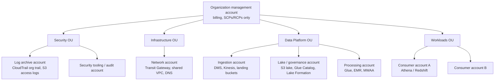

# 01 — AWS Fundamentals for Data Engineers

> Related: [21 Security & Governance](21-aws-security-and-governance.md) · [22 Networking](22-networking-and-connectivity.md) · [02 Data Lake Architecture](02-data-lake-architecture.md)

This chapter covers the AWS fundamentals that matter to data engineers: where data physically lives, who is responsible for what, how identity and authorization work, and how one account's workloads safely touch another account's data.

---

## 1. Global infrastructure

### 1.1 Regions, Availability Zones, edge locations

| Construct | What it is | Data engineering implication |
|---|---|---|
| **Region** | Geographically separate area containing multiple AZs. Most services are regional. | Data residency, latency to sources, service/feature availability, pricing differ by Region. Cross-Region transfer is charged. |
| **Availability Zone (AZ)** | One or more discrete data centers with redundant power/networking inside a Region. | S3 Standard, DynamoDB, and Kinesis store data across multiple AZs. EMR clusters, Redshift provisioned clusters (unless Multi-AZ), and Glue connections in a VPC run in a single subnet → single AZ. |
| **Local Zones / Wavelength / Outposts** | Extensions closer to users or on-premises. | Rare in DE interviews; relevant for latency-sensitive ingestion or on-prem data gravity. |
| **Edge locations (CloudFront, Route 53)** | Points of presence for caching/DNS. | S3 Transfer Acceleration uses edge locations for faster long-distance uploads `[Additional cost]`. |

**Interview trap:** "Global" services. IAM, Organizations, Route 53, and CloudFront are global; S3 **bucket names** are globally unique but **buckets live in one Region**. The S3 console looks global; the data is not.

**Interview trap:** AZ names (`us-east-1a`) are mapped per account. Use **AZ IDs** (`use1-az1`) when coordinating cross-account placement (e.g., aligning an MSK cluster with a consumer VPC to avoid cross-AZ charges).

### 1.2 Why AZ awareness matters for data pipelines

- **Cross-AZ data transfer** is charged in both directions for many services (EC2-to-EC2, EMR shuffles across AZs). An EMR cluster is placed in one subnet (one AZ) partly for this reason.
- **Resilience**: a single-AZ EMR cluster or a Glue job using a single-subnet connection fails if that AZ has a problem. Mitigation: retry in another subnet (Glue connections are single-subnet; you can define multiple connections), EMR instance fleets with multiple subnets (EMR chooses one at launch).
- **IP exhaustion**: Glue, EMR, Lambda in VPC, and MWAA consume ENIs/IPs from subnets. Small subnets (`/24` = 251 usable IPs) are a common cause of job launch failures.

---

## 2. Shared responsibility model

| AWS is responsible for ("security **of** the cloud") | You are responsible for ("security **in** the cloud") |
|---|---|
| Physical facilities, hardware, hypervisor | IAM design, least privilege, credential hygiene |
| Managed service infrastructure (e.g., Glue fleet, Athena engine, S3 durability) | Data classification, encryption choices, key policies |
| Patching of managed service hosts | Network configuration (security groups, endpoints, routes) |
| | Bucket policies, Block Public Access, Lake Formation grants |
| | Application code, dependencies, container images |
| | Logging/monitoring configuration (CloudTrail data events, log retention) |

The split shifts with abstraction level:

| Service model | Example | You still own |
|---|---|---|
| IaaS | EMR on EC2, Batch on EC2 | OS-level config through AMIs/bootstrap, instance roles, patch cadence via release upgrades |
| Container | EMR on EKS, Batch on Fargate | Image contents and vulnerabilities, task roles |
| Serverless/managed | Glue, Athena, Lambda, EMR Serverless | Code, IAM, data access, network config, encryption settings |

**Senior talking point:** "Serverless shifts *operational* responsibility, not *data* responsibility. I still own who can read the data, how it's encrypted, and whether access is logged."

---

## 3. Accounts and AWS Organizations

### 3.1 Why multiple accounts

An AWS account is the strongest isolation boundary: **IAM, quotas, billing, and blast radius** are all per account.

Typical data platform layout (AWS Prescriptive Guidance "multi-account strategy" pattern):



### 3.2 Organizations concepts

| Concept | Purpose | Key behavior |
|---|---|---|
| **OU** | Group accounts | Policies inherit down the tree. |
| **SCP** (Service Control Policy) | Maximum permissions for **principals** in member accounts | **Does not grant** permissions. Does not affect the management account. Does not affect service-linked roles. |
| **RCP** (Resource Control Policy) | Maximum permissions on **resources** in member accounts (e.g., S3, KMS, STS, SQS, Secrets Manager) | Enables data perimeters such as "no principal outside my org can read my buckets." Does not grant. |
| **Delegated administrator** | Lets a member account administer a service org-wide | Common for Security Hub, GuardDuty, IAM Identity Center, Lake Formation-related tooling. |
| **Tag policies / backup policies** | Standardization | Enforce tag keys for cost attribution. |

**Interview trap:** An SCP `Allow` does not give anyone access. A request needs an identity- or resource-based **Allow** and **no** explicit Deny from SCPs/RCPs/boundaries/policies.

---

## 4. IAM fundamentals

### 4.1 Principals and credentials

| Principal | Credentials | DE usage |
|---|---|---|
| Root user | Long-term | Only for account-level tasks; MFA, no access keys. |
| IAM user | Long-term keys | **Avoid** for workloads. Legacy pipelines with access keys are an audit finding. |
| IAM role | Temporary (STS) | All workloads: Glue job role, EMR instance profile/runtime role, Lambda execution role, Batch job role, MWAA execution role. |
| IAM Identity Center user | Temporary via permission sets | Human access (engineers, analysts). |
| Federated (SAML/OIDC) | Temporary | CI/CD (GitHub Actions OIDC → `AssumeRoleWithWebIdentity`), EKS pods (IRSA / EKS Pod Identity). |
| AWS service principal | N/A | `glue.amazonaws.com` in a role trust policy lets Glue assume the role. |

### 4.2 Policy types

| Policy type | Attached to | Grants? | Typical DE use |
|---|---|---|---|
| Identity-based (managed/inline) | User, group, role | Yes | Glue job role reads `s3://lake/silver/*`. |
| Resource-based | Resource (S3 bucket, KMS key, SQS queue, SNS topic, Lambda function, Glue Catalog, Secrets Manager secret) | Yes, including cross-account | Bucket policy allowing a consumer account's role. |
| Trust policy | Role (special resource policy) | Who may assume | `glue.amazonaws.com`, or `arn:aws:iam::<acct>:role/x`. |
| Permissions boundary | User/role | No (caps) | Let teams create roles without escalating. |
| Session policy | Passed in `AssumeRole` | No (caps) | Scope a session down to one tenant prefix. |
| SCP / RCP | OU/account | No (caps) | Org guardrails. |
| ACLs | S3 legacy, VPC NACL (different thing) | Yes (S3) | `[Legacy/deprecated]` for S3 — disabled by default with Object Ownership = Bucket owner enforced. |

### 4.3 Comparison: IAM identity policies vs. resource policies

| Dimension | Identity policy | Resource policy |
|---|---|---|
| Attached to | Principal | Resource |
| `Principal` element | Implicit (the attached identity) | Required |
| Cross-account grant | Not sufficient alone | Can grant to another account's principal (that account must also allow via identity policy) |
| Supported by | All services | Only services that implement them (S3, KMS, SQS, SNS, Lambda, Secrets Manager, Glue Data Catalog, ECR, EventBridge buses, Kinesis Data Streams, etc.) |
| Scale | Policy size quotas per role | Policy size quotas per resource (e.g., S3 bucket policy 20 KB) |
| Auditing | IAM Access Analyzer (unused access) | IAM Access Analyzer (external access findings) |

**Selection rule:** Use identity policies for "what this workload can do." Use resource policies for "who outside this account can touch this resource" and for hard guarantees on the resource (deny non-TLS, deny unencrypted, deny outside VPC endpoint).

**Operational consequence:** Resource policies centralize control at the data owner; identity policies decentralize to the consumer. Cross-account requires both.

**Limitations:** Not all resources support resource policies; policy size limits push large-scale sharing toward **S3 Access Points**, **Lake Formation**, or **AWS RAM**.

### 4.4 Policy evaluation logic (single account, simplified)

```text
1. Explicit Deny anywhere (identity, resource, SCP, RCP, boundary, session)? -> DENY
2. SCPs allow the action for this principal's account?      no -> DENY
3. RCPs allow the action on this resource's account?        no -> DENY
4. Resource-based policy allows?                             yes -> ALLOW*
5. Identity-based policy allows?                             no -> DENY
6. Permissions boundary allows?                              no -> DENY
7. Session policy (if any) allows?                           no -> DENY
-> ALLOW
```

\*Same-account nuance: a resource policy granting directly to an IAM role ARN can allow even without an identity policy, but boundaries/session policies still constrain role sessions; KMS key policies and role trust policies have special rules (a KMS key policy must allow the account or principal; IAM policies alone are insufficient unless the key policy delegates to IAM).

Cross-account: **both** the principal's account (identity policy) **and** the resource's account (resource policy, or role trust policy for `AssumeRole`) must allow.

**Interview trap:** "My Glue job role has `s3:*` but gets AccessDenied." Common causes in order: (1) bucket policy explicit deny (e.g., `aws:SourceVpce` condition), (2) SSE-KMS key policy doesn't allow the role `kms:Decrypt`, (3) object owned by another account (ACLs enabled, legacy), (4) SCP/RCP deny, (5) VPC endpoint policy restricting buckets, (6) Lake Formation governs the table and the role lacks LF grants (for catalog-based reads).

### 4.5 Least privilege for data roles — example

Glue job that reads Silver and writes Gold, with SSE-KMS:

```json
{
  "Version": "2012-10-17",
  "Statement": [
    {
      "Sid": "ReadSilver",
      "Effect": "Allow",
      "Action": ["s3:GetObject"],
      "Resource": "arn:aws:s3:::<lake-bucket>/silver/orders/*"
    },
    {
      "Sid": "ListSilverPrefix",
      "Effect": "Allow",
      "Action": "s3:ListBucket",
      "Resource": "arn:aws:s3:::<lake-bucket>",
      "Condition": {"StringLike": {"s3:prefix": ["silver/orders/*", "gold/orders_daily/*"]}}
    },
    {
      "Sid": "WriteGold",
      "Effect": "Allow",
      "Action": ["s3:PutObject", "s3:DeleteObject", "s3:AbortMultipartUpload"],
      "Resource": "arn:aws:s3:::<lake-bucket>/gold/orders_daily/*"
    },
    {
      "Sid": "UseLakeKey",
      "Effect": "Allow",
      "Action": ["kms:Decrypt", "kms:GenerateDataKey"],
      "Resource": "arn:aws:kms:<region>:<account-id>:key/<key-id>"
    },
    {
      "Sid": "Catalog",
      "Effect": "Allow",
      "Action": ["glue:GetTable", "glue:GetPartitions", "glue:BatchCreatePartition", "glue:UpdateTable"],
      "Resource": [
        "arn:aws:glue:<region>:<account-id>:catalog",
        "arn:aws:glue:<region>:<account-id>:database/gold",
        "arn:aws:glue:<region>:<account-id>:table/gold/orders_daily"
      ]
    }
  ]
}
```

Notes:
- `s3:ListBucket` applies to the **bucket ARN**, object actions to **object ARNs**. Mixing them is a classic bug.
- `s3:DeleteObject` is needed if the job overwrites partitions (Spark dynamic partition overwrite deletes files).
- CloudWatch Logs permissions (`logs:CreateLogStream`, `logs:PutLogEvents`) and `glue:GetJob*` are typically added via the AWS managed `AWSGlueServiceRole` policy; scope where possible.

### 4.6 Service roles, service-linked roles, and `iam:PassRole`

| Concept | Meaning |
|---|---|
| **Service role** | A role you create that a service assumes (Glue job role, Step Functions role). You control its permissions. |
| **Service-linked role** | Predefined role owned by the service (e.g., `AWSServiceRoleForEMRCleanup`). You can't edit its permissions; SCPs don't apply to it. |
| **`iam:PassRole`** | Permission to hand a role to a service. Needed by the person/pipeline creating a Glue job, launching EMR, registering a Batch job definition, or starting Step Functions with a role. Scope with `iam:PassedToService`. |

**Interview trap:** "Who needs `iam:PassRole`?" — the *caller* configuring the service (CI pipeline, engineer), not the role itself.

---

## 5. STS and temporary credentials

### 5.1 Key APIs

| API | Use |
|---|---|
| `AssumeRole` | Workload or human in account A acts as role in account B. Max session duration up to the role's configured maximum (1–12 hours). |
| `AssumeRoleWithWebIdentity` | OIDC federation (GitHub Actions, EKS IRSA). |
| `AssumeRoleWithSAML` | Enterprise IdP federation. |
| `GetCallerIdentity` | "Who am I?" — first command in every AccessDenied investigation. Requires no permissions. |
| `GetSessionToken` | MFA-protected temporary credentials for IAM users. |

**Role chaining** (assuming a role from a role session) limits session duration to **1 hour** maximum.

**Official behavior:** Prefer **Regional STS endpoints** (lower latency, Region isolation). SDKs default to Regional endpoints in current versions; verify your SDK configuration (`sts_regional_endpoints`).

### 5.2 The default credential provider chain

boto3 resolves credentials in order: explicit parameters → environment variables → shared credentials/config files (including SSO profiles) → container credentials (ECS/Batch task role) → instance metadata (EC2/EMR instance profile). Glue and Lambda inject role credentials automatically.

```python
# Runs in: local Python / any AWS compute. Requires AWS credentials.
import boto3
print(boto3.client("sts").get_caller_identity()["Arn"])
```

---

## 6. Cross-account access patterns

### 6.1 Pattern comparison

| Pattern | How | Best for | Limitations |
|---|---|---|---|
| **Role assumption** | Consumer assumes a role in producer account | Full control by producer; works for any service | Consumer must manage credentials switching; per-consumer role sprawl |
| **Resource policy grant** | Bucket/KMS/SQS policy names consumer principal | Simple S3 sharing | Policy size limits; must also update KMS key policy |
| **S3 Access Points** | Per-consumer access point with its own policy | Many consumers on one bucket | Need access point aliases/ARNs in consumers |
| **Lake Formation cross-account (via AWS RAM)** | Share databases/tables or LF-Tags | Governed table/column/row-level sharing for Athena/Glue/EMR/Redshift Spectrum | Requires LF adoption; hybrid access mode subtleties |
| **Redshift data sharing** | Producer cluster/namespace shares to consumer | Warehouse-to-warehouse live sharing | RA3 or Serverless only `[Cloud-specific]` |
| **Replication** | S3 CRR/SRR to consumer-owned bucket | Isolation, Region residency, consumer pays for reads | Duplicated storage; replication lag |

### 6.2 Cross-account S3 read with SSE-KMS — the checklist

1. Consumer role identity policy: `s3:GetObject` on producer object ARNs, `s3:ListBucket` on bucket ARN, `kms:Decrypt` on the producer key ARN.
2. Producer bucket policy: allows consumer role ARN (or account root with conditions).
3. Producer KMS key policy: allows consumer role `kms:Decrypt` (identity policy alone is insufficient across accounts).
4. Object ownership: Bucket owner enforced (ACLs disabled), so objects written by other accounts are owned by the bucket owner.
5. Network: if the consumer runs in a VPC with an S3 gateway endpoint, the **endpoint policy** must allow the producer bucket.
6. If the producer uses `aws:PrincipalOrgID` conditions or RCPs, consumer must be in the org.

**Interview trap:** The **AWS managed key `aws/s3` cannot be used for cross-account access** because you can't edit its key policy. Use a customer managed key for shared data.

### 6.3 Confused deputy and external ID

When a third party (SaaS vendor) assumes a role in your account, require `sts:ExternalId` in the trust policy. For AWS service principals, use `aws:SourceArn` / `aws:SourceAccount` conditions to prevent another customer's resource from making the service act on your resources.

---

## 7. Well-Architected framing for data platforms

The Well-Architected Framework pillars applied to data engineering (see the **Data Analytics Lens**):

| Pillar | DE translation |
|---|---|
| Operational excellence | IaC, runbooks, observability, automated backfills |
| Security | Least privilege, encryption, data classification, audit logs |
| Reliability | Idempotent pipelines, retries with backoff, replay capability, multi-AZ storage |
| Performance efficiency | Right engine per workload, partitioning, file sizing |
| Cost optimization | Storage tiering, scan reduction, right-sizing, Spot, Flex execution |
| Sustainability | Avoid redundant copies and wasteful recomputation |

---

## 8. Failure scenarios and troubleshooting methodology

| Symptom | Likely causes | Diagnostic path |
|---|---|---|
| `AccessDenied` from S3 | Bucket policy deny, KMS, endpoint policy, SCP/RCP, ACL ownership | `aws sts get-caller-identity`; CloudTrail event (`errorCode`, `errorMessage`); IAM Policy Simulator; check KMS `Decrypt` events |
| `AccessDenied ... kms:Decrypt` | Key policy doesn't include role/account; grant missing; wrong Region key | CloudTrail KMS events; key policy; is it `aws/s3`? |
| `is not authorized to perform: sts:AssumeRole` | Trust policy principal mismatch; missing `sts:ExternalId`; caller lacks `sts:AssumeRole` | Read trust policy; check exact principal ARN (role vs. assumed-role session) |
| `iam:PassRole` errors when creating jobs | CI role lacks PassRole for job role | Scope `iam:PassRole` with `iam:PassedToService` |
| Works in dev, fails in prod | SCP differences, Region-dependent feature, different endpoint policy | Compare SCPs in OU; Region feature tables |
| Throttling (`ThrottlingException`, `SlowDown`) | Quotas, API rate limits | Service Quotas; retries with exponential backoff and jitter |

Methodology (use in interviews): **Identify the principal → identify the resource and its account → enumerate every policy layer → check encryption → check network path → reproduce with the CLI using the same role.**

---

## 9. Interview questions and model answers

**Q1. How do you give an Athena user in account B read access to S3 data in account A encrypted with SSE-KMS?**
Model answer: Prefer Lake Formation cross-account sharing if the lake is governed: share the table (or LF-Tag) via RAM, accept the share in B, create a resource link, grant B's principals in B's Lake Formation. If not using LF: B's role needs `s3:GetObject`/`ListBucket` and `kms:Decrypt`; A's bucket policy must allow B's role; A's KMS key policy must allow B's role; Glue Catalog resource policy in A must allow B's role for `glue:GetTable/GetPartitions` (or replicate catalog metadata in B). Also the Athena result bucket in B and its encryption. Mention that `aws/s3` can't be used cross-account.

**Q2. What's the difference between an SCP and a permissions boundary?**
Both cap permissions and neither grants. SCPs apply to all principals in member accounts of an OU/account (except management account and service-linked roles) and are set by central governance. Boundaries apply to a specific user/role and are typically used for delegated role creation (developers can create roles only if they attach the boundary).

**Q3. Why prefer roles over IAM users for pipelines?**
Temporary credentials auto-rotate, no secrets to leak, CloudTrail attributes actions to a role session name, and trust policies constrain who can use them. Access keys in Airflow connections or Jenkins are a common breach vector.

**Q4. A Glue job in a VPC can reach RDS but can't read S3. IAM is correct. What's wrong?**
Network: the subnet's route table lacks an S3 gateway endpoint and has no NAT route, or the endpoint policy denies the bucket. IAM and network are separate requirements.

**Q5. How do you design account structure for a data platform with 30 product teams?**
Separate ingestion, lake/governance, processing, and consumer accounts; central Lake Formation in the governance account; producers as data domains (data mesh) owning their own accounts and sharing via LF/RAM; org-level SCPs/RCPs for data perimeter; central log archive; cost attribution via accounts plus tags.

---

## 10. Self-check

1. **Q:** An SCP allows `s3:*`. A role has no identity policy. Can it read S3 in the same account? **A:** Only if a resource policy (bucket policy) grants it directly; the SCP grants nothing.
2. **Q:** Why might an EMR cluster bill unexpectedly high data transfer? **A:** Cross-AZ traffic (e.g., reading from an RDS/MSK in another AZ, or nodes spread across AZs) or cross-Region S3 reads; check Cost Explorer by usage type `DataTransfer-Regional-Bytes`.
3. **Q:** What's the maximum session duration for a chained role assumption? **A:** 1 hour, regardless of the role's maximum session setting.
4. **Q:** Which key type can't be used to share SSE-KMS-encrypted S3 objects cross-account? **A:** The AWS managed key `aws/s3` (key policy not editable).
5. **Q:** First command to run when debugging AccessDenied in a container? **A:** `aws sts get-caller-identity` (or `boto3.client("sts").get_caller_identity()`) to confirm which role is actually in use.
6. **Q:** What does an RCP add that an SCP doesn't? **A:** It restricts what can be done **to resources** in your accounts regardless of the calling principal's account — enabling "only my org can access my data" perimeters.
