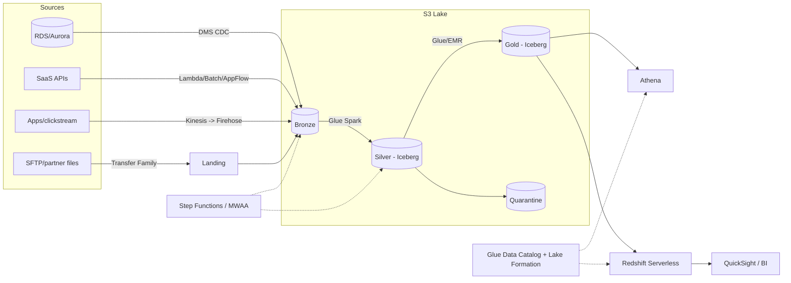
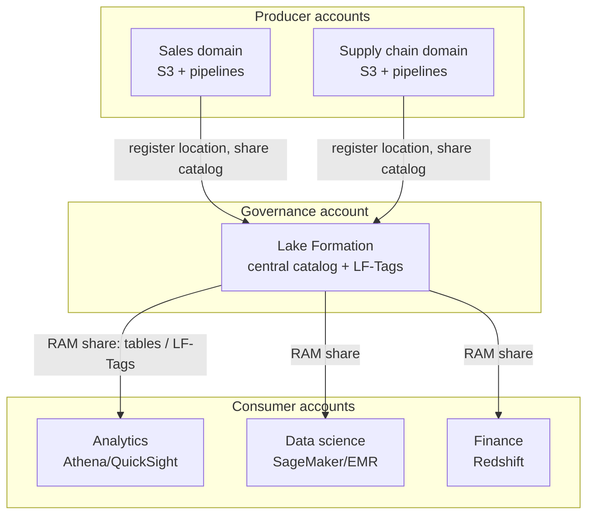

# 02 — Data Lake and Lakehouse Architecture

> Related: [03 S3](03-amazon-s3.md) · [04 Glue](04-aws-glue.md) · [15 File Formats](15-file-formats-and-partitioning.md) · [21 Governance](21-aws-security-and-governance.md) · [32 ADRs](32-architecture-decision-records.md)

---

## 1. Definitions that interviewers probe

| Term | Definition | What distinguishes it |
|---|---|---|
| **Data lake** | Central repository (on AWS: S3) storing raw and processed data in open formats, decoupled from compute. | Schema-on-read, cheap storage, many engines. Without discipline → "data swamp". |
| **Data warehouse** | Managed analytical database with storage and compute optimized for SQL (Redshift). | Schema-on-write, strong SQL performance, workload management, concurrency. |
| **Lakehouse** | Lake storage + open table formats (Iceberg/Hudi/Delta) providing ACID transactions, row-level updates, time travel, and schema evolution, with governance and warehouse-grade SQL engines on top. | Warehouse semantics without copying data into a proprietary store. |
| **Data mesh** | Organizational model: domain-owned data products, self-serve platform, federated governance. | It's a *socio-technical* model, not a technology. On AWS: producer accounts + Lake Formation/DataZone sharing. |

**Senior talking point:** "Lake vs. warehouse is no longer binary. My default on AWS is S3 + Iceberg as the system of record, Athena/EMR/Glue for lake workloads, and Redshift for high-concurrency, low-latency BI, reading the same data via Spectrum or loading curated marts."

---

## 2. Zones / layers

### 2.1 Medallion mapping

| Medallion | Zone name | Contents | Format | Mutability | Typical consumers |
|---|---|---|---|---|---|
| **Landing** (optional) | Raw-transient | Files exactly as delivered (CSV, JSON, gz, zip), short retention | Source native | Write-once | Ingestion jobs only |
| **Bronze** | Raw | Immutable, append-only copy of source + ingestion metadata (`_ingest_ts`, `_source_file`, `_batch_id`) | Source native or Parquet/Avro | Append-only | Reprocessing, audits |
| **Silver** | Cleansed / conformed | Typed, deduplicated, validated, CDC applied, conformed keys, PII tokenized | Parquet/Iceberg | Upserts (Iceberg MERGE) | Data scientists, domain engineers |
| **Gold** | Curated | Business aggregates, dimensional models, feature tables, data products | Iceberg/Parquet, or Redshift tables | Rebuilt or incrementally merged | BI, APIs, ML |
| **Quarantine** | Error | Rejected records + reason codes | Parquet/JSON | Append | Data stewards |
| **Sandbox** | Exploration | User workspaces, TTL-based | Any | Mutable | Analysts |

**Best practice:** Keep Bronze **replayable**: you must be able to rebuild Silver and Gold from Bronze. This is the foundation of backfills (see [13](13-data-ingestion-patterns.md)).

**Interview trap:** "Bronze should be raw CSV forever." Not necessarily. Many teams store Bronze as the original files *and* a typed Parquet/Avro copy with no business logic. What matters is fidelity (no data lost) and replayability, not the format.

### 2.2 Bucket and prefix layout options

| Option | Example | Pros | Cons |
|---|---|---|---|
| One bucket per zone | `acme-lake-bronze-<region>`, `acme-lake-silver-...` | Clean bucket policies, lifecycle, replication per zone | More buckets to manage |
| One bucket per domain per zone | `acme-sales-silver` | Domain ownership, per-domain KMS keys | Bucket sprawl (quota now 10,000 by default — see [27](27-numbers-limits-and-defaults.md)) |
| One bucket, prefixes per zone | `acme-lake/bronze/...` | Simple | Coarse permissions; mixed lifecycle; one bucket policy size limit |

Recommended: **bucket per zone (and per domain for large orgs)**, account per environment.

Key layout within a zone:

```text
s3://acme-lake-silver-us-east-1/
  sales/                          # domain
    orders/                       # dataset (table)
      data/                       # Iceberg data files (managed by table format)
      metadata/                   # Iceberg metadata
  marketing/
    clickstream_events/
      event_date=2026-10-09/hour=13/part-00000-....snappy.parquet   # Hive-style (non-Iceberg)
```

---

## 3. Metadata and catalog

| Layer | AWS service | Notes |
|---|---|---|
| Technical metadata (schemas, partitions, locations) | Glue Data Catalog | Hive-compatible; used by Athena, EMR, Glue, Redshift Spectrum, Lake Formation. |
| Permissions | Lake Formation | Fine-grained, tag-based access over the Catalog. |
| Business metadata, data products, discovery | Amazon DataZone / Amazon SageMaker Unified Studio (catalog) | Glossaries, publish/subscribe data products `[Optional integration]` `[Region-dependent]`. |
| Operational metadata | Your own tables (pipeline runs, watermarks, DQ results) | DynamoDB/RDS/Iceberg "control tables". |
| Lineage | DataZone/OpenLineage integrations, Marquez, or custom | Increasingly asked at senior level. |
| Schema registry (streaming) | Glue Schema Registry | Avro/JSON Schema/Protobuf compatibility checks for Kinesis/MSK. |

**Interview trap:** The Glue Data Catalog stores **pointers and schema**, not data. Dropping an external table in Athena doesn't delete S3 data; dropping an Iceberg table in some engines with `PURGE` semantics can. Know your engine's `DROP TABLE` behavior.

---

## 4. Data contracts

A data contract formalizes producer obligations:

```yaml
# Example data contract (YAML, illustrative — not an AWS format)
dataset: sales.orders
version: 3.1.0
owner: sales-platform@acme.example
schema:
  - {name: order_id,    type: string,        nullable: false, unique: true}
  - {name: customer_id, type: string,        nullable: false}
  - {name: amount,      type: decimal(18,2), nullable: false, constraints: {min: 0}}
  - {name: status,      type: string,        allowed: [PLACED, SHIPPED, CANCELLED, RETURNED]}
  - {name: updated_at,  type: timestamp,     nullable: false}
semantics:
  primary_key: [order_id]
  event_time: updated_at
  delivery: at_least_once        # consumers must dedupe on (order_id, updated_at)
sla:
  freshness_minutes: 60
  completeness: ">= 99.9% of source rows within 2h"
compatibility: backward          # additive nullable columns only without major bump
breaking_change_policy: "90-day dual-publish with v-next"
```

Enforcement points: Glue Schema Registry (streaming), Glue Data Quality / Great Expectations / Deequ (batch), CI checks on producer schema changes, quarantine on violation.

---

## 5. Partitioning, file formats, and table formats (summary)

Full detail in [15](15-file-formats-and-partitioning.md). Architectural rules:

1. Partition by the **most common filter with bounded cardinality** (usually event date). Avoid partitions that produce files < ~100 MB on average for large tables.
2. Prefer **Parquet** (or ORC) with Snappy/ZSTD for analytics; Avro for row-oriented streaming/CDC landing.
3. Use **Iceberg** for tables needing upserts/deletes (CDC, GDPR deletes), concurrent writers, time travel, or schema/partition evolution.

### 5.1 Hive-style tables vs. Apache Iceberg

| Dimension | Hive-style (directory partitions + Glue Catalog) | Apache Iceberg |
|---|---|---|
| Atomic commits | No — readers can see partially written partitions | Yes — snapshot isolation via metadata pointer swap |
| Row-level update/delete | Rewrite whole partition | `MERGE`, `UPDATE`, `DELETE` (copy-on-write or merge-on-read) |
| Partition discovery | Catalog partitions (crawler, `MSCK REPAIR`, `ADD PARTITION`) or Athena projection | Manifests track files; no partition listing |
| Partition evolution | Requires rewrite | Metadata-only change; hidden partitioning (`days(ts)`) |
| Schema evolution | Positional/name issues by format | ID-based columns; safe rename/reorder |
| Time travel | No | Yes (`FOR TIMESTAMP AS OF`) |
| Maintenance | Compaction by custom jobs | `OPTIMIZE`/`rewrite_data_files`, `expire_snapshots`, orphan file removal; Glue Data Catalog can automate compaction for Iceberg tables `[Optional integration]` |
| AWS engine support | Universal | Athena (engine v3), Glue 3.0+, EMR, Redshift (read; write support evolving — verify), Firehose delivery to Iceberg, S3 Tables `[Region-dependent]` |

**Amazon S3 Tables** (table buckets) provide managed Iceberg storage with automatic maintenance, integrated with the AWS analytics services. `[Region-dependent]` `[Additional cost]` — confirm availability and integration specifics in current docs.

---

## 6. Enterprise reference architectures

### 6.1 Single-account lakehouse (small/medium org)



### 6.2 Multi-account, hub-and-spoke (central governance)



| Model | Description | Pros | Cons |
|---|---|---|---|
| **Centralized** | One account owns storage, catalog, processing | Simple, one governance point | Bottleneck team; blast radius; quota contention |
| **Hub-and-spoke** | Producers own storage; central catalog/governance | Domain ownership + central control | Lake Formation expertise; cross-account debugging |
| **Fully federated mesh** | Each domain owns catalog and shares peer-to-peer | Max autonomy | Inconsistent standards; discovery harder |

Decision detail in [32 ADR-010](32-architecture-decision-records.md).

---

## 7. Scalability, reliability, performance, cost, security

| Concern | Lake design levers |
|---|---|
| Scalability | S3 scales request rates per prefix; spread hot writes across prefixes; table formats avoid listing; compute is elastic and decoupled. |
| Reliability | Immutable Bronze; versioning on critical buckets; Iceberg snapshots for rollback; idempotent jobs; CRR for DR. |
| Performance | Columnar formats, 128 MB–1 GB files, partition pruning, sorted/clustered data within partitions, statistics. |
| Cost | Lifecycle Bronze to IA/Glacier; avoid duplicate copies across zones; compress; reduce scanned bytes; expire old snapshots. |
| Security | Bucket per zone with distinct KMS keys; Lake Formation column/row filters; PII tokenization in Silver; CloudTrail data events on sensitive buckets. |

---

## 8. Common failure scenarios

| Failure | Cause | Fix / prevention |
|---|---|---|
| Readers see partial data | Non-atomic writes to Hive-style partitions | Write to staging prefix then swap partition location; or use Iceberg. |
| Athena queries slow down over months | Small files accumulation; partition explosion | Compaction; coarser partitions; Iceberg rewrite. |
| Schema drift breaks downstream | Producer added/renamed column; crawler changed types | Data contracts; disable crawler schema updates on curated tables; schema registry. |
| "Swamp": nobody knows what's trustworthy | No ownership, no contracts, no DQ | Data products with owners, SLAs, DQ scores in catalog. |
| GDPR delete takes days | Data scattered across raw files | Iceberg row-level deletes; keep PII in limited tables; tokenization. |
| Cross-account consumers get AccessDenied after migration to LF | Hybrid access mode/IAMAllowedPrincipals removed | Plan LF migration per table, test with consumers. |

---

## 9. Interview questions and model answers

**Q1. Why keep a Bronze layer at all if Silver is the source of truth?**
Bronze decouples ingestion from transformation: if Silver logic is wrong, I replay from Bronze without re-extracting from sources (which may have retention limits — CDC logs, Kinesis retention, API history windows). It also supports audits ("what did the source send on date X?").

**Q2. When would you not use Iceberg?**
Append-only, immutable event data queried mostly by date where Hive-style Parquet + partition projection is simpler and cheaper; very small datasets; when a required engine lacks support for needed Iceberg features; or when the team can't operate table maintenance (snapshot expiry, compaction).

**Q3. How do you prevent the lake from becoming a swamp?**
Ownership per dataset, data contracts, a quality gate between Bronze and Silver, catalog descriptions/tags enforced in CI, lifecycle for sandbox, and usage-based deprecation.

**Q4. How do you structure accounts for dev/test/prod in a lake?**
Separate accounts per environment; prod data does not flow to dev except masked/sampled through a controlled pipeline; IaC deploys identical stacks; Lake Formation grants per environment.

**Q5. Lakehouse or warehouse for a 50-analyst BI team with sub-second dashboards?**
Redshift (or a semantic cache) serving Gold marts for dashboards; lakehouse remains system of record. Athena alone may not meet sub-second concurrency SLOs.

---

## 10. Self-check

1. **Q:** What property must Bronze have to support backfills? **A:** Completeness and immutability (append-only, original fidelity) so Silver/Gold can be deterministically rebuilt.
2. **Q:** Name two problems Iceberg solves that Hive-style partitions don't. **A:** Atomic commits (no partial reads) and row-level updates/deletes (also: partition evolution, time travel).
3. **Q:** Why one bucket per zone rather than prefixes? **A:** Independent bucket policies, KMS keys, lifecycle, replication, and smaller blast radius.
4. **Q:** Where are Lake Formation permissions enforced for Athena? **A:** Athena obtains temporary, scoped credentials from Lake Formation for registered locations; the catalog grants decide table/column/row access.
5. **Q:** What does a data contract need beyond schema? **A:** Semantics (keys, event time, delivery guarantees), SLAs (freshness, completeness), compatibility rules, ownership.
6. **Q:** A team wants hourly partitions on a 2 GB/day table. Good idea? **A:** Usually not. 2 GB/day ÷ 24 ≈ 83 MB/hour before compression (often 15–30 MB as Parquet), split across several writer tasks → many small files and 8,760 partitions/year. Partition daily, and only go hourly if queries genuinely filter by hour and volume grows.
