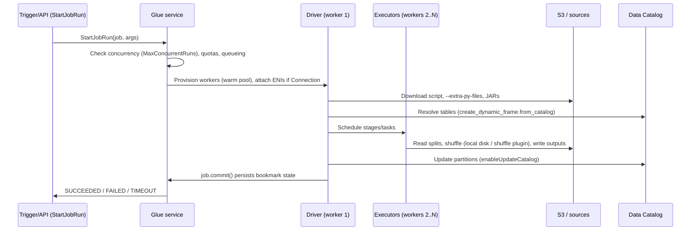

# 04 — AWS Glue

> Related: [10 EMR & Spark](10-amazon-emr-and-apache-spark.md) · [18 PySpark](18-pyspark-interview-preparation.md) · [05 Athena](05-amazon-athena.md) · [13 Ingestion](13-data-ingestion-patterns.md) · [20 Data Quality](20-data-quality-and-reliability.md) · [30 Troubleshooting](30-troubleshooting-playbook.md)

Glue is several products under one name: a **metadata catalog**, **crawlers**, a **serverless Spark (and Python shell / Ray) runtime**, **orchestration** (triggers, workflows), **data quality**, and **connectors**. Interviewers expect you to separate them.

---

## 1. Glue Data Catalog

### 1.1 Objects

| Object | Notes |
|---|---|
| Catalog | One per account per Region (plus federated/S3 Tables catalogs in newer integrations). |
| Database | Namespace; has a location URI optionally. |
| Table | Schema, SerDe/format, location, partition keys, table parameters (`classification`, `projection.*`, `table_type=ICEBERG`). |
| Partition | Values + location + (optionally) its own schema/SerDe. |
| Table versions | Each update creates a version (quota: 100,000 versions per table). |
| Connections | JDBC/network configuration used by jobs and crawlers. |

Quotas (verified 2026-10-10, adjustable): 10,000 databases/account, 200,000 tables/database, 1,000,000 tables/account, 10,000,000 partitions/table, 20,000,000 partitions/account. See [27](27-numbers-limits-and-defaults.md).

**Interview trap:** Athena can query tables with up to 10 million partitions but **cannot read more than 1 million partitions in a single scan**. Partition projection avoids catalog partition lookups entirely.

### 1.2 Access control

- IAM actions (`glue:GetTable`, `glue:GetPartitions`, `glue:BatchCreatePartition`) on catalog/database/table ARNs `[IAM permission required]`.
- Catalog resource policy for cross-account access.
- Lake Formation for fine-grained permissions `[Lake Formation required]` — see [21](21-aws-security-and-governance.md).
- Encryption of catalog metadata with KMS `[KMS configuration required]`.

---

## 2. Crawlers

### 2.1 What a crawler actually does

1. Lists the S3 path (or connects to JDBC/DynamoDB).
2. Samples files and runs **classifiers** (built-in for CSV, JSON, Parquet, Avro, ORC, XML, etc.; custom grok/JSON/CSV/XML classifiers first).
3. Groups files into tables based on schema similarity and folder structure.
4. Infers partition keys from folder structure (Hive-style `k=v` names or `partition_0`, `partition_1`).
5. Creates/updates tables and partitions per the **schema change policy**.

### 2.2 Settings that matter

| Setting | Options | Guidance |
|---|---|---|
| Schema change policy | Update table / log only; deleted objects: delete/deprecate/log | For curated tables: **log only** — schema changes go through contracts, not crawlers. |
| Recrawl policy | Crawl all / **new folders only** / event-based (S3 events via SQS) | Incremental crawls cut runtime and cost at scale. |
| Table grouping | "Create a single schema for each S3 path", table level | Prevents a crawler from splitting one dataset into dozens of tables when schemas vary. |
| Partition index | Index on partition keys | Speeds `GetPartitions` with predicates for large partitioned tables. |
| Sample size | Files per leaf folder | Smaller = faster, riskier inference. |

### 2.3 When not to use crawlers

- Known, stable schemas: define tables in IaC (Terraform/CDK/CloudFormation) or via DDL.
- Partitions with predictable patterns: **partition projection** (Athena) or `ALTER TABLE ADD PARTITION` / `BatchCreatePartition` from the writing job.
- Iceberg tables: the table format tracks files; crawlers are unnecessary (Glue can create Iceberg tables via API/DDL).

**Interview trap:** Crawlers infer types from samples. A column that is `bigint` in the sample and has `"N/A"` later causes `HIVE_BAD_DATA`/type mismatch in Athena, or a schema flip between runs.

---

## 3. Glue ETL jobs

### 3.1 Job types

| Type | Command | Runtime | Use |
|---|---|---|---|
| Spark | `glueetl` | Serverless Spark (Glue versions below) | Batch ETL |
| Spark Streaming | `gluestreaming` | Spark Structured Streaming | Kinesis/MSK/Kafka continuous ETL |
| Python shell | `pythonshell` | Single-node Python, 0.0625 or 1 DPU | Small tasks, API calls, orchestration glue |
| Ray | `glueray` | Ray on Glue | Python-native distributed processing `[Region-dependent]` |

### 3.2 Glue versions (verified 2026-10-10)

| Glue version | Spark | Python |
|---|---|---|
| 6.0 | 4.1.1 | 3.13 |
| 5.1 (default when unspecified) | 3.5.6 | 3.11 |
| 5.0 | 3.5.4 | 3.11 |
| 4.0 | 3.3.0 | 3.10 |
| 3.0 | 3.1.1 | 3.7 `[Legacy/deprecated]` — check support policy |

**Senior talking point:** Pin the Glue version in IaC. Upgrading Glue versions changes Spark versions → behavior changes (ANSI mode defaults in Spark 4, datetime parsing, AQE settings). Test with the same data before switching.

### 3.3 Worker types (verified 2026-10-10)

| Worker | DPU | vCPU | Memory | Disk (free) | Notes |
|---|---|---|---|---|---|
| G.025X | 0.25 | 2 | 4 GB | ~34 GB | Streaming only (3.0+) |
| G.1X | 1 | 4 | 16 GB | ~44 GB | General ETL |
| G.2X | 2 | 8 | 32 GB | ~78 GB | Heavier joins/aggregations, ML transforms |
| G.4X | 4 | 16 | 64 GB | ~230 GB | Demanding transforms; Glue 3.0+ `[Region-dependent]` |
| G.8X | 8 | 32 | 128 GB | ~485 GB | Very demanding; Glue 3.0+ `[Region-dependent]` |
| G.12X / G.16X | 12 / 16 | 48 / 64 | 192 / 256 GB | ~741 / ~996 GB | Glue 4.0+, higher startup latency, no Flex `[Region-dependent]` |
| R.1X–R.8X | 1–8 | — | Memory-optimized | — | OOM-prone workloads; Glue 4.0+ `[Region-dependent]` |

One Spark executor per worker; the driver runs on one worker.

### 3.4 Execution model — what happens when a Glue job runs



Key behaviors:
- **Billing**: per-second with a 1-minute minimum for Glue 2.0+ Spark jobs; DPU-hours × rate `[Additional cost]`. Check pricing page for current rates.
- **Startup**: Glue 2.0+ reduced startup to typically tens of seconds; larger/new worker types and VPC connections add latency.
- **VPC connections**: workers get ENIs in the connection's subnet → **IP consumption** = number of workers (+ driver). Requires a security group with a **self-referencing inbound rule** (all TCP) and outbound access; plus S3 gateway endpoint or NAT for S3 access `[VPC/networking required]`.
- **Auto Scaling** (Glue 3.0+): set max workers; Glue adds/removes executors by stage demand.
- **Flex execution**: spare capacity, lower price, may start later or lose workers; G.1X/G.2X on Glue 3.0+ only. For non-urgent workloads.
- **Job run queuing**: runs can queue when quotas/resources prevent immediate start instead of failing.

### 3.5 Job properties to know (verified 2026-10-10)

| Property | Default / range |
|---|---|
| Timeout | Max 7 days (10,080 min). Default when blank: **2,880 min for Glue ≤ 4.0; 480 min for Glue ≥ 5.0**. Jobs that time out are not retried. |
| Number of retries | 0–10 |
| Max concurrent runs per job | Default **1** (raise for parameterized parallel runs; service quota up to 4,000) |
| Concurrent job runs per account | 2,000 (adjustable) |
| Task DPUs per account | 1,000 in major Regions, 500 elsewhere (adjustable) — a common cause of `ResourceNumberLimitExceededException` |

### 3.6 Job parameters

```python
# Runs in: Glue Spark job (Requires AWS). Pass: --source_path s3://... --run_date 2026-10-09
import sys
from awsglue.utils import getResolvedOptions

args = getResolvedOptions(sys.argv, ["JOB_NAME", "source_path", "run_date"])
```

Reserved/special parameters: `--job-bookmark-option` (`job-bookmark-enable|disable|pause`), `--enable-metrics`, `--enable-continuous-cloudwatch-log`, `--enable-spark-ui` + `--spark-event-logs-path`, `--additional-python-modules`, `--extra-py-files`, `--extra-jars`, `--conf` (Spark conf; officially only some uses supported), `--datalake-formats iceberg` (Glue 3.0+), `--enable-auto-scaling`, `--TempDir`.

---

## 4. DynamicFrames vs. DataFrames

| Dimension | DynamicFrame | Spark DataFrame |
|---|---|---|
| Schema | Self-describing per record; **choice types** for conflicting types | Fixed schema per DataFrame |
| Strengths | Messy semi-structured data; `resolveChoice`, `relationalize`, `ApplyMapping`; native bookmarks/catalog integration; Glue connectors | Full Spark SQL/Catalyst optimization, rich API, portability (runs on EMR/local) |
| Weaknesses | Fewer optimizations; slower for complex logic; Glue-only | Fails on inconsistent types unless handled |
| Interop | `dyf.toDF()`, `DynamicFrame.fromDF(df, glueContext, "name")` | — |

**Selection rule:** Use DynamicFrames at the **edges** (read from catalog with bookmarks and pushdown predicates, write with catalog updates); convert to DataFrames for transformations. Write portable business logic as plain PySpark functions to unit test locally.

```python
# Runs in: Glue Spark job (Requires AWS). Pseudocode-level skeleton with real APIs.
import sys
from awsglue.context import GlueContext
from awsglue.job import Job
from awsglue.utils import getResolvedOptions
from awsglue.dynamicframe import DynamicFrame
from pyspark.context import SparkContext
from pyspark.sql import functions as F

args = getResolvedOptions(sys.argv, ["JOB_NAME", "run_date"])
sc = SparkContext()
glue = GlueContext(sc)
spark = glue.spark_session
job = Job(glue)
job.init(args["JOB_NAME"], args)

src = glue.create_dynamic_frame.from_catalog(
    database="bronze",
    table_name="orders_raw",
    push_down_predicate=f"ingest_date = '{args['run_date']}'",   # partition pruning at list time
    transformation_ctx="src_orders",                               # required for bookmarks
)
df = src.toDF()
clean = (df.filter(F.col("order_id").isNotNull())
           .withColumn("amount", F.col("amount").cast("decimal(18,2)"))
           .dropDuplicates(["order_id", "updated_at"]))

clean.write.mode("overwrite").partitionBy("order_date").parquet("s3://<silver-bucket>/orders/")
job.commit()   # persists bookmark state only if the script reaches here
```

**Interview trap:** `push_down_predicate` filters **partitions** before listing files (catalog-side). It is not row-level predicate pushdown into Parquet. `catalogPartitionPredicate` uses server-side partition indexes for very large partition counts.

---

## 5. Job bookmarks

### 5.1 How they work

- Bookmark state is stored per job (and per `transformation_ctx`) by Glue.
- S3 sources: tracks processed **files** by modification timestamp/path listing; supported for JSON, CSV, Avro, XML, Parquet, ORC.
- JDBC sources: tracks **bookmark keys** (defaults to primary key; must be monotonically increasing; configurable `jobBookmarkKeys` and sort order).
- State is persisted only on `job.commit()`.
- Options: `enable`, `disable`, `pause` (process from last bookmark without updating it). Can **reset** or **rewind** to a previous run.

### 5.2 Limitations

- Doesn't detect **updates to already-processed rows** in JDBC (only new keys beyond the bookmark).
- Doesn't detect **overwritten S3 files with older timestamps**, and files written late with timestamps before the bookmark window may be skipped (Glue uses a consistency window on modification times; verify current behavior).
- Not supported with Lake Formation cell-level filtered tables.
- Doesn't make **writes** idempotent: if the job writes output and fails before `commit()`, the retry reprocesses the same input and may duplicate output.

**Interview trap: A Glue job bookmark does not replace application-level deduplication or transactional design.** It's a read-side convenience.

### 5.3 Comparison: Glue bookmarks vs. explicit watermark-based incremental ingestion

| Dimension | Glue job bookmarks | Explicit watermark (control table) |
|---|---|---|
| State location | Glue-managed, opaque | Your table (DynamoDB/RDS/Iceberg) — inspectable |
| Granularity | Files (S3) / monotonically increasing keys (JDBC) | Any column (`updated_at`, LSN, sequence), composite keys |
| Handles updates | JDBC: only if bookmark key increases on update (use `updated_at` + PK) | Yes with `updated_at`-based extraction + merge |
| Backfill / replay | Reset/rewind job-wide | Set watermark per table/tenant/partition; replay windows |
| Portability | Glue only | Any engine |
| Atomicity with output | No | Can be committed in the same transaction as output (e.g., Iceberg snapshot properties) or after successful write |
| Late data | Limited | Lookback window (`updated_at > wm - 15 min`) + dedupe |
| Operational visibility | Console/API | SQL queries, dashboards |

**Selection rule:** Bookmarks for simple append-only file ingestion inside Glue. Explicit watermarks for anything with updates, multiple tenants, cross-engine portability, or audited replay.

**Limitation of watermarks:** You own correctness (clock skew, transactions committing out of order — rows with `updated_at` earlier than the watermark becoming visible later). Mitigate with lookback windows and dedupe, or prefer log-based CDC.

---

## 6. Glue Studio, connections, connectors

- **Glue Studio**: visual job authoring generating PySpark; good for simple pipelines and onboarding; generated code is hard to unit test — export and own it in Git for production.
- **Connections**: JDBC (with Secrets Manager for credentials), network (VPC-only), MongoDB, Kafka, and native connectors for SaaS (Salesforce, SAP, etc.) `[Region-dependent]`.
- **Glue Schema Registry**: Avro/JSON Schema/Protobuf, compatibility modes (BACKWARD, FORWARD, FULL, NONE, *_ALL).
- **Interactive sessions / notebooks**: per-session billing; set idle timeout `[Additional cost]`.

---

## 7. Triggers and workflows

| Trigger type | Behavior |
|---|---|
| Scheduled | Cron expressions |
| Conditional | Start when watched jobs/crawlers reach states (SUCCEEDED/FAILED/TIMEOUT); `ALL`/`ANY` logic |
| On-demand | Manual/API |
| EventBridge event | Workflow starts on events with batching (batch size/window) |

**Glue Workflows** chain triggers, jobs, crawlers; share run properties (key-value) across steps. Limited branching, error handling, and observability compared with Step Functions/Airflow — see comparison in [11](11-aws-step-functions-and-orchestration.md).

---

## 8. Glue Data Quality

- DQDL (Data Quality Definition Language) rulesets evaluated against catalog tables or within ETL jobs (`EvaluateDataQuality` transform).
- Rule types include `IsComplete`, `IsUnique`, `ColumnValues`, `RowCount`, `Completeness`, `Freshness`, `ReferentialIntegrity`, `DataFreshness`, `CustomSql`, `DistinctValuesCount`, and anomaly detection on statistics (`[Optional integration]`).
- Outputs: scores, rule outcomes, row-level results (to route bad rows to quarantine), CloudWatch metrics and EventBridge events for alerting.

```text
Rules = [
    IsComplete "order_id",
    IsUnique "order_id",
    ColumnValues "amount" >= 0,
    ColumnValues "status" in ["PLACED","SHIPPED","CANCELLED","RETURNED"],
    RowCount between 1000 and 50000000,
    DataFreshness "updated_at" <= 2 hours
]
```

`[Additional cost]` — billed as DPU-hours for evaluation runs. Verify rule syntax against current DQDL reference.

---

## 9. Glue vs. EMR vs. AWS Batch vs. Lambda

| Dimension | Glue (Spark) | EMR (EC2/Serverless/EKS) | AWS Batch | Lambda |
|---|---|---|---|---|
| Programming model | Spark/PySpark, DynamicFrames, Python shell, Ray | Spark, Hive, Presto/Trino, Flink, HBase, custom | Any container | Function per event |
| Max duration | Up to 7 days per run | Unlimited (EC2/EKS); EMR Serverless job timeouts configurable | Configurable job timeout | 15 minutes |
| Startup | Seconds–~1 min | EC2 cluster: minutes; Serverless: seconds with pre-initialized capacity | Depends on CE (Fargate ~tens of seconds–minutes, EC2 scaling minutes) | Milliseconds–seconds |
| Ops burden | Lowest | EC2: highest; Serverless: low; EKS: high (K8s) | Medium (images, CEs) | Lowest |
| Tuning control | Limited Spark conf, worker types | Full (instance types, Spark/YARN conf, Spot) | Full container resources | Memory (CPU scales with memory) |
| Cost model | DPU-hours | EC2 + EMR uplift (or vCPU/GB-hours for Serverless) | Underlying EC2/Fargate | Requests + GB-seconds |
| Spot | Flex execution (different mechanism) | Yes (task nodes, fleets) | Yes (Spot CEs) | N/A |
| Best for | Standard serverless ETL, catalog-centric pipelines | Large/complex Spark, cost-optimized steady workloads, non-Spark engines | Non-Spark batch (Python, pandas/Polars, binaries), heavy single-node, GPU | Small event-driven transforms, glue code |

**Selection rule:** Start with Glue for Spark ETL under a few TB/run with standard needs. Move to EMR when you need fine-grained tuning, Spot economics at scale, long-running clusters, or other engines. Use Batch for containerized non-Spark jobs. Use Lambda for per-event work under 15 minutes and modest memory.

**Operational consequences:** Glue hides cluster tuning — great until you need a JVM flag or a specific instance family. EMR on EC2 gives control but requires capacity, AMI/release, and scaling management.

**Limitations:** Glue is constrained by DPU account quotas and worker-type Regional availability; Lambda by 15 minutes / 10 GB memory / payload limits.

**Interview trap: Increasing worker counts may increase cost without improving a bottlenecked workload.** If one skewed key creates one 40 GB task, 100 workers sit idle while one executor spills. Fix skew (salting, AQE skew join) before scaling.

---

## 10. Performance tuning checklist

1. Enable metrics, continuous logging, and Spark UI event logs.
2. Check **executor utilization** (`glue.driver.ExecutorAllocationManager.executors.numberAllExecutors` vs. needed) and stage timeline.
3. Look for skew (one long task), spills, and shuffle size.
4. Pushdown predicates + column pruning; read Parquet not CSV.
5. Group small input files: `groupFiles: inPartition`, `groupSize` (S3 sources with DynamicFrames).
6. Right-size: G.2X for memory-heavy joins, R types for OOM-prone; auto scaling with sensible max.
7. Avoid `collect()`, `toPandas()` on large data; avoid Python UDFs (use built-ins or pandas UDFs).
8. Control output file count: `repartition` by partition columns before write; target 128 MB–1 GB files.
9. Use S3 shuffle plugin / Glue's shuffle options for disk-heavy shuffles where supported (verify for your Glue version).

---

## 11. Common failures

| Error / symptom | Root cause | Fix |
|---|---|---|
| `ResourceNumberLimitExceededException` | Account DPU / concurrent run quota | Request quota; enable job run queuing; stagger |
| `ConcurrentRunsExceededException` | Job's MaxConcurrentRuns (default 1) | Raise per job if runs are independent |
| `Container killed by YARN for exceeding memory limits` / executor lost | Skew, large partitions, Python worker memory, broadcast too large | Repartition, skew fixes, bigger/R workers, disable broadcast for that join |
| `No space left on device` | Shuffle spill on worker disk | Bigger workers (more disk), reduce shuffle, S3 shuffle offload |
| Job stuck in `STARTING` / ENI errors | Subnet IP exhaustion, SG misconfig | Larger subnets; self-referencing SG rule |
| `Unable to connect to RDS` | SG/NACL/route; wrong subnet AZ; DNS | Test with Glue connection test; Reachability Analyzer |
| Reads no new data | Bookmark advanced past files; files have older timestamps | Inspect bookmark; reset/rewind; use explicit watermarks |
| Duplicates after retry | Writes not idempotent | Overwrite partitions or Iceberg MERGE |
| `AnalysisException: path ... already exists` | `errorifexists` default mode | Use explicit mode |

---

## 12. Interview questions and model answers

**Q1. A Glue job processing 500 GB went from 30 to 90 minutes after data growth to 600 GB. What do you check?**
Spark UI stage timeline for skew or a new shuffle; input file count (small files increase task count and listing); executor count vs. auto-scaling max; spills; whether a broadcast join flipped to sort-merge as a dimension grew past the threshold (or AQE changed strategy); new input format/compression (non-splittable gzip). Then fix the bottleneck, not just add workers.

**Q2. When would you choose a Python shell job over Spark?**
Small data (< a few GB) transformations, API calls, metadata operations, triggering Redshift SQL. Spark's startup and distribution overhead isn't justified. Alternatively Lambda (< 15 min) or Batch.

**Q3. How do you make a Glue job idempotent?**
Deterministic outputs per run key (e.g., `run_date`): dynamic partition overwrite of exactly the partitions produced; or Iceberg MERGE keyed by business key; staging + atomic swap; bookmarks commit only after successful write; downstream consumers read by snapshot/partition after success marker.

**Q4. Crawlers vs. defining tables in IaC?**
IaC for curated, contract-governed tables (reviewable, no surprise schema drift). Crawlers for discovery of raw/unknown data, with log-only schema change policy on anything consumers depend on.

**Q5. Explain DPU billing for a job with auto scaling between 2 and 50 G.2X workers.**
Billed for DPU-seconds actually allocated: each G.2X worker is 2 DPUs; as workers scale up and down, billing follows (minimum 1 minute per run). Exact rates per Region on the pricing page.

---

## 13. Self-check

1. **Q:** Bookmark state persists when? **A:** When `job.commit()` succeeds; failure before commit means the next run reprocesses the same input.
2. **Q:** What's the default timeout for a Glue 5.x job with no timeout set? **A:** 480 minutes (2,880 for Glue 4.0 and earlier); max 7 days. Timed-out runs aren't retried.
3. **Q:** Why must a Glue connection's security group have a self-referencing rule? **A:** Glue workers communicate with each other (driver/executors, shuffle) over ENIs in that SG.
4. **Q:** What does `push_down_predicate` do? **A:** Prunes catalog partitions before listing/reading files.
5. **Q:** Which worker types support Flex execution? **A:** G.1X and G.2X on Glue 3.0+.
6. **Q:** A job's MaxConcurrentRuns is the default. What happens when a second run starts while one is active? **A:** The new run is rejected with `ConcurrentRunsExceededException` (the documented behavior is that an error is returned when the threshold is reached). Raise MaxConcurrentRuns only if parallel runs are independent and idempotent.
