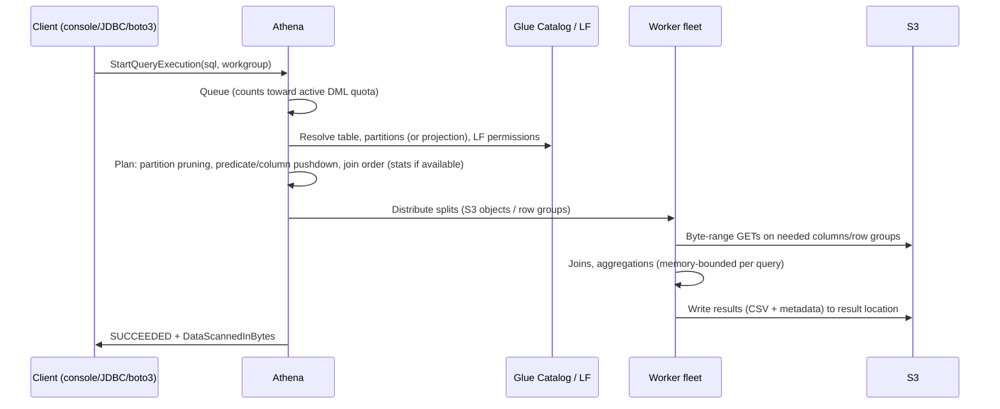

# 05 — Amazon Athena

> Related: [04 Glue Catalog](04-aws-glue.md) · [06 Redshift](06-amazon-redshift.md) · [15 File Formats](15-file-formats-and-partitioning.md) · [23 Cost](23-monitoring-and-cost-optimization.md)

---

## 1. What Athena is internally

- Serverless, distributed SQL engine. **Athena engine version 3** is based on **Trino** (earlier v2 on Presto `[Legacy/deprecated]`). Athena also offers an Apache Spark runtime for notebooks (separate pricing/quotas).
- Metadata from the **Glue Data Catalog** (or Hive metastore, or federated catalogs).
- Reads directly from S3; writes query results to a result location (or managed query results).

Execution flow:



---

## 2. Pricing model

| Model | Charged by | Notes |
|---|---|---|
| **Per-query (on-demand)** | **Bytes scanned**, rounded up per query to a 10 MB minimum; historically $5 per TB in many Regions (verify) | DDL, failed queries and partition management statements are typically not charged for scanned data; cancelled queries charge bytes scanned until cancellation. |
| **Capacity reservations (provisioned)** | DPU-hours for reserved capacity | Predictable cost and concurrency control for heavy workloads `[Additional cost]` `[Quota-dependent]` |
| Federated queries | Scan charges + Lambda connector costs | `[Additional cost]` |
| Spark in Athena | DPU-hours | Separate |

**Interview trap: Athena cost depends on scanned data (for per-query pricing), not execution time.** A 20-minute query scanning 5 GB costs less than a 4-second query scanning 2 TB. Query time is relevant only for provisioned capacity cost efficiency and quotas.

Also S3 GET/LIST request charges and result storage apply.

### 2.1 Cost estimation

```text
Table: 5 TB/month JSON, analysts run 2,000 queries/month each scanning full month.
JSON full scan: 2,000 × 5 TB = 10 PB scanned → ~$51,200 at $5/TB.

After: Parquet + Snappy (~8x smaller => ~0.6 TB), partitioned by day; typical query = 7 days, 6 of 40 columns:
0.6 TB × (7/30) × (6/40) ≈ 0.021 TB per query → 2,000 × 0.021 = 42 TB → ~$210.
```

(Use your Region's current price; ratios matter more than the constant.)

---

## 3. Tables

### 3.1 External tables (Hive-style)

```sql
-- Runs in: Athena (Requires AWS). Replace <bucket>.
CREATE EXTERNAL TABLE IF NOT EXISTS silver.clickstream (
  event_id     string,
  user_id      string,
  event_type   string,
  event_ts     timestamp,
  properties   map<string,string>
)
PARTITIONED BY (event_date date)
STORED AS PARQUET
LOCATION 's3://<bucket>/silver/clickstream/'
TBLPROPERTIES ('parquet.compression'='SNAPPY');
```

Partition management options:

| Method | How | Scale |
|---|---|---|
| `MSCK REPAIR TABLE` | Lists S3 to find Hive-style partitions | Slow on many partitions; only `k=v` paths; doesn't remove deleted partitions |
| `ALTER TABLE ADD PARTITION` | Explicit, idempotent with `IF NOT EXISTS` | Good when writer knows partitions |
| Glue API `BatchCreatePartition` | From the writing job | Best for pipelines |
| Crawlers | Discovery | See [04](04-aws-glue.md) |
| **Partition projection** | Compute partitions from table properties | Best for predictable, high-cardinality partitions |

### 3.2 Partition projection

```sql
CREATE EXTERNAL TABLE silver.app_logs (
  request_id string, status int, latency_ms int, msg string
)
PARTITIONED BY (dt string, region string)
STORED AS PARQUET
LOCATION 's3://<bucket>/silver/app_logs/'
TBLPROPERTIES (
  'projection.enabled'='true',
  'projection.dt.type'='date',
  'projection.dt.format'='yyyy-MM-dd',
  'projection.dt.range'='2024-01-01,NOW',
  'projection.dt.interval'='1',
  'projection.dt.interval.unit'='DAYS',
  'projection.region.type'='enum',
  'projection.region.values'='us-east-1,eu-west-1,ap-south-1',
  'storage.location.template'='s3://<bucket>/silver/app_logs/dt=${dt}/region=${region}/'
);
```

**Official behavior:** With projection enabled, Athena ignores catalog partitions for that table. Queries **without** predicates on projected columns may enumerate the full projected range (many empty prefixes) — slow, though no data scanned for empty paths. Projection is an Athena feature; **other engines (EMR Spark, Redshift Spectrum) don't use projection properties** and need real catalog partitions.

**Interview trap:** Partition projection + Redshift Spectrum on the same table: Spectrum sees no partitions. Decide per table which engines read it.

### 3.3 Partition pruning conditions

Pruning works when predicates are on partition columns with literal/derivable values. It fails or degrades when:
- Functions are applied to the partition column (`WHERE date_format(event_date, '%Y') = '2026'`) — rewrite as range.
- Joins supply the partition values (dynamic filtering in Trino can help, not guaranteed).
- Type mismatch (string partition compared to date).

---

## 4. CTAS and INSERT INTO

```sql
-- Convert raw JSON to partitioned Parquet (bucketed for join locality on user_id)
CREATE TABLE gold.daily_user_events
WITH (
  format = 'PARQUET',
  write_compression = 'SNAPPY',
  external_location = 's3://<bucket>/gold/daily_user_events/',
  partitioned_by = ARRAY['event_date'],
  bucketed_by = ARRAY['user_id'],
  bucket_count = 16
) AS
SELECT user_id, event_type, count(*) AS events, event_date
FROM silver.clickstream
WHERE event_date BETWEEN DATE '2026-09-01' AND DATE '2026-09-30'
GROUP BY user_id, event_type, event_date;
```

| Fact | Detail |
|---|---|
| Partitions per CTAS/INSERT | **Up to 100 partitions** written per statement — loop over ranges (e.g., CTAS first 100 days, then `INSERT INTO` subsequent ranges). |
| Partition columns | Must be **last** in the SELECT list, in the order of `partitioned_by`. |
| `external_location` | Must be empty for CTAS. |
| INSERT INTO | Appends files; not idempotent — reruns duplicate. |

**Interview trap:** `INSERT INTO` on Hive tables is append-only. For idempotent reloads use Iceberg (`MERGE INTO`, `INSERT OVERWRITE` semantics per engine) or delete the partition's S3 prefix and re-insert in a controlled process.

### 4.1 Iceberg in Athena

```sql
CREATE TABLE silver.orders (
  order_id string, customer_id string, amount decimal(18,2),
  status string, updated_at timestamp
)
PARTITIONED BY (day(updated_at))
LOCATION 's3://<bucket>/silver/orders_iceberg/'
TBLPROPERTIES ('table_type'='ICEBERG', 'format'='parquet');

MERGE INTO silver.orders t
USING (SELECT * FROM bronze.orders_cdc WHERE batch_id = '2026-10-10T01') s
ON t.order_id = s.order_id
WHEN MATCHED AND s.op = 'D' THEN DELETE
WHEN MATCHED AND s.updated_at > t.updated_at THEN UPDATE SET
  customer_id = s.customer_id, amount = s.amount, status = s.status, updated_at = s.updated_at
WHEN NOT MATCHED AND s.op <> 'D' THEN INSERT
  (order_id, customer_id, amount, status, updated_at)
  VALUES (s.order_id, s.customer_id, s.amount, s.status, s.updated_at);

OPTIMIZE silver.orders REWRITE DATA USING BIN_PACK WHERE updated_at >= TIMESTAMP '2026-10-01 00:00:00';
VACUUM silver.orders;   -- expire snapshots / remove orphan files per table properties
```

Caveat: the `MERGE` source must have at most one row per key (deduplicate CDC first with `ROW_NUMBER()`), otherwise the merge fails on multiple matches.

---

## 5. Formats and compression

| Format | Athena behavior |
|---|---|
| Parquet / ORC | Column pruning, predicate pushdown via row group/stripe statistics, splittable |
| Avro | Row-based, splittable, schema evolution; scans all columns |
| JSON / CSV | Full scan of each file; gzip files not splittable (one reader per file) |
| Compression | Snappy (fast), ZSTD (better ratio, good speed), GZIP (good ratio, non-splittable for text) |

Detail in [15](15-file-formats-and-partitioning.md).

---

## 6. Workgroups

| Capability | Use |
|---|---|
| Per-workgroup result location + encryption (enforced) | Prevent results landing in random buckets |
| **Per-query data scan limit** (cancel above threshold) | Guardrail against `SELECT *` on 100 TB |
| Per-workgroup data usage alarms (hourly/daily thresholds → SNS) | Budget alerting |
| Engine version selection | Controlled upgrades |
| Tags for cost allocation | Chargeback per team |
| IAM conditions on workgroup ARN | Restrict teams to their workgroup |
| Capacity reservation assignment | Isolate critical workloads |

Quotas (verified 2026-10-10): up to 1,000 workgroups per Region per account; service quotas are **shared across workgroups**.

---

## 7. Query optimization

1. **Reduce bytes**: Parquet/ORC, compression, select only needed columns, partition filters.
2. **File sizing**: aim for files ≥ 128 MB; avoid tens of thousands of small files per partition.
3. **Sort/cluster within files** on common filter columns to make min/max statistics effective (e.g., sort by `user_id` within date partitions; Iceberg sort orders).
4. **Joins**: put the larger table on the left in Trino for some join strategies historically; engine v3 uses cost-based optimization when table statistics exist (Glue column statistics) — generate statistics for large tables.
5. **Approximate functions**: `approx_distinct`, `approx_percentile`.
6. **Avoid `ORDER BY` without `LIMIT`** on huge results (single-node final sort).
7. **Window functions** partition by high-cardinality keys to spread work.
8. **Query result reuse** for repeated identical queries (configurable max age) `[Optional integration]`.
9. **UNLOAD** to write large results as Parquet instead of CSV result sets.

`EXPLAIN` and `EXPLAIN ANALYZE` show distributed plans and per-stage stats.

### Common errors

| Error | Meaning | Fix |
|---|---|---|
| `HIVE_PARTITION_SCHEMA_MISMATCH` | Partition schema differs from table schema | Update partition schemas; crawler setting "inherit from table"; consistent writes |
| `HIVE_BAD_DATA: Error parsing field value` | Data doesn't match declared type | Fix data or declare string and cast with `try_cast` |
| `Query exhausted resources at this scale factor` | Memory pressure (large join/agg/sort) | Reduce data, pre-aggregate, split query, use CTAS stages, approximate functions |
| `TooManyRequestsException` / queued | Active DML quota | Request increase, capacity reservations, client-side concurrency control |
| `Access Denied` on results | Result bucket permissions/KMS | Workgroup result config, KMS policy |
| `HIVE_CURSOR_ERROR` | Corrupt/incomplete files or changed during query | Check writers; atomic publishing |
| Slow query with no data scanned | Projection enumerating huge range or S3 listing many prefixes | Add partition predicates; narrow projection ranges |

Quotas (verified 2026-10-10): DML query timeout default **30 minutes** (adjustable up to 240); DDL timeout 600 minutes; active DML queries Region-dependent (e.g., 200 in us-east-1, 20 in smaller Regions); query string max 262,144 bytes.

---

## 8. Federated queries

Athena Federated Query uses **Lambda-based connectors** (DynamoDB, RDS/Aurora, Redshift, CloudWatch Logs, DocumentDB, OpenSearch, etc.).

- When to use: occasional joins across operational data and the lake; exploration; low-volume reporting.
- When not to use: large scans of production OLTP databases (load impact, Lambda limits, slow), or as a replacement for ingestion.
- Prerequisites: connector Lambda deployed (Serverless Application Repository), VPC access to the source `[VPC/networking required]`, spill bucket, Secrets Manager credentials, IAM for Lambda invocation `[IAM permission required]` `[Additional cost]`.

---

## 9. Athena vs. Redshift

| Dimension | Athena | Redshift (provisioned RA3 / Serverless) |
|---|---|---|
| Storage | Your S3 (open formats) | Redshift Managed Storage (+ Spectrum/data lake queries) |
| Cost model | Per TB scanned (or capacity reservations) | Node-hours / RPU-hours + storage |
| Performance for repeated BI | Good with tuned data; each query re-reads S3 | Excellent: local SSD cache, result cache, materialized views, sort keys |
| Concurrency | Quota-based active queries; queuing | WLM + concurrency scaling |
| Data modification | Iceberg MERGE/UPDATE/DELETE | Full DML, transactions |
| Ops | None | Low (Serverless) to moderate (provisioned: sizing, WLM, maintenance) |
| Best for | Ad hoc lake exploration, infrequent/variable workloads, ETL via CTAS/UNLOAD, log analytics | Dashboards with many concurrent users, complex joins over curated models, predictable SLAs |
| Weaknesses | Unpredictable cost with unbounded scans; memory limits for huge joins | Data loading/modeling overhead; cost when idle (provisioned) |

**Selection rule:** If queries are sporadic and data is already well-partitioned Parquet/Iceberg → Athena. If hundreds of users hit dashboards on the same models all day with sub-second–few-second SLOs → Redshift (possibly with Spectrum for the long tail). See [32 ADR-002](32-architecture-decision-records.md).

---

## 10. Security

- IAM on workgroups and `athena:*` actions; plus S3 and Glue permissions for data and metadata.
- Lake Formation for column/row/cell-level security on registered data `[Lake Formation required]`.
- Result encryption (SSE-S3/SSE-KMS/CSE-KMS), enforced by workgroup.
- VPC interface endpoint for Athena API `[VPC/networking required]` `[Additional cost]`.
- CloudTrail logs `StartQueryExecution` (including query text).

---

## 11. Interview questions and model answers

**Q1. Athena queries on a log table got slow and expensive after 18 months. Diagnose.**
Check: partition count growth with `MSCK`-managed partitions (catalog lookups); missing partition predicates in dashboards; small files from streaming writers; JSON vs. Parquet; lack of compaction. Fix: partition projection, compaction to Parquet ≥ 128 MB, workgroup scan limits, Iceberg with hidden partitioning and `OPTIMIZE`.

**Q2. How do you load 3 years of daily partitions with CTAS given the 100-partition limit?**
CTAS for the first 100 days, then a loop of `INSERT INTO ... WHERE event_date BETWEEN` 100-day windows, orchestrated by Step Functions/Airflow; or use Glue/EMR Spark for bulk conversion.

**Q3. How would you restrict analysts from running a query scanning > 1 TB?**
Workgroup per-query data usage control (cancels queries above threshold) and workgroup-level alarms; IAM to force analysts into that workgroup.

**Q4. Why does `SELECT COUNT(*)` on a Parquet table scan little data?**
Parquet footers contain row counts; engines can answer counts from metadata, scanning far less (behavior depends on engine optimizations).

**Q5. When would you use Athena UNLOAD?**
To export large query results as partitioned, compressed Parquet/ORC/Avro/JSON to S3 for downstream systems — faster and more efficient than CSV result sets.

---

## 12. Self-check

1. **Q:** Two queries: Q1 runs 10 minutes scanning 20 GB; Q2 runs 3 seconds scanning 800 GB. Which costs more under per-query pricing? **A:** Q2 — cost is based on bytes scanned.
2. **Q:** How many partitions can a single CTAS write? **A:** 100.
3. **Q:** Does EMR Spark honor Athena partition projection? **A:** No; projection is Athena-specific.
4. **Q:** What's the default Athena DML query timeout? **A:** 30 minutes (adjustable up to 240).
5. **Q:** Why must a MERGE source be deduplicated? **A:** Multiple source rows matching one target row cause the MERGE to fail (ambiguous update).
6. **Q:** Name two workgroup controls for cost. **A:** Per-query scan cutoff; per-workgroup data usage alarms (also enforced result locations and tags for chargeback).
