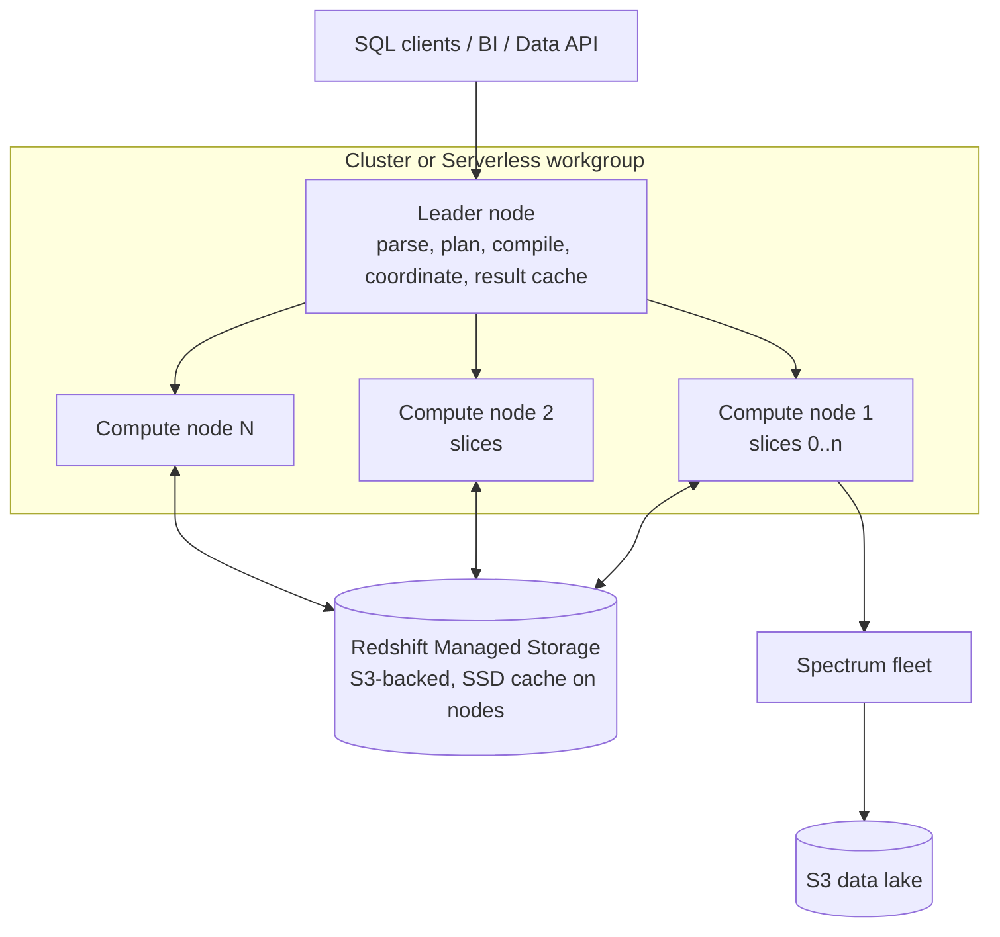

# 06 — Amazon Redshift

> Related: [05 Athena](05-amazon-athena.md) · [17 SQL](17-sql-for-data-engineering-interviews.md) · [14 Transformations](14-data-transformation-and-processing.md) · [32 ADR-002](32-architecture-decision-records.md)

---

## 1. Architecture



| Component | Role |
|---|---|
| **Leader node** | Parses SQL, builds plan, compiles segments (compiled code cached), distributes to compute nodes, aggregates final results, hosts catalog. Leader-only functions run here. |
| **Compute nodes / slices** | Each node has slices; each slice owns a portion of data and processes it in parallel. |
| **Columnar storage** | 1 MB blocks per column, compressed, with **zone maps** (min/max per block). |
| **Redshift Managed Storage (RMS)** | RA3 and Serverless: storage decoupled from compute; hot data cached on local SSD; pay storage separately. |
| **Spectrum** | Separate fleet scanning S3 external tables; billed per TB scanned `[Additional cost]`. |
| **Concurrency scaling** | Transient clusters for burst read (and some write) queries `[Additional cost]` beyond free credits. |

### 1.1 Deployment options

| Option | Units | Pricing | Notes |
|---|---|---|---|
| Provisioned **RA3** (`ra3.large`, `ra3.xlplus`, `ra3.4xlarge`, `ra3.16xlarge`) | Nodes | Node-hours (on-demand or reserved) + RMS storage | Data sharing, AQUA-era features, resize/pause/resume |
| Provisioned **DC2** | Nodes with local SSD storage | Node-hours | `[Legacy/deprecated]` for new builds — no RMS; verify current status |
| **DS2** | HDD | — | `[Legacy/deprecated]` (retired) |
| **Redshift Serverless** | RPUs (1 RPU = 16 GB memory) | RPU-hours billed per second while queries run (60-second minimum per charge), + RMS storage | Base capacity default **128 RPU**, configurable **4–512 RPU** (up to **1,024** in some Regions) — verified 2026-10-10; max capacity and RPU-hour usage limits for cost control |

**Senior talking point:** "Serverless for spiky or unpredictable workloads and fast setup; provisioned RA3 with reserved instances for steady, high-utilization 24/7 workloads where per-hour economics win. I validate with a two-week cost comparison using actual query history."

**Official note (verified 2026-10-10):** Redshift documentation states Python UDFs will no longer be supported after **June 30, 2026**, with phased enforcement — migrate to Lambda UDFs or SQL UDFs. **Interview trap:** legacy pipelines relying on Python UDFs.

---

## 2. Table design

### 2.1 Distribution styles

| Style | Placement | Use when | Risk |
|---|---|---|---|
| `AUTO` (default) | Redshift chooses (starts ALL for small, moves to EVEN/KEY) | Default, especially with Automatic Table Optimization | May not match your join pattern immediately |
| `EVEN` | Round-robin | No dominant join key; staging tables | Joins require redistribution |
| `KEY` | Hash of a column → slice | Large fact joined to large dimension on same key | **Skew** if key has hot values or many nulls |
| `ALL` | Full copy on every node | Small, slowly changing dimensions | Storage × nodes; slow writes |

Choose `DISTKEY` = the most frequent **join key between the two largest tables**, with high cardinality and even distribution. Check skew:

```sql
-- Runs in: Redshift (Requires AWS)
SELECT "table", diststyle, skew_rows, skew_sortkey1, unsorted, stats_off, tbl_rows, size AS size_mb
FROM svv_table_info
ORDER BY skew_rows DESC NULLS LAST
LIMIT 20;
```

`skew_rows` = ratio of rows on the fullest slice to the emptiest. Values far above ~4 warrant investigation (engineering heuristic, not an AWS limit).

Query plan redistribution operators: `DS_DIST_NONE` (good — co-located), `DS_DIST_ALL_NONE` (dimension is ALL), `DS_BCAST_INNER` (inner table broadcast — expensive if large), `DS_DIST_INNER` / `DS_DIST_OUTER` / `DS_DIST_BOTH` (redistribution).

### 2.2 Sort keys

| Type | Behavior | Use |
|---|---|---|
| `AUTO` | Redshift chooses via ATO | Default |
| Compound | Sorted by columns in order; zone maps effective on prefix columns | Range filters on leading column (timestamps), merge joins |
| Interleaved | Equal weight to each column | Rarely recommended now; expensive `VACUUM REINDEX`; poor for monotonically increasing columns `[Legacy/deprecated]` for most use cases |

**Interview trap: Redshift distribution keys and sort keys solve different problems.** Distribution controls *where rows live across slices* (join/aggregation data movement). Sort keys control *order within each slice* (block skipping via zone maps, merge joins). A good DISTKEY doesn't speed up `WHERE event_ts > ...`; a good SORTKEY doesn't avoid redistribution.

### 2.3 Compression (encodings)

`ENCODE AUTO` (default) lets Redshift pick (AZ64 for numeric/date/timestamp, LZO/ZSTD for strings; RAW for sort key leading column in many cases). `ANALYZE COMPRESSION` reports recommendations. Compression reduces I/O — the dominant cost in scans.

### 2.4 Example DDL

```sql
CREATE TABLE sales.fact_order_line (
  order_line_id  BIGINT        NOT NULL,
  order_id       BIGINT        NOT NULL,
  customer_id    BIGINT        NOT NULL,
  product_id     INT           NOT NULL,
  order_ts       TIMESTAMP     NOT NULL,
  qty            INT,
  amount         DECIMAL(18,2),
  PRIMARY KEY (order_line_id)                 -- informational only, not enforced
)
DISTSTYLE KEY DISTKEY (customer_id)
COMPOUND SORTKEY (order_ts);

CREATE TABLE sales.dim_product (
  product_id INT NOT NULL, name VARCHAR(256), category VARCHAR(64)
)
DISTSTYLE ALL SORTKEY (product_id);
```

**Interview trap:** Primary key, unique, and foreign key constraints are **informational, not enforced**. The planner may use them, so declaring them on data that violates them can produce **incorrect results**. Deduplicate in the pipeline.

---

## 3. Loading and unloading

### 3.1 COPY

```sql
COPY sales.stg_orders
FROM 's3://<bucket>/silver/orders/dt=2026-10-09/'
IAM_ROLE 'arn:aws:iam::<account-id>:role/<redshift-copy-role>'
FORMAT AS PARQUET;

-- CSV with manifest and error tolerance
COPY sales.stg_events
FROM 's3://<bucket>/manifests/events-2026-10-09.manifest'
IAM_ROLE default
CSV GZIP IGNOREHEADER 1
MANIFEST
MAXERROR 100
TIMEFORMAT 'auto';
```

How COPY parallelizes: each slice loads files in parallel. **Best practice (AWS docs):** split input into multiple files — a multiple of the number of slices — of roughly equal size, about 1 MB–1 GB each after compression. One huge gzip file loads on one slice.

Errors: `STL_LOAD_ERRORS` (provisioned) / `SYS_LOAD_ERROR_DETAIL`; `SYS_LOAD_HISTORY`.

**Interview trap:** `COPY` appends. Re-running a COPY after partial failure duplicates data unless you load to a staging table and merge (idempotent upsert pattern below). COPY of a single statement is transactional (all-or-nothing for that statement), but your orchestration retry is not.

### 3.2 Idempotent upsert pattern

```sql
BEGIN;
CREATE TEMP TABLE stg (LIKE sales.dim_customer);
COPY stg FROM 's3://<bucket>/silver/customers/dt=2026-10-09/' IAM_ROLE default FORMAT AS PARQUET;

-- MERGE is supported in Redshift; dedupe source first
MERGE INTO sales.dim_customer
USING (
  SELECT * FROM (
    SELECT s.*, ROW_NUMBER() OVER (PARTITION BY customer_id ORDER BY updated_at DESC) AS rn FROM stg s
  ) WHERE rn = 1
) src
ON sales.dim_customer.customer_id = src.customer_id
WHEN MATCHED THEN UPDATE SET name = src.name, tier = src.tier, updated_at = src.updated_at
WHEN NOT MATCHED THEN INSERT (customer_id, name, tier, updated_at)
  VALUES (src.customer_id, src.name, src.tier, src.updated_at);
COMMIT;
```

(The source subquery includes `rn`; in practice select explicit columns. Verify current MERGE syntax constraints in the Redshift docs.)

### 3.3 UNLOAD

```sql
UNLOAD ('SELECT * FROM sales.fact_order_line WHERE order_ts >= ''2026-10-01''')
TO 's3://<bucket>/exports/fact_order_line/'
IAM_ROLE default
FORMAT AS PARQUET
PARTITION BY (order_date_col)   -- column must exist in the SELECT
MAXFILESIZE 512 MB;
```

`PARALLEL ON` (default) writes one or more files per slice. `ALLOWOVERWRITE` / `CLEANPATH` control existing files.

### 3.4 Other ingestion paths

| Path | Use | Notes |
|---|---|---|
| Streaming ingestion (Kinesis Data Streams / MSK → materialized view) | Low-latency ingest without Firehose | `[Optional integration]` |
| Firehose → Redshift | Firehose stages to S3 then COPY | Quota page notes Firehose delivery to Redshift requires publicly accessible clusters for some configurations — verify current docs |
| Zero-ETL integrations (Aurora, RDS, DynamoDB, some SaaS) | Near-real-time replication without pipelines | `[Region-dependent]` `[Optional integration]` |
| Auto-copy from S3 (`COPY JOB`) | Continuous file ingestion | `[Optional integration]` |
| Federated queries (RDS/Aurora PostgreSQL/MySQL) | Query live OLTP | Load impact on source |

---

## 4. Maintenance: VACUUM and ANALYZE

| Command | What it does | Automatic? |
|---|---|---|
| `VACUUM DELETE ONLY` | Reclaims space from deleted/updated rows (updates = delete + insert) | Automatic vacuum delete runs in background |
| `VACUUM SORT ONLY` | Re-sorts unsorted region | Automatic table sort runs in background |
| `VACUUM FULL` | Both | Manual |
| `VACUUM REINDEX` | Interleaved sort keys | Manual |
| `ANALYZE` | Updates statistics for the planner | Automatic analyze runs in background; run explicitly after big loads before critical queries |

`svv_table_info.unsorted` and `stats_off` indicate need. Heavy `UPDATE`/`DELETE` patterns (e.g., naive SCD2) create ghost rows → slow scans until vacuum.

---

## 5. Workload management (WLM)

| Mode | Behavior |
|---|---|
| **Automatic WLM** (recommended) | Redshift manages memory and concurrency per queue; you set **priorities** (highest…lowest) and queues by user group/query group |
| Manual WLM | Fixed queue slots and memory %; up to 8 user queues; total concurrency across queues 50 (verify) |
| **Short Query Acceleration (SQA)** | Routes predicted-short queries to a dedicated space |
| **Query Monitoring Rules (QMR)** | Predicates (e.g., `query_execution_time > 600`, `scan_row_count > 1e9`, `nested_loop_join_row_count`) → log, hop, abort, change priority |
| **Concurrency scaling** | Burst capacity for eligible queries; clusters accrue free credits (documented as up to one hour per day of usage) `[Additional cost]` beyond credits |
| Serverless | No WLM queues; control with base/max RPU, usage limits, query limits (`max_query_execution_time` etc.) |

---

## 6. Materialized views

- Precompute joins/aggregations; refresh **incrementally** when supported (depends on SQL constructs), else full recompute.
- Auto refresh `[Optional integration]` and **automatic query rewrite** (planner uses MV for matching queries).
- MVs over Spectrum tables, streaming ingestion sources.
- Limitations: some functions/constructs prevent incremental refresh; refresh cost lands on your cluster.

---

## 7. Spectrum

```sql
CREATE EXTERNAL SCHEMA lake
FROM DATA CATALOG DATABASE 'silver'
IAM_ROLE 'arn:aws:iam::<account-id>:role/<spectrum-role>'
REGION '<region>';

SELECT d.category, SUM(f.amount)
FROM lake.order_lines f            -- S3 Parquet via Glue Catalog
JOIN sales.dim_product d ON d.product_id = f.product_id
WHERE f.order_date = '2026-10-09'
GROUP BY 1;
```

Spectrum pushes filters, projections, and aggregations to the Spectrum layer; joins with local tables happen on the cluster. Cost: per TB scanned in S3 (similar logic to Athena). Partitioned Parquet matters equally here.

**Data sharing**: share live data across RA3/Serverless namespaces and accounts without copying (`CREATE DATASHARE`), including cross-account via AWS Data Exchange or direct grants `[Cloud-specific]`.

---

## 8. Query plans and performance troubleshooting

```sql
EXPLAIN
SELECT c.tier, SUM(f.amount)
FROM sales.fact_order_line f JOIN sales.dim_customer c ON c.customer_id = f.customer_id
WHERE f.order_ts >= '2026-10-01'
GROUP BY 1;
```

Read for: `XN Seq Scan` with filter (are zone maps helping? check `rows` vs. table size), join type (`Hash Join` vs. `Merge Join` vs. `Nested Loop` — nested loop usually means missing join condition), distribution operator (`DS_BCAST_INNER` on a large table is a red flag), and high costs relative to other steps.

Diagnostics:

```sql
-- Recent slow queries (Serverless & provisioned)
SELECT query_id, user_id, status, elapsed_time/1e6 AS sec, queue_time/1e6 AS queue_sec,
       LEFT(query_text, 120) AS sql
FROM sys_query_history
WHERE start_time > dateadd(hour, -24, getdate())
ORDER BY elapsed_time DESC LIMIT 20;

-- Planner/execution alerts (provisioned)
SELECT query, TRIM(event) AS event, TRIM(solution) AS solution, COUNT(*)
FROM stl_alert_event_log
WHERE event_time > dateadd(day, -1, getdate())
GROUP BY 1,2,3 ORDER BY 4 DESC LIMIT 20;

-- Spill to disk per step
SELECT query_id, step_name, spilled_block_local_disk, spilled_block_remote_disk
FROM sys_query_detail WHERE spilled_block_local_disk > 0 ORDER BY 3 DESC LIMIT 20;
```

Common root causes:

| Symptom | Root cause | Fix |
|---|---|---|
| Large broadcast/redistribution | Mismatched DISTKEY | Align DISTKEY or ALL for small dims |
| Full scans despite date filter | No/poor sort key; unsorted data | Sort key on date; vacuum sort |
| Slow after big loads | Stale stats | `ANALYZE` |
| Queue time high | Concurrency | Automatic WLM priorities, concurrency scaling, SQA, Serverless max RPU |
| Disk-full / spills | Huge intermediate results, skew | Rewrite query, filter early, fix skew, bigger nodes |
| Commit queue waits | Many small transactions (row-by-row inserts) | Batch loads with COPY; fewer commits |
| Lock waits | DDL vs. long-running reads | Schedule DDL; `STV_LOCKS`, `SVV_TRANSACTIONS` |

---

## 9. Security

- IAM roles for COPY/UNLOAD/Spectrum (`IAM_ROLE default` set on cluster/namespace) `[IAM permission required]`.
- Encryption at rest with KMS `[KMS configuration required]`; SSL enforced via parameter `require_ssl`.
- Network: private subnets, enhanced VPC routing (COPY/UNLOAD traffic through VPC → needs S3 gateway endpoint/NAT) `[VPC/networking required]`.
- Fine-grained: RBAC roles, row-level security policies, dynamic data masking, column-level grants; Lake Formation for Spectrum/datashares `[Lake Formation required]`.
- Audit logging to S3/CloudWatch.

---

## 10. S3 partitioning vs. Redshift distribution and sort keys

See full comparison in [03 §10](03-amazon-s3.md). Summary: S3 partitions prune files; distribution keys minimize data movement; sort keys prune blocks.

---

## 11. Interview questions and model answers

**Q1. A dashboard query joining a 5 B-row fact to a 50 M-row customer dimension takes 90 seconds. Approach?**
EXPLAIN: if `DS_BCAST_INNER` or `DS_DIST_BOTH`, align both tables' DISTKEY on `customer_id` (check skew). Add compound sort key on the fact's date column for range filters; check `unsorted`/`stats_off`; consider a materialized view for the dashboard's aggregate; ensure the query has a date predicate. Check WLM queue time separately from execution.

**Q2. Provisioned vs. Serverless for a team running ETL 2 hours nightly and few daytime queries?**
Serverless: pay only while running; base RPU sized to finish ETL within window; usage limits to cap spend. Provisioned would idle 20+ hours (pause/resume helps but is operationally clunky).

**Q3. Why might `COUNT(DISTINCT customer_id)` be wrong after you declared `customer_id` UNIQUE?**
Constraints are not enforced; the optimizer may trust the declaration and skip the distinct step, producing wrong results if duplicates exist.

**Q4. How do you implement SCD2 efficiently in Redshift?**
Stage changes with COPY; detect changed rows via hash of tracked columns; in one transaction, `UPDATE` current rows to set `valid_to`/`is_current=false` for changed keys, then `INSERT` new versions; run on batches, not row-by-row; vacuum handles ghost rows. Or compute SCD2 in Spark/Iceberg and load the result.

**Q5. When use Spectrum vs. loading data?**
Spectrum for large, infrequently queried history or data shared with the lake; load into RMS for hot, frequently joined data needing best performance.

---

## 12. Self-check

1. **Q:** What does `DS_BCAST_INNER` indicate? **A:** The inner join table is broadcast to all nodes — fine for small tables, expensive for large ones; often a DISTKEY mismatch.
2. **Q:** Are primary keys enforced? **A:** No; they're informational and can influence the planner.
3. **Q:** How should files be laid out for COPY? **A:** Multiple, similar-size files (≈1 MB–1 GB compressed), count a multiple of slice count.
4. **Q:** What's the Serverless base capacity default and range? **A:** Default 128 RPU; 4–512 RPU (up to 1,024 in select Regions).
5. **Q:** What is the risk of KEY distribution on a column with 30% nulls? **A:** All nulls hash to one slice → severe skew.
6. **Q:** What happens to deleted rows until vacuum? **A:** They're marked deleted (ghost rows) and still scanned/stored until reclaimed.
