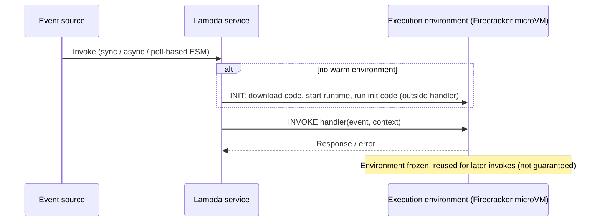

# 07 — AWS Lambda and Event-Driven Processing

> Related: [03 S3 events](03-amazon-s3.md) · [08 Kinesis](08-amazon-kinesis-and-streaming.md) · [11 Orchestration](11-aws-step-functions-and-orchestration.md) · [12 Batch](12-aws-batch-and-containerized-data-jobs.md) · [27 Limits](27-numbers-limits-and-defaults.md)

---

## 1. Execution model



| Phase | Notes |
|---|---|
| **Init** | Runtime start + your module-level code (create boto3 clients, load config). Contributes to **cold start**. |
| **Invoke** | Handler runs; one event (or batch) per environment at a time. |
| **Freeze/reuse** | Globals and `/tmp` persist across invocations in the same environment; do not rely on it for correctness. |
| **Shutdown** | Environment reclaimed eventually. |

**Concurrency** = number of environments processing simultaneously ≈ requests/sec × average duration (s).

### 1.1 Key limits (verified 2026-10-10)

| Limit | Value |
|---|---|
| Timeout | Max **900 s (15 min)**; default 3 s |
| Memory | 128–10,240 MB (CPU scales; ~1 vCPU at 1,769 MB) |
| `/tmp` | 512–10,240 MB |
| Sync payload | 6 MB request / 6 MB response (200 MB streamed response) |
| **Async payload** | **1 MB** (raised from the long-standing 256 KB) |
| Env vars | 4 KB total |
| Deployment package | 50 MB zipped (direct upload), 250 MB unzipped incl. layers; 10 GB container image |
| Layers | 5 |
| Concurrency | **1,000 per Region** default (adjustable; new accounts may start lower) |
| Scaling rate | Each function: **1,000 execution environments every 10 seconds** |
| Code storage | 300 GB per Region (Lambda-managed storage) |

Newer options exist (e.g., **Lambda Managed Instances** with longer async durations, **Lambda durable functions**) — `[Region-dependent]`, verify before relying on them in designs.

---

## 2. Invocation types and retry behavior

| Type | Sources | Retry owner | Default retries | Failure destination |
|---|---|---|---|---|
| **Synchronous** | API Gateway, SDK `RequestResponse`, ALB, Step Functions task (sync) | Caller | None by Lambda | Caller handles |
| **Asynchronous** | S3, SNS, EventBridge, SDK `Event` | Lambda internal queue | **2 retries** (configurable 0–2), event age up to 6 h | On-failure destination (SQS, SNS, Lambda, EventBridge, S3) or DLQ (SQS/SNS) |
| **Event source mapping (poll-based)** | SQS, Kinesis, DynamoDB Streams, MSK/Kafka, MQ, DocumentDB | Lambda poller | SQS: until visibility/redrive; streams: until success or record expiry (configurable) | SQS: queue's redrive DLQ; streams: on-failure destination |

### 2.1 SQS event source mapping

- Batch size up to 10,000 (standard queues; FIFO up to 10), batch window up to 300 s.
- Lambda deletes messages on success. On error, the **whole batch** returns to the queue after visibility timeout unless you use **partial batch response** (`ReportBatchItemFailures`).
- Set queue **visibility timeout ≥ 6 × function timeout** (AWS recommendation) + batch window.
- Maximum concurrency setting on the ESM limits pollers per queue.
- Redrive policy `maxReceiveCount` → DLQ.

### 2.2 Kinesis/DynamoDB Streams ESM

- One concurrent batch per shard by default; **parallelization factor** 1–10 per shard (ordering preserved per partition key).
- Error handling: `BisectBatchOnFunctionError`, `MaximumRetryAttempts`, `MaximumRecordAgeInSeconds`, on-failure destination.
- **Interview trap:** By default, a poison record **blocks the shard** (retries until success or expiry). Configure bisect + max retries + destination.
- Tumbling windows for stateful aggregations (up to 15 minutes).
- Partial batch response supported (`ReportBatchItemFailures` returns sequence numbers to checkpoint).

---

## 3. Triggers for data engineering

| Trigger | Pattern | Notes |
|---|---|---|
| S3 → Lambda directly | Small file processing | Async invoke; no buffering; concurrency spikes on bulk uploads |
| S3 → SQS → Lambda | **Preferred** for file ingestion | Buffer, batching, DLQ, controlled concurrency |
| S3 → EventBridge → Lambda/Step Functions | Routing, multi-consumer | See [03 §8](03-amazon-s3.md) |
| EventBridge Scheduler → Lambda | Cron tasks, API polling | Flexible time windows, retries, DLQ |
| Kinesis → Lambda | Streaming transform/enrich | Per-shard ordering |
| DynamoDB Streams → Lambda | CDC from DynamoDB | 24 h stream retention |
| Firehose transform Lambda | Record transformation in delivery | Firehose buffers to Lambda (payload up to 6 MB per invocation in some configs — verify) |

---

## 4. SQS vs. SNS vs. EventBridge

| Dimension | SQS | SNS | EventBridge |
|---|---|---|---|
| Model | Queue (pull) | Pub/sub push | Event bus with rules (push) |
| Consumers | Competing consumers (one message → one consumer) | Fan-out to many subscriptions | Fan-out to many rules/targets |
| Persistence | Up to 14 days (default 4) | No storage (FIFO topics support archive/replay) | Archive + replay (optional) |
| Filtering | None at queue level (consumer filters; Lambda ESM filtering exists) | Subscription filter policies (attributes or body) | Rich event patterns |
| Ordering | FIFO queues per message group | FIFO topics | No ordering guarantee |
| Message size | **1 MiB** (verified 2026-10-10) | 256 KiB default, up to **1 MiB** via `MaximumMessageSize` (verified) | 256 KB (classic) — verify |
| Throughput | Standard: nearly unlimited; FIFO: 300 TPS/partition without batching, higher with high-throughput mode | High; Region-dependent publish quotas | Region-dependent PutEvents quotas |
| Delivery | At-least-once (standard), exactly-once processing within dedupe window (FIFO) | At-least-once with retries per protocol | At-least-once with retry policy (default up to 24 h / 185 attempts on classic targets) |
| Best for | Buffering, load leveling, work queues | Simple fan-out, notifications, SNS→SQS fan-out | Event routing across services/accounts, SaaS events, schedules |

**Selection rule:** SQS to **decouple and buffer** a consumer; SNS to **fan out the same message** to multiple queues/endpoints cheaply; EventBridge to **route heterogeneous events by content** across teams/accounts with replay.

**Operational consequences:** SQS requires you to manage consumers and visibility; SNS has no durable storage for standard topics (pair with SQS); EventBridge has lower throughput quotas per Region and higher per-event cost than SNS at extreme volume.

**Limitations:** None of them guarantee exactly-once end-to-end delivery into your target; FIFO dedupe works within a 5-minute window.

---

## 5. Idempotency

Every Lambda processing an at-least-once source must be idempotent.

| Technique | Implementation |
|---|---|
| Idempotency key table | DynamoDB conditional `PutItem` with `attribute_not_exists(pk)` on an event key (`bucket/key/versionId`, message ID, business key + version) |
| Deterministic outputs | Write to a key derived from input (`out/<input-key-hash>.parquet`); retries overwrite same object |
| Conditional writes | S3 `If-None-Match: *` |
| Upserts | MERGE/`ON CONFLICT` in target DB |
| Powertools for AWS Lambda (Python) idempotency utility | Decorator-based with DynamoDB persistence `[Optional integration]` |

```python
# Runs in: Lambda (Python 3.12) — Requires AWS (DynamoDB table <idempotency-table> with pk string).
import json, os, urllib.parse
import boto3
from botocore.exceptions import ClientError

ddb = boto3.client("dynamodb")
s3 = boto3.client("s3")
TABLE = os.environ["IDEMPOTENCY_TABLE"]

def _claim(event_key: str) -> bool:
    try:
        ddb.put_item(
            TableName=TABLE,
            Item={"pk": {"S": event_key}, "status": {"S": "IN_PROGRESS"}},
            ConditionExpression="attribute_not_exists(pk)",
        )
        return True
    except ClientError as e:
        if e.response["Error"]["Code"] == "ConditionalCheckFailedException":
            return False
        raise

def handler(event, context):
    failures = []
    for record in event["Records"]:                      # SQS batch
        msg_id = record["messageId"]
        try:
            body = json.loads(record["body"])
            for s3rec in body.get("Records", []):        # S3 event inside SQS body
                bucket = s3rec["s3"]["bucket"]["name"]
                key = urllib.parse.unquote_plus(s3rec["s3"]["object"]["key"])
                version = s3rec["s3"]["object"].get("versionId", "null")
                if not _claim(f"{bucket}/{key}/{version}"):
                    continue                              # duplicate event: skip
                obj = s3.get_object(Bucket=bucket, Key=key)
                _process(obj["Body"])                     # must itself write deterministically
                ddb.update_item(TableName=TABLE, Key={"pk": {"S": f"{bucket}/{key}/{version}"}},
                                UpdateExpression="SET #s = :d",
                                ExpressionAttributeNames={"#s": "status"},
                                ExpressionAttributeValues={":d": {"S": "DONE"}})
        except Exception:
            failures.append({"itemIdentifier": msg_id})
    return {"batchItemFailures": failures}                # requires ReportBatchItemFailures

def _process(stream):
    for _line in stream.iter_lines():
        pass
```

Caveat: if `_process` fails after the claim, the key stays `IN_PROGRESS` and a retry would skip it. Production versions store a TTL/expiry on in-progress claims and allow takeover after expiry (Powertools implements this).

**Interview trap: A retry can duplicate writes if the target operation is not idempotent.** "We have retries" is not a correctness argument.

---

## 6. Concurrency controls

| Control | Effect |
|---|---|
| Account concurrency quota | Shared across all functions in Region |
| **Reserved concurrency** | Guarantees and caps a function's concurrency (0 = disable) — protect downstream databases |
| **Provisioned concurrency** | Pre-initialized environments to avoid cold starts `[Additional cost]` |
| SQS ESM maximum concurrency | Caps concurrent invocations per event source |
| Throttling behavior | Sync: 429 to caller; async: retried internally up to 6 h; ESM: backs off polling |

**Interview trap:** A Lambda writing to RDS with unbounded concurrency exhausts DB connections. Cap with reserved concurrency/ESM max concurrency and use RDS Proxy.

---

## 7. Cold starts

Drivers: package size, runtime (JVM slower without SnapStart), VPC attachment (much improved since Hyperplane ENIs, but still adds some setup), heavy init code. Mitigations: smaller packages, lazy imports, SnapStart (Java, Python, .NET — verify runtime support), provisioned concurrency. For batch data processing, cold starts are usually irrelevant compared with I/O.

---

## 8. When Lambda is inappropriate

**Interview trap: Lambda is not automatically the right tool for long-running or large-scale transformations.**

Avoid Lambda when:
- Processing time can exceed 15 minutes (including retries of large files).
- Data per invocation exceeds memory/`/tmp` (10 GB) or needs distributed joins/shuffles → Glue/EMR.
- You need consistent high CPU for hours → Batch/ECS on EC2 (cheaper per vCPU-hour at sustained utilization).
- Ordering across many keys with complex state → Flink (Managed Service for Apache Flink) or Spark Structured Streaming.
- Target systems can't tolerate burst concurrency.
- Payloads exceed limits (pass S3 pointers instead — "claim check" pattern).

Good fits: per-file validation/routing, small format conversions, metadata updates (`BatchCreatePartition`), API polling, Firehose transforms, triggering orchestrations, lightweight stream enrichment.

---

## 9. Monitoring

Metrics: `Invocations`, `Errors`, `Throttles`, `Duration`, `ConcurrentExecutions`, `IteratorAge` (streams — **key lag signal**), `AsyncEventAge`, `AsyncEventsDropped`, `DeadLetterErrors`, ESM metrics for SQS (`ApproximateAgeOfOldestMessage` on the queue).

Logs: CloudWatch Logs (set retention!), structured JSON logging, Lambda Insights `[Additional cost]`, X-Ray tracing `[Optional integration]`.

---

## 10. Interview questions and model answers

**Q1. Files land in S3 at 2,000/minute. Each needs a 30-second validation. Design.**
S3 → SQS → Lambda ESM with batch size ~10, partial batch response, ESM maximum concurrency sized to downstream capacity (concurrency ≈ 2,000/60 × 30 ≈ 1,000 at batch size 1; batching helps if per-file work is amortized). DLQ with alarm; idempotency table; reconciliation job comparing S3 Inventory to processed ledger.

**Q2. IteratorAge on a Kinesis-triggered Lambda is climbing. Causes and fixes?**
Function slower than ingest (increase memory, optimize, raise parallelization factor up to 10, increase batch size), throttling (concurrency limits), poison records retried (bisect, max retries, on-failure destination), too few shards for parallelism.

**Q3. Async invocation failed twice. What happens?**
After retries are exhausted (default 2) or max event age exceeded, the event goes to the on-failure destination/DLQ if configured; otherwise it's dropped (`AsyncEventsDropped`).

**Q4. Why prefer SQS between S3 and Lambda over direct triggers?**
Buffering against bursts, controllable concurrency, batch processing, redrive/DLQ semantics, replay by re-sending messages, visibility into backlog.

**Q5. How do you pass a 50 MB payload between Lambda and Step Functions?**
Claim check: write payload to S3, pass the S3 URI (Step Functions state payload limit is 256 KiB; Lambda async 1 MB).

---

## 11. Self-check

1. **Q:** What's the Lambda maximum timeout? **A:** 900 seconds.
2. **Q:** For an SQS ESM, what visibility timeout does AWS recommend? **A:** At least 6× the function timeout (plus batch window).
3. **Q:** What happens by default when a Kinesis-triggered function keeps failing on one record? **A:** The shard is blocked; retries continue until success or record expiry unless bisect/max retries/max age are configured.
4. **Q:** How do you avoid exhausting database connections from Lambda? **A:** Reserved concurrency/ESM max concurrency caps, RDS Proxy, batching.
5. **Q:** What's partial batch response? **A:** Returning `batchItemFailures` so only failed messages/records are retried.
6. **Q:** Current async payload limit? **A:** 1 MB (verified 2026-10-10; previously 256 KB).
