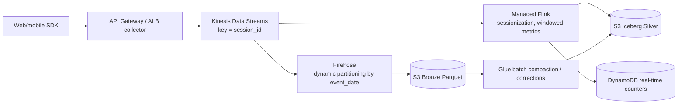

# 08 — Amazon Kinesis and Streaming

> Related: [07 Lambda](07-aws-lambda-and-event-driven-processing.md) · [13 Ingestion](13-data-ingestion-patterns.md) · [24 System Design](24-data-engineering-system-design.md) · [32 ADR-004](32-architecture-decision-records.md)

Naming: **Amazon Kinesis Data Streams (KDS)**; **Amazon Data Firehose** (formerly *Kinesis Data Firehose*); **Amazon Managed Service for Apache Flink** (formerly *Kinesis Data Analytics*); **Amazon MSK** (Managed Streaming for Apache Kafka).

---

## 1. Kinesis Data Streams internals

### 1.1 Data model

| Concept | Detail |
|---|---|
| Stream | Ordered set of shards |
| Shard | Unit of capacity and ordering. Owns a **hash key range** of the 128-bit key space. |
| Record | Data blob (up to **10 MiB** before base64, verified 2026-10-10; previously 1 MB), partition key, sequence number |
| Partition key | Up to 256 Unicode chars; **MD5-hashed** to a 128-bit integer → selects shard by hash range |
| Explicit hash key | Override for precise shard targeting |
| Sequence number | Assigned by KDS per shard; increases over time within a shard |
| Retention | Default 24 hours; up to 8,760 hours (365 days) `[Additional cost]` beyond 24 h |

### 1.2 Capacity modes (verified 2026-10-10)

| Dimension | Provisioned | On-demand |
|---|---|---|
| Capacity | You set shard count; each shard **1 MB/s or 1,000 records/s write**, **2 MB/s read** (shared across standard consumers), 5 GetRecords TPS | Starts at 4 MB/s write / 8 MB/s read; scales automatically up to 10 GB/s write in us-east-1/us-west-2/eu-west-1 (200 MB/s elsewhere by default) |
| Scaling | `UpdateShardCount` (uniform), `SplitShard`/`MergeShards` | Automatic based on observed traffic (doubles relative to recent peak; sudden >2× spikes can throttle) |
| Pricing | Shard-hours + PUT payload units | Per GB in/out + stream-hours `[Additional cost]` |
| Mode switching | Twice per 24 hours per stream | |
| Best for | Predictable throughput, cost optimization at high steady utilization | Unknown/spiky traffic, new workloads |

**Interview trap:** On-demand doesn't mean "can't throttle". A **hot partition key** is still limited by the per-shard write limit because one key maps to one shard.

### 1.3 Partition keys

**Interview trap: Kinesis partition keys influence ordering and shard distribution.**

- Ordering is guaranteed **only within a shard**, i.e., for records with the same partition key (and in order of successful writes).
- Low-cardinality keys (e.g., `country`) → hot shards → `ProvisionedThroughputExceededException`.
- Random keys (UUID) → even distribution but **no ordering** per entity.
- Choose the **entity whose events must be ordered** (e.g., `order_id`, `device_id`) with enough cardinality to spread load.

### 1.4 Producers

| Producer | Notes |
|---|---|
| `PutRecord` | One record; strict ordering possible with `SequenceNumberForOrdering` |
| `PutRecords` | Up to 500 records per call (size limits per docs); **partial failures** returned per record (`FailedRecordCount`) — you must retry failed entries |
| Kinesis Producer Library (KPL) | Aggregation (multiple user records per KDS record), collection, retries — consumers need deaggregation (KCL does it) |
| Kinesis Agent / Fluent Bit / CloudWatch Logs subscription | Log shipping |

**Interview trap:** `PutRecords` returns HTTP 200 even when some records fail. Not checking `FailedRecordCount` silently drops data.

```python
# Runs in: local Python / Lambda — Requires AWS (stream <stream-name>).
import json, random, time
import boto3

kds = boto3.client("kinesis")

def put_with_retry(stream: str, records: list[dict], max_attempts: int = 6) -> None:
    entries = [{"Data": json.dumps(r).encode(), "PartitionKey": str(r["device_id"])} for r in records]
    for attempt in range(max_attempts):
        resp = kds.put_records(StreamName=stream, Records=entries)
        if resp["FailedRecordCount"] == 0:
            return
        entries = [e for e, r in zip(entries, resp["Records"]) if "ErrorCode" in r]
        time.sleep(min(2 ** attempt * 0.1, 5) * random.uniform(0.5, 1.5))   # backoff + jitter
    raise RuntimeError(f"{len(entries)} records failed after {max_attempts} attempts")
```

Retrying failed entries can reorder them relative to later successful writes for the same key. When strict per-key order matters, send per-key sequentially or let consumers reorder by event sequence.

### 1.5 Consumers

| Consumer type | Throughput | Latency | Notes |
|---|---|---|---|
| Shared (standard) via `GetRecords` | 2 MB/s per shard **shared** by all standard consumers; 5 calls/s per shard | ~200 ms+ per consumer; more consumers → more contention | Cheapest |
| **Enhanced fan-out (EFO)** via `SubscribeToShard` (HTTP/2 push) | **2 MB/s per shard per consumer** | ~70 ms typical | Up to 20 registered consumers per stream (50 with On-demand Advantage, verified) `[Additional cost]` |
| KCL (Java; Python via MultiLangDaemon) | Lease coordination via DynamoDB lease table; checkpoints | — | One worker processes a shard at a time |
| Lambda ESM | See [07](07-aws-lambda-and-event-driven-processing.md) | | |
| Firehose | Reads stream and delivers | Buffered | |
| Managed Flink / Spark Structured Streaming (EMR/Glue) | Stateful processing | | Checkpoints in S3 |

### 1.6 Checkpointing and delivery semantics

- KCL stores the last processed sequence number per shard in DynamoDB. After a crash, a worker resumes from the checkpoint → records after the checkpoint but already processed are **reprocessed** → **at-least-once**.
- Producer retries can create **duplicates** in the stream (network timeout after a successful write).
- So KDS-based pipelines are at-least-once end-to-end unless you build idempotent sinks.

**Interview trap: Exactly-once processing is not guaranteed merely because a pipeline uses retries.** Retries cause duplicates. Effectively-once requires: deterministic record IDs from producers + idempotent/transactional sink (upsert by key, or a framework like Flink with two-phase-commit sinks, or Spark Structured Streaming with idempotent sinks such as Iceberg/Delta keyed writes).

### 1.7 Resharding

- Split a hot shard → two children; merge two adjacent cold shards.
- Parent shard remains readable until retention expires; KCL processes parent fully before children to keep per-key order.
- `UpdateShardCount` has frequency/scale limits per rolling 24 h (see API docs).

---

## 2. Amazon Data Firehose

Fully managed delivery: buffers, optionally transforms (Lambda), converts formats, partitions, compresses, and delivers.

| Feature | Detail (verified 2026-10-10 unless noted) |
|---|---|
| Sources | Direct PUT, KDS, MSK, CloudWatch Logs, AWS WAF, IoT, etc. |
| Destinations | S3, Redshift (via S3 + COPY), OpenSearch, Splunk, Snowflake, Apache Iceberg tables, HTTP endpoints, partners |
| Record size | Up to 1,000 KiB |
| `PutRecordBatch` | Up to 500 records or 4 MiB per call |
| Direct PUT quota | 500,000 records/s, 2,000 requests/s, 5 MiB/s in us-east-1/us-west-2/eu-west-1; 100,000 / 1,000 / 1 MiB/s elsewhere; auto-increases when throttled; adjustable |
| Buffering | Size (MiB) and interval hints; quota page lists interval 60–900 s; zero/low-buffering options exist for some destinations — check destination docs |
| Retention on destination failure | Direct PUT: up to 24 hours; KDS source: follows stream retention |
| Dynamic partitioning | Partition S3 prefixes from record content (JQ or Lambda); default 500 active partitions per stream `[Additional cost]` |
| Format conversion | JSON → Parquet/ORC using a Glue table schema `[Additional cost]` |
| Delivery semantics | At-least-once (duplicates possible, e.g., on retries) |
| Pricing note | Ingestion billed per record rounded up to the nearest 5 KB — many tiny records cost more |

**Interview trap:** Firehose output to S3 without dynamic partitioning uses **arrival-time** prefixes (`YYYY/MM/DD/HH` UTC), not event time. Late events land in the "wrong" hour. Use dynamic partitioning on event time, or treat Firehose output as Bronze and repartition downstream.

---

## 3. Kinesis Data Streams vs. Amazon Data Firehose vs. Amazon MSK

| Dimension | Kinesis Data Streams | Amazon Data Firehose | Amazon MSK (Provisioned / Serverless) |
|---|---|---|---|
| Abstraction | Durable ordered log with shards | Managed delivery pipeline (no custom consumers) | Apache Kafka (topics/partitions) |
| Consumers | Many (KCL, Lambda, Flink, Firehose, EFO) | Destination only | Any Kafka client, Kafka Connect, Flink, Spark |
| Replay | Yes, within retention (up to 365 days) | No | Yes, within retention (tiered storage for long retention) |
| Ordering | Per shard (partition key) | Not a consumer-facing concept | Per partition |
| Latency | Sub-second | Seconds to minutes (buffering) | Sub-second |
| Ops | Low (on-demand: very low) | Lowest | Provisioned: broker sizing, partitions, upgrades; Serverless: lower but with its own quotas |
| Ecosystem | AWS-native SDKs | AWS-native | Kafka ecosystem (Connect, Schema Registry, Debezium, Streams) — portability |
| Exactly-once options | Sink idempotency | None | Kafka transactions / idempotent producer (EOS within Kafka); sinks still matter |
| Cost model | Shard-hours or per-GB on-demand | Per GB ingested (5 KB rounding) + conversions | Broker-hours + storage (provisioned); per-partition/throughput (serverless) |
| Best for | AWS-native real-time apps, multiple consumers, Lambda integration | Landing streams into S3/Redshift/OpenSearch/Iceberg without code | Kafka-compatible workloads, Debezium CDC, high-partition-count, migration from on-prem Kafka |

**Selection rule:** Need only "get events into S3/warehouse" → Firehose (optionally fed by KDS). Need multiple real-time consumers in AWS → KDS. Need Kafka APIs/ecosystem or migrating existing Kafka → MSK.

**Operational consequences:** KDS requires shard/key planning (provisioned) and consumer checkpoint management. Firehose removes consumers but limits transformations and replay. MSK requires Kafka expertise (partitions, consumer groups, rebalances, ISR, retention).

**Limitations:** KDS per-shard limits; Firehose buffering latency and no replay; MSK partition count and broker storage limits.

---

## 4. Streaming architecture patterns

### 4.1 Lambda architecture vs. Kappa

| Pattern | Description | Trade-off |
|---|---|---|
| Lambda architecture | Separate batch and speed layers, merged at serving | Two code paths; drift |
| Kappa | Single streaming pipeline; reprocess by replaying the log | Requires long retention / Bronze replay |
| Pragmatic AWS | Stream into Bronze (Firehose/Flink to S3/Iceberg); batch rebuild from Bronze for corrections | Most common in practice |

### 4.2 Reference: clickstream to lakehouse



### 4.3 Event time, late data, watermarks

- **Event time** (when it happened) vs. **processing time** (when you saw it).
- Watermark: "I believe I've seen all events up to time T − allowed lateness."
- Late events beyond watermark: drop, route to side output, or update via batch correction.
- Spark Structured Streaming: `withWatermark("event_ts", "15 minutes")` bounds state for windowed aggregations and dedup.

---

## 5. Scalability, performance, cost, security

| Concern | Guidance |
|---|---|
| Throughput sizing (provisioned) | shards = max(write MB/s ÷ 1, records/s ÷ 1,000, read MB/s ÷ 2 per shared consumer group) × headroom (1.3–1.5) |
| Hot shards | Better keys; `explicit hash key`; split hot shards; add random suffix if ordering not needed per key |
| Consumer lag | `GetRecords.IteratorAgeMilliseconds`, Lambda `IteratorAge`; scale consumers/EFO |
| Cost | Aggregate small records (KPL) to reduce PUT units; Firehose 5 KB rounding → batch tiny events; extended retention costs |
| Security | SSE with KMS on streams `[KMS configuration required]`; IAM per stream; resource policies for cross-account; VPC interface endpoints `[VPC/networking required]` |

### 5.1 Sizing example

```text
Peak 40,000 events/s × 1.2 KB = 48 MB/s write.
Write shards: max(48/1, 40,000/1,000) = max(48, 40) = 48 → ×1.3 headroom ≈ 63 shards.
Consumers: Firehose + Flink + Lambda (3 consumers × 48 MB/s = 144 MB/s read).
Shared read capacity on 63 shards = 126 MB/s < 144 → use EFO for Flink and Lambda, or add shards.
On-demand alternative: no shard math, but check per-key hot spots and the cost per GB at this volume.
```

---

## 6. Failure scenarios

| Symptom | Cause | Fix |
|---|---|---|
| `ProvisionedThroughputExceededException` on write | Hot key / insufficient shards | Key redesign, more shards, on-demand, KPL aggregation |
| Same on read (`GetRecords`) | Too many shared consumers | EFO, fewer polling consumers, back off |
| `ExpiredIteratorException` | Shard iterator unused > 5 minutes | Re-acquire iterator from checkpoint |
| Duplicate records downstream | Producer retries / consumer restarts | Idempotent sink; dedupe on event ID within watermark |
| Data loss | Retention expired while consumer was down | Alarms on iterator age vs. retention; longer retention |
| Out-of-order events | Different keys/shards; retries | Order by event sequence in sink; key by entity |
| Firehose `DeliveryToS3.Success` drops | IAM/KMS changes on bucket | Error output prefix; CloudWatch alarms |

---

## 7. Interview questions and model answers

**Q1. Design ingestion for IoT devices where per-device ordering matters and you need both real-time alerts and an hourly lake.**
KDS with `device_id` partition key (ordering per device, high cardinality); Flink (or Lambda for simple rules) consumer with EFO for alerts; Firehose consumer with dynamic partitioning by event date into Bronze Parquet; Glue hourly compaction/dedupe into Iceberg Silver. Late data handled by Iceberg MERGE. Retention 7 days to allow replay.

**Q2. Why would you choose MSK over KDS?**
Existing Kafka producers/consumers, Debezium/Kafka Connect ecosystem, need for Kafka semantics (consumer groups, compacted topics, transactions), portability, many partitions per topic. Trade-off: operational complexity (provisioned) and Kafka expertise.

**Q3. Can Kinesis guarantee exactly-once?**
No — at-least-once from producer retries and consumer checkpoint replays. Achieve effectively-once with unique event IDs and idempotent sinks.

**Q4. On-demand stream is throttling at 3 MB/s total. Why?**
A single partition key concentrates traffic on one shard (per-shard write limit), or a sudden spike above twice the recent peak before scaling catches up.

**Q5. How do you replay last 3 days of events after a bug in a consumer?**
If retention ≥ 3 days: start a new consumer (or reset KCL checkpoints) using `AT_TIMESTAMP` iterators; ensure the sink is idempotent. If not: replay from Bronze in S3 via batch.

---

## 8. Self-check

1. **Q:** Provisioned shard write limits? **A:** 1 MB/s or 1,000 records/s per shard.
2. **Q:** What does EFO change? **A:** Each registered consumer gets a dedicated 2 MB/s per shard push pipe instead of sharing 2 MB/s.
3. **Q:** What's the ordering scope in KDS? **A:** Per shard; effectively per partition key.
4. **Q:** Why are many 200-byte records expensive in Firehose? **A:** Ingestion is billed per record rounded up to 5 KB.
5. **Q:** What's the max retention? **A:** 8,760 hours (365 days).
6. **Q:** Name the KCL component that stores checkpoints. **A:** A DynamoDB lease table.
