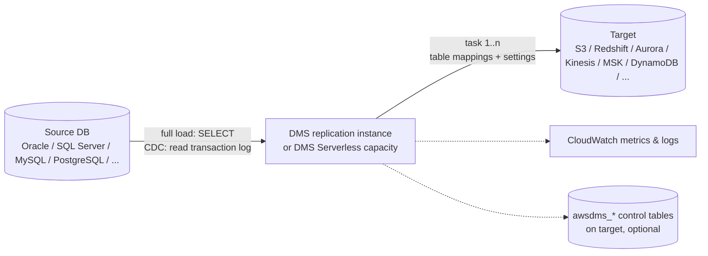

# 09 — AWS DMS and Database Ingestion

> Related: [13 Ingestion Patterns](13-data-ingestion-patterns.md) · [14 CDC apply / SCD](14-data-transformation-and-processing.md) · [22 Networking](22-networking-and-connectivity.md) · [24 System Design §CDC](24-data-engineering-system-design.md)

---

## 1. AWS DMS architecture



| Component | Role |
|---|---|
| **Replication instance** (provisioned) | EC2-based instance in your VPC running tasks; sized by instance class and storage (for caching transactions, logs) |
| **DMS Serverless** | Capacity in DMS Capacity Units (DCUs) with min/max; automatically scales `[Region-dependent]` |
| **Endpoints** | Source/target connection definitions (+ engine-specific extra settings) |
| **Task** | Migration type (full load, CDC, full load + CDC), table mappings (selection/transformation rules), task settings JSON |
| **Fleet Advisor / Schema Conversion** | Discovery and schema conversion (DMS Schema Conversion replaces most uses of the standalone AWS SCT for heterogeneous migrations) |

---

## 2. Migration types

| Type | What happens | Use |
|---|---|---|
| **Full load** | Bulk unload tables (parallel per table, optionally parallel segments per table) | One-time migration, periodic snapshots |
| **CDC only** | Reads changes from a start position (time, LSN/SCN/binlog position, or checkpoint) | After an external bulk load |
| **Full load + CDC** | Full load while **caching changes** that occur during load, applies cached changes, then continues ongoing replication | Standard lake ingestion and migrations |

### 2.1 Full load + CDC internals

1. Task starts capturing changes from the log at T0.
2. Tables are loaded (up to `MaxFullLoadSubTasks`, default 8, concurrently).
3. Changes for a table during its load are cached on the instance.
4. After each table loads, cached changes are applied.
5. Steady-state CDC continues from the transaction log.

**Interview trap:** During full load + CDC, the target may briefly contain rows that will be "corrected" by cached changes — consumers reading mid-load see an inconsistent state. Gate consumers until `FullLoadEndTime` / "load complete" signals.

---

## 3. Source prerequisites (CDC)

| Source | Requirements (summary — verify per engine docs) |
|---|---|
| MySQL / Aurora MySQL | Binary logging enabled, `binlog_format=ROW`, `binlog_row_image=FULL`; adequate **binlog retention** (RDS: `mysql.rds_set_configuration('binlog retention hours', N)`) |
| PostgreSQL / Aurora PostgreSQL | Logical replication (`rds.logical_replication=1` on RDS), `wal_level=logical`, replication slots (`test_decoding` or `pglogical`), primary keys for UPDATE/DELETE capture; **monitor slot lag** — inactive slots retain WAL and can fill storage |
| Oracle | Archive log mode, supplemental logging (database + table/PK level), LogMiner or Binary Reader |
| SQL Server | MS-CDC or MS-Replication (depending on edition/config), full recovery model, log backups retention |
| MongoDB/DocumentDB | Change streams / oplog |

**Interview trap:** A failed/paused DMS task with a PostgreSQL replication slot can **fill the source database's disk** with retained WAL — a production outage caused by the analytics pipeline. Alarm on `OldestReplicationSlotLag` / `TransactionLogsDiskUsage` (RDS metrics) and drop abandoned slots.

---

## 4. S3 as a DMS target (the lake pattern)

Key endpoint settings (S3 target):

| Setting | Effect |
|---|---|
| `DataFormat` = `parquet` (or `csv`) | Parquet recommended for downstream |
| `TimestampColumnName` | Adds a commit/load timestamp column |
| `IncludeOpForFullLoad` | Adds `Op` column also for full-load rows (`I`) |
| CDC `Op` column | `I`, `U`, `D` for inserts/updates/deletes |
| `CdcInsertsOnly` / `CdcInsertsAndUpdates` | Restrict captured ops (dangerous: deletes lost) |
| `DatePartitionEnabled` + `DatePartitionSequence` | Date-based folder partitioning of CDC files |
| `CdcMaxBatchInterval`, `CdcMinFileSize` | File flush frequency vs. file size (small files vs. latency) |
| `PreserveTransactions` + `CdcPath` | Transactional order of changes written to S3 (specific requirements) |
| `ServiceAccessRoleArn` | Role DMS uses to write to S3 `[IAM permission required]` |
| `EncryptionMode` = `SSE_KMS`, `ServerSideEncryptionKmsKeyId` | `[KMS configuration required]` |

Typical S3 layout:

```text
s3://<bronze>/dms/<schema>/<table>/LOAD00000001.parquet           # full load
s3://<bronze>/dms/<schema>/<table>/2026/10/10/20261010-013000123.parquet   # CDC files (date partitioning)
```

Downstream (Silver) must **apply** CDC: dedupe per key by commit order, apply deletes, merge into Iceberg — see [14](14-data-transformation-and-processing.md).

---

## 5. Task settings that matter

```json
{
  "TargetMetadata": {
    "SupportLobs": true,
    "FullLobMode": false,
    "LimitedSizeLobMode": true,
    "LobMaxSize": 64,
    "InlineLobMaxSize": 0
  },
  "FullLoadSettings": {
    "TargetTablePrepMode": "DO_NOTHING",
    "MaxFullLoadSubTasks": 8,
    "CommitRate": 10000
  },
  "Logging": {"EnableLogging": true},
  "ValidationSettings": {"EnableValidation": false},
  "ChangeProcessingTuning": {
    "BatchApplyEnabled": true,
    "BatchApplyTimeoutMin": 1,
    "BatchApplyTimeoutMax": 30,
    "BatchSplitSize": 0,
    "MemoryLimitTotal": 1024
  },
  "ErrorBehavior": {
    "DataErrorPolicy": "LOG_ERROR",
    "ApplyErrorDeletePolicy": "IGNORE_RECORD",
    "ApplyErrorInsertPolicy": "LOG_ERROR",
    "ApplyErrorUpdatePolicy": "LOG_ERROR",
    "RecoverableErrorCount": -1,
    "TableErrorPolicy": "SUSPEND_TABLE"
  }
}
```

(Illustrative; field names follow the DMS task settings reference — validate against current docs before use.)

| Setting | Note |
|---|---|
| `TargetTablePrepMode` | `DO_NOTHING`, `TRUNCATE_BEFORE_LOAD`, `DROP_AND_CREATE` — a reload with `DROP_AND_CREATE` on a shared target can destroy consumer tables |
| `BatchApplyEnabled` | For relational targets, applies changes in batches (faster); not the same semantics as transactional apply |
| Error policies | Decide whether to suspend tables, stop task, or log and continue |
| `EnableValidation` | Row-by-row compare source/target (for supported targets; adds load) |

### 5.1 Checkpoints and recovery

- DMS records **recovery checkpoints** (`CheckpointRecoveryEnabled` / `awsdms_txn_state` on some targets) and you can restart CDC from `--cdc-start-position` (native LSN/SCN/binlog pos) or a recovery checkpoint string.
- "Resume" continues from last checkpoint → changes after the checkpoint may be **reapplied** → downstream must be idempotent.

---

## 6. LOB handling

| Mode | Behavior | Trade-off |
|---|---|---|
| Limited LOB mode | Truncates LOBs above `LobMaxSize` (KB; default 32 KB) | Fast; **silent truncation** risk — warnings in logs |
| Full LOB mode | Fetches LOBs in chunks (`LobChunkSize`) via lookups | Slow for many LOBs; complete |
| Inline LOB mode | LOBs ≤ `InlineLobMaxSize` inline, larger fetched | Balanced when most LOBs small |

LOB columns typically require a primary key on the source table for lookup.

**Interview trap:** Data analysts discover truncated JSON documents weeks later — limited LOB mode with too small `LobMaxSize`. Measure max LOB size (`SELECT MAX(LENGTH(col))`) during design.

---

## 7. Schema conversion considerations

- Heterogeneous migrations (Oracle → PostgreSQL) need schema/code conversion: **DMS Schema Conversion** or AWS SCT; DMS itself moves data, creating only basic target tables.
- DMS's auto-created tables lack secondary indexes, defaults, constraints — pre-create targets for production.
- Data type mapping traps: Oracle `NUMBER` without precision, `DATE` containing time, timezone handling, character sets (NLS), unsigned ints in MySQL, `datetime2` precision.
- DDL changes during CDC: DMS supports some DDL propagation (e.g., add column) depending on source/target; the S3 target writes new columns in later files → downstream schema evolution needed.

---

## 8. JDBC extraction (non-DMS)

When DMS is overkill or unavailable, extract via Spark/Glue JDBC.

### 8.1 Parallel JDBC reads

```python
# Runs in: Glue/EMR Spark — Requires AWS + network path to DB. Credentials from Secrets Manager.
import json, boto3

secret = json.loads(boto3.client("secretsmanager").get_secret_value(SecretId="<secret-id>")["SecretString"])
df = (spark.read.format("jdbc")
      .option("url", f"jdbc:postgresql://{secret['host']}:5432/{secret['dbname']}")
      .option("dbtable", "(SELECT * FROM sales.orders WHERE updated_at >= '2026-10-09' AND updated_at < '2026-10-10') q")
      .option("user", secret["username"]).option("password", secret["password"])
      .option("partitionColumn", "order_id")       # numeric/date/timestamp
      .option("lowerBound", "1").option("upperBound", "50000000")
      .option("numPartitions", "16")               # = concurrent DB connections
      .option("fetchsize", "10000")
      .load())
```

**Interview trap:** `lowerBound`/`upperBound` **don't filter** rows; they only define stride. Rows outside bounds go to the first/last partition → skew. Use `MIN/MAX` of the column for the window. `numPartitions` = concurrent connections → don't DOS the OLTP database; read from a replica.

Glue equivalents: `hashfield`/`hashpartitions`, `sampleQuery`, `enablePartitioningForSampleQuery` options for JDBC DynamicFrames; bookmarks on monotonically increasing keys.

### 8.2 Incremental ingestion patterns

| Pattern | Mechanism | Captures deletes? | Risks |
|---|---|---|---|
| Full snapshot | `SELECT *` each run | Yes (by diff) | Cost/time grows; source load |
| High-watermark on `updated_at` | `WHERE updated_at > :wm` | No (soft deletes only) | Clock skew, long transactions committing late, missing `updated_at` maintenance |
| High-watermark on monotonically increasing ID | `WHERE id > :wm` | No; misses updates | Insert-only tables only |
| Log-based CDC (DMS, Debezium) | Transaction log | Yes | Source config, operational complexity |
| Trigger/outbox tables | App writes change records | Yes if designed | App changes |
| Snapshot diff (hash compare) | Compare snapshot hashes by key | Yes | Expensive for big tables |

Late-committing transactions: a transaction that started at 10:00 and commits at 10:20 has `updated_at = 10:00`; a 10:15 extraction with `updated_at > 10:00 watermark from previous run` may miss it next time if the watermark advanced to 10:14. Mitigation: **lookback overlap** (e.g., `updated_at > wm - 30 min`) plus dedupe on `(pk, updated_at)`, or use log-based CDC.

---

## 9. Batch vs. CDC vs. streaming ingestion

| Dimension | Batch (snapshot / incremental query) | CDC (log-based) | Streaming (events) |
|---|---|---|---|
| Latency | Hours | Seconds–minutes | Sub-second–seconds |
| Captures deletes | Snapshot diff only | Yes | If producers emit delete events |
| Source impact | Query load (heavy for full) | Low (log reading) but requires log retention config | None on DB (app emits) |
| Complexity | Low | Medium–high (ordering, schema drift, slot mgmt) | Medium–high |
| Replay | Re-query (if source retains history) | From log retention window or Bronze | From stream retention or Bronze |
| Correctness risks | Missed late commits, no deletes | Duplicates on resume, ordering across tables, DDL | Duplicates, out-of-order, late data |
| Best for | Small/medium tables, daily SLAs, sources without log access | Operational DBs to lake/warehouse with deletes and freshness needs | Application events, IoT, clickstream |

**Selection rule:** Default to batch incremental for tables < ~10 M rows with daily SLAs and no hard-delete needs. Use CDC for large, frequently updated tables, delete-sensitive data, or freshness < 1 hour. Use streaming when the source is naturally an event stream.

**Interview trap: CDC requires handling deletes, updates, duplicate events, ordering, and schema changes.** Saying "we use DMS CDC" is not a design; describe how Silver applies changes.

---

## 10. Monitoring and troubleshooting

| Metric / signal | Meaning |
|---|---|
| `CDCLatencySource` | Delay reading source log — source/log issues, instance under-sized |
| `CDCLatencyTarget` | Delay applying to target — target slow, batch apply settings, LOB lookups |
| `CDCIncomingChanges` | Backlog of changes waiting |
| `FreeableMemory`, `SwapUsage`, `FreeStorageSpace` (instance) | Instance capacity; swapping indicates memory pressure from large transactions |
| Task log `[SOURCE_CAPTURE]`, `[TARGET_APPLY]` | Component-level errors |
| Table statistics | Per-table inserts/updates/deletes, validation state |

Common issues:

| Issue | Root cause | Fix |
|---|---|---|
| Task fails: "binlog not found" / "log position not available" | Log retention too short; task stopped too long | Increase retention; restart with full load |
| Latency spikes nightly | Large batch transactions on source | Bigger instance/storage; split transactions; batch apply |
| Missing columns in target | DDL not propagated / table mapping | Handle schema evolution; reload table |
| Truncated LOBs | Limited LOB mode | Increase `LobMaxSize` or full/inline LOB |
| Connection timeouts | SG/NACL/route/DNS; on-prem firewall | See [22](22-networking-and-connectivity.md); test endpoint connection |
| Duplicates in Silver | Task resume replays | Idempotent merge on (PK, commit ts/LSN) |

---

## 11. Interview questions and model answers

**Q1. Replicate a 3 TB Oracle schema to S3 with < 15-minute freshness, preserving deletes. Design.**
DMS full load + CDC (LogMiner/Binary Reader, supplemental logging), S3 target Parquet with `Op` and commit timestamp columns, date-partitioned CDC files. Glue/EMR job every 10 minutes merging CDC into Iceberg Silver (dedupe by PK keeping latest commit order, apply deletes). Validation counts vs. source daily. Alarms on CDC latency. Multi-AZ replication instance for availability. Plan LOB handling and data type mapping.

**Q2. DMS Serverless vs. provisioned instance?**
Serverless for variable workloads and less sizing effort (DCU min/max); provisioned for steady, predictable load, specific instance requirements, or features/endpoints not yet supported by Serverless (verify support matrix).

**Q3. How do you order changes when multiple updates to the same row arrive in one batch?**
Use a source-provided ordering field (commit LSN/SCN, DMS transaction sequence, or commit timestamp + intra-transaction sequence), `ROW_NUMBER() OVER (PARTITION BY pk ORDER BY seq DESC)` keep latest, then MERGE.

**Q4. When would you avoid DMS?**
Heavy transformation needs in-flight (use Debezium + MSK + Flink), sources unsupported, extreme scale requiring Kafka ecosystem, or tiny tables where nightly JDBC extraction is simpler.

**Q5. What happens if the DMS task is down for 2 days and binlog retention is 24 hours?**
CDC can't resume from the checkpoint — logs are gone. Requires full reload (or targeted reload of affected tables) and re-establishing CDC. Prevention: retention > max tolerated outage, alarms.

---

## 12. Self-check

1. **Q:** What does the `Op` column contain in DMS S3 CDC files? **A:** `I`, `U`, or `D` indicating insert, update, delete.
2. **Q:** Why monitor PostgreSQL replication slot lag? **A:** Inactive/lagging slots retain WAL and can fill source storage.
3. **Q:** Do JDBC `lowerBound`/`upperBound` filter rows? **A:** No, they only determine partition strides.
4. **Q:** What's the risk of limited LOB mode? **A:** LOBs larger than `LobMaxSize` are truncated.
5. **Q:** Why do high-watermark extractions miss rows? **A:** Late-committing transactions with older `updated_at`, clock skew, or rows updated without changing `updated_at`.
6. **Q:** After resuming a DMS task from checkpoint, what must downstream handle? **A:** Replayed (duplicate) changes — apply idempotently.
