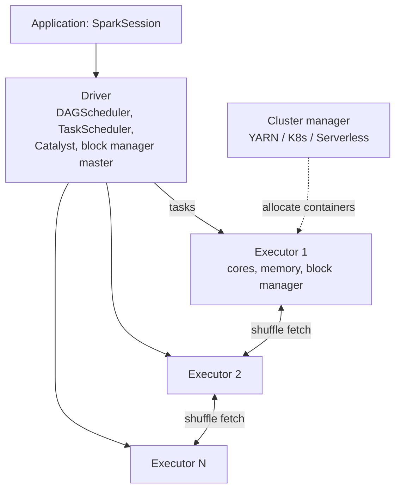

# 10 — Amazon EMR and Apache Spark

> Related: [18 PySpark](18-pyspark-interview-preparation.md) · [04 Glue](04-aws-glue.md) · [15 File Formats](15-file-formats-and-partitioning.md) · [30 Troubleshooting](30-troubleshooting-playbook.md) · [32 ADR-001](32-architecture-decision-records.md)

---

## 1. EMR deployment models

### 1.1 EMR on EC2

| Node type | Role | Notes |
|---|---|---|
| **Primary** (formerly master) | YARN ResourceManager, HDFS NameNode, Spark history server, Livy etc. | Up to 3 primary nodes for HA |
| **Core** | YARN NodeManager + HDFS DataNode | Removing core nodes risks HDFS data; avoid Spot for core in production unless HDFS-free |
| **Task** | YARN NodeManager only | Ideal for **Spot**; scale freely |

Key features: instance **groups** vs. **instance fleets** (multiple instance types/subnets, Spot allocation strategies), **EMR managed scaling**, bootstrap actions, steps API, release labels (EMR 7.x → Spark 3.5.x; verify current release mapping), EMRFS for S3, transient vs. long-running clusters, runtime roles (per-step IAM roles with Lake Formation integration).

### 1.2 EMR Serverless

- Create an **application** (Spark or Hive) for a release label; submit **job runs**.
- Workers provisioned on demand; **pre-initialized capacity** keeps warm drivers/workers for fast starts `[Additional cost]` while idle.
- Configure maximum capacity per application (vCPU, memory, disk) and auto-stop.
- Billing: vCPU-hours, GB-hours, storage beyond included per worker.
- Quotas: max concurrent vCPUs per account per Region `[Quota-dependent]`.
- Networking: optional VPC config for private resources `[VPC/networking required]`.

### 1.3 EMR on EKS

- Run Spark jobs on an existing EKS cluster via **virtual clusters** mapped to namespaces; job runs via `StartJobRun`.
- Uses Kubernetes scheduling, pod templates, Karpenter/cluster autoscaler, Fargate profiles optional.
- Best when the organization already standardizes on Kubernetes and wants multi-tenant compute sharing.

### 1.4 Comparison: EMR on EC2 vs. EMR Serverless vs. EMR on EKS

| Dimension | EMR on EC2 | EMR Serverless | EMR on EKS |
|---|---|---|---|
| Control | Full (instance types, YARN, HDFS, bootstrap, AMIs) | Spark config + worker sizes; no host access | K8s-level control (pod templates, node groups) |
| Startup | Minutes (cluster) / seconds (existing cluster) | Seconds–minutes; near-instant with pre-initialized capacity | Pod scheduling time; depends on node autoscaling |
| Ops | Highest: capacity, scaling, upgrades, patching via releases | Lowest | High (Kubernetes ops), shared with platform team |
| Cost levers | Spot, Reserved/Savings Plans, Graviton, managed scaling | Pay per use; Graviton (arm64) option; no idle cluster cost (except pre-init) | Bin-packing with other workloads, Spot node groups |
| Engines | Spark, Hive, Trino, Flink, HBase, Presto, etc. | Spark, Hive | Spark (and some others via containers) |
| HDFS | Yes | No | No |
| Multi-tenancy | Cluster per team or YARN queues | Application per team; IAM per job | Namespace per team; strong K8s isolation |
| Best for | Long-running/steady heavy clusters, non-Spark engines, deep tuning, HDFS needs | Spiky/periodic Spark jobs without cluster management | Orgs standardized on EKS, mixed workloads |

**Selection rule:** Default to **EMR Serverless** for batch Spark when Glue is too constrained. Choose **EMR on EC2** for sustained high utilization (Spot + Savings Plans economics), specialized engines, or host-level customization. Choose **EMR on EKS** when K8s is already the compute platform.

**Limitations:** Serverless has per-application max capacity and account vCPU quotas; EC2 clusters can fail on Spot interruptions or capacity shortages in an AZ; EKS requires mature K8s operations.

---

## 2. Spark architecture refresher (senior depth)



Execution chain: **action** → logical plan → Catalyst optimization (predicate pushdown, column pruning, constant folding, join reordering with CBO) → physical plan (join strategies) → **whole-stage codegen** → DAG of **stages** split at **shuffle boundaries** → **tasks** (one per partition per stage) → executors.

| Concept | Senior detail |
|---|---|
| Job | Triggered by an action (`count`, `write`, `collect`); some operations trigger jobs implicitly (schema inference, `df.cache().count()`, sampling for range partitioning in `sort`) |
| Stage | Set of narrow transformations pipelined; a new stage begins after a shuffle (Exchange) |
| Task | Unit per partition; failures retried (`spark.task.maxFailures` default 4) |
| Shuffle | Map side writes partitioned files to local disk; reduce side fetches over network. External shuffle service (YARN) lets executors be removed without losing shuffle files |
| Speculation | `spark.speculation` (default false) re-launches slow tasks; careful with non-idempotent side effects |

**Interview trap: Spark transformations are lazy until an action or execution-triggering operation occurs.** Errors in a transformation (bad cast in ANSI mode, missing file) surface at the action, possibly far from the line that introduced them.

---

## 3. Partitioning and shuffles

| Setting | Default (Spark 3.x/4.x) | Meaning |
|---|---|---|
| `spark.sql.files.maxPartitionBytes` | 128 MB | Max bytes per input partition for file sources |
| `spark.sql.files.openCostInBytes` | 4 MB | Estimated cost to open a file (bin-packing small files) |
| `spark.sql.shuffle.partitions` | 200 | Partitions after a shuffle (AQE can coalesce) |
| `spark.default.parallelism` | Total cores (cluster-dependent) | RDD default |
| `spark.sql.adaptive.enabled` | true (since 3.2) | AQE |
| `spark.sql.adaptive.coalescePartitions.enabled` | true | Merge small shuffle partitions |
| `spark.sql.adaptive.advisoryPartitionSizeInBytes` | 64 MB | Target post-shuffle partition size for AQE |
| `spark.sql.autoBroadcastJoinThreshold` | 10 MB | Max size to auto-broadcast (static) |
| `spark.sql.adaptive.autoBroadcastJoinThreshold` | Same as above unless set | AQE runtime broadcast threshold |
| `spark.sql.adaptive.skewJoin.enabled` | true | Split skewed partitions in sort-merge joins |
| `spark.sql.adaptive.skewJoin.skewedPartitionFactor` | 5.0 | Partition is skewed if > factor × median **and** > threshold |
| `spark.sql.adaptive.skewJoin.skewedPartitionThresholdInBytes` | 256 MB | |
| `spark.sql.broadcastTimeout` | 300 s | |
| `spark.sql.ansi.enabled` | **true in Spark 4.0+** (false in 3.x) | Errors on invalid casts/overflow — migration trap |

(Defaults per Apache Spark configuration docs; EMR and Glue may override some — check `spark.conf.get()` in your environment.)

**Interview trap: More partitions do not automatically mean better performance.** Each task has scheduling overhead (~ms), each shuffle partition creates map×reduce shuffle blocks (M×R fetches), and writers produce one file per partition → small files. Target ~100–200 MB per partition for input and shuffle (engineering heuristic), and ≥ 2–3 tasks per core for load balancing.

### 3.1 Repartition vs. coalesce

| Dimension | `repartition(n)` / `repartition(n, cols)` | `coalesce(n)` |
|---|---|---|
| Shuffle | **Always full shuffle** | **No shuffle** in the common case when reducing partitions (merges local partitions) |
| Increase partitions | Yes | No (can't increase without `shuffle=True` in RDD API) |
| Data balance | Even (round-robin or hash by columns) | Can be uneven (merges neighbors) |
| Upstream parallelism | Preserved; shuffle boundary separates | **Reduces parallelism of the upstream stage** (coalesce(1) makes the whole preceding stage single-task) |
| Use | Before writes partitioned by columns (`repartition("dt")`), fix skew, increase parallelism | Reduce file count at the end of a narrow pipeline cheaply |

**Interview trap:** `df.filter(...).coalesce(1).write` — the filter stage now runs with 1 task. Use `repartition(1)` if upstream work is heavy (pays a shuffle but keeps upstream parallel), or better, don't write 1 file.

---

## 4. Joins

| Strategy | When chosen | Cost | Failure modes |
|---|---|---|---|
| **Broadcast hash join** | One side < broadcast threshold (static or AQE runtime) or hinted | No shuffle of big side; small side collected to driver then broadcast | Driver OOM collecting; executor OOM; `broadcastTimeout`; wrong size estimates (filtered stats) |
| **Sort-merge join** | Default for large equi-joins | Shuffle both sides + sort | Skew → straggler tasks, spills |
| Shuffle hash join | When enabled/preferred and one side fits per-partition hash | Shuffle both, no sort | OOM if build side partitions large |
| Broadcast nested loop / Cartesian | Non-equi joins | Very expensive | Explosion |

### 4.1 Broadcast vs. sort-merge

| Dimension | Broadcast hash join | Sort-merge join |
|---|---|---|
| Data movement | Small side → every executor | Both sides shuffled by key |
| Memory | Entire small side in each executor (and driver during build) | Bounded per partition; spills to disk |
| Skew sensitivity | Insensitive (big side not shuffled) | Sensitive |
| Supported joins | Not for full outer; build side constraints by join type (e.g., left outer broadcasts right) | All equi-joins |
| Selection rule | Small side ≤ a few hundred MB compressed in memory and stable | Default for large-large |

**Interview trap: A broadcast join can fail when the broadcast-side data exceeds available memory.** Statistics from file size underestimate in-memory size (Parquet compression 5–10×). A "200 MB" Parquet dimension can be 2 GB in memory. Hints (`broadcast(df)`) override safety checks.

### 4.2 Skew handling

1. **Detect**: Spark UI stage → task duration/shuffle read max ≫ median; `df.groupBy(key).count().orderBy(desc)`.
2. **AQE skew join** (sort-merge joins): automatic splitting — check it triggered (`SortMergeJoin(skew=true)` in plan).
3. **Broadcast** the small side if possible.
4. **Salting**: add random salt `0..N-1` to the skewed side key, explode the other side N times.
5. **Isolate hot keys**: process top keys separately (broadcast join for hot keys, normal join for the rest), union.
6. **Null keys**: filter or handle separately (nulls never match in equi-join but still hash to one partition).
7. **Two-phase aggregation**: partial aggregate on salted key, then final aggregate.

```python
# Runs in: any Spark (local/EMR/Glue). Runnable with local PySpark.
from pyspark.sql import functions as F

SALT = 16
facts_salted = facts.withColumn("salt", (F.rand(seed=7) * SALT).cast("int"))
dims_salted = dims.crossJoin(spark.range(SALT).withColumnRenamed("id", "salt"))
joined = facts_salted.join(dims_salted, ["customer_id", "salt"]).drop("salt")
```

---

## 5. Memory management

### 5.1 Executor memory layout (unified memory manager)

```text
Container (YARN/K8s) memory = spark.executor.memory (heap)
                              + spark.executor.memoryOverhead (default max(384 MB, 10% of heap))
                              + spark.executor.pyspark.memory (if set)
                              + off-heap (if spark.memory.offHeap.enabled)

Heap:
  Reserved: 300 MB
  Usable = heap - 300 MB
    Unified (spark.memory.fraction = 0.6 of usable): execution + storage, dynamic borrowing
       storage protected region = spark.memory.storageFraction (0.5) of unified
    User memory (0.4): UDF objects, data structures, metadata
```

Python workers (PySpark UDFs, pandas UDFs, `mapInPandas`) consume **overhead/off-heap** memory, not the JVM heap → "Container killed by YARN for exceeding memory limits ... Consider boosting spark.executor.memoryOverhead".

### 5.2 Common memory errors

| Error | Usual cause | Fix |
|---|---|---|
| `java.lang.OutOfMemoryError: Java heap space` (executor) | Huge partition (skew), large broadcast, explode, collect_list on hot key | More partitions, skew fixes, avoid large per-key collections |
| `Container killed ... exceeding memory limits` | Overhead exceeded (Python, Netty buffers, off-heap) | Increase `memoryOverhead`; reduce Python memory; fewer cores per executor |
| `OutOfMemoryError` (driver) | `collect()`, `toPandas()`, broadcast build, huge plans (thousands of columns/unions), many files' metadata | Avoid collects; increase `spark.driver.memory`; `spark.driver.maxResultSize` |
| `FetchFailedException` / `MetadataFetchFailedException` | Executor lost (OOM/Spot) during shuffle; shuffle service issues | Fix OOM root cause; Spot handling with decommissioning; retry |
| `No space left on device` | Shuffle spill/local disk full | Larger disks (EBS), fewer bigger partitions, reduce shuffle |
| GC overhead limit | Too many objects; small executors | Bigger executors with fewer cores, avoid UDF object churn |

---

## 6. Executor sizing (EMR on EC2)

Heuristic (engineering practice, not AWS-enforced):

```text
Node: r6g.4xlarge-like = 16 vCPU, 128 GiB. YARN allocates ~ (memory minus OS/daemons) per node (EMR sets yarn.nodemanager.resource.memory-mb per instance type).
Leave 1 vCPU for OS/daemons -> 15 usable.
Choose 5 cores/executor (HDFS/S3 throughput sweet spot, GC manageable) -> 3 executors/node.
Memory per executor container ≈ yarn_memory / 3; heap ≈ container / 1.1 (overhead 10%).
Example: yarn ≈ 116 GiB -> ~38 GiB container -> ~34 GiB heap, ~4 GiB overhead.
For PySpark-UDF-heavy jobs: increase overhead (e.g., 20–25%).
```

EMR's `maximizeResourceAllocation` classification sets executor sizing to use whole nodes (one large executor per node) — simple but can harm GC and parallelism.

**Dynamic allocation** (`spark.dynamicAllocation.enabled=true` on EMR by default): scales executors by pending tasks; requires shuffle tracking or external shuffle service; set `minExecutors`/`maxExecutors` to avoid starving other jobs on shared clusters.

**EMR managed scaling** scales cluster nodes (with min/max units, on-demand limit, max core nodes) based on YARN metrics.

---

## 7. Caching vs. checkpointing

| Dimension | `cache()` / `persist(level)` | `checkpoint()` (reliable) / `localCheckpoint()` |
|---|---|---|
| Storage | Executor memory/disk (block manager) | Reliable: files in checkpoint dir (HDFS/S3); local: executor storage |
| Lineage | **Kept** — lost blocks recomputed from lineage | **Truncated** — plan restarts from checkpointed data |
| Eager? | Lazy (materialized on first action) | Eager by default for DataFrames (`eager=True`) |
| Survives executor loss | Recomputes lost partitions | Reliable checkpoint survives; local doesn't |
| Use | Reuse of a DataFrame in multiple actions within a job | Very long lineage (iterative algorithms, many unions/loops), plan explosion, streaming state |
| Costs | Memory pressure, eviction | Write I/O to storage; slower |

**Selection rule:** Cache when a DataFrame is reused ≥ 2 times and fits; unpersist after use. Checkpoint when lineage/plan size becomes the problem (driver slow planning, StackOverflowError) or you need fault-tolerant materialization. Alternative to both: write an intermediate table to S3 explicitly (also debuggable).

**Interview trap:** `df.cache()` alone does nothing until an action runs. And caching a DataFrame that's used once just adds memory pressure.

---

## 8. Spark SQL and AQE

AQE features (runtime, based on shuffle statistics):
1. **Coalescing shuffle partitions** toward advisory size → fewer tiny tasks.
2. **Switching join strategies** — sort-merge → broadcast hash join when runtime size of one side is small.
3. **Skew join optimization** — splits skewed partitions.
4. **Optimizing local shuffle reader** after switching to broadcast.

Limitations: AQE acts at shuffle boundaries (needs exchanges); doesn't fix skew in aggregations directly in older versions; can't fix input-side skew from unsplittable files; statistics for the first stage come from file metadata.

Read plans: `df.explain("formatted")` → look for `Exchange hashpartitioning`, `BroadcastHashJoin`, `SortMergeJoin`, `PushedFilters`, `PartitionFilters`, `AdaptiveSparkPlan isFinalPlan=true` (in UI after execution).

---

## 9. Writing to S3 correctly

- **EMRFS S3-optimized committer** (default on EMR for Parquet and others in recent releases) avoids rename-based commits; improves performance and avoids some consistency issues.
- `spark.sql.sources.partitionOverwriteMode=dynamic` overwrites only partitions present in the output (vs. `static` deleting the whole table path) — critical for idempotent partition reloads.
- Control file count: `repartition(*partition_cols)` or `maxRecordsPerFile`.
- For ACID: Iceberg (`spark.sql.catalog.glue_catalog=org.apache.iceberg.spark.SparkCatalog` with Glue catalog implementation) — EMR provides Iceberg in releases (`iceberg-defaults` classification).

---

## 10. Production debugging methodology

1. **Symptom**: slow, failed, wrong output, cost spike.
2. **Locate stage**: Spark UI (live via proxy / persistent UI for EMR on EC2, Spark History Server for EMR Serverless, Glue Spark UI via event logs).
3. **In the stage**: task duration distribution (skew), shuffle read/write sizes, spill (memory/disk), GC time, input size per task, failed tasks + error.
4. **Executors tab**: lost executors, OOM, GC, Spot interruptions.
5. **SQL tab**: physical plan, join strategies, row counts per operator (where's the explosion?).
6. **Logs**: YARN container logs (`yarn logs -applicationId`), EMR step logs in S3 (`s3://<log-uri>/<cluster-id>/steps/`), node logs (`/var/log/hadoop-yarn/`), CloudWatch for Serverless/EKS.
7. **Hypothesis → single change → rerun** on a representative sample, then full.

---

## 11. Interview questions and model answers

**Q1. A join of 2 TB fact and 30 GB dimension takes 3 hours with one task running 2.5 hours. Fix?**
Skew on the join key. Confirm via task metrics. AQE skew join should split; if not triggered (thresholds, join type, or skew arises from aggregation), salt the hot keys or isolate them. The dimension is too large to broadcast safely in most clusters; but if hot keys' dimension rows are few, broadcast-join just the hot subset.

**Q2. Spot interruption killed executors mid-shuffle; job failed with `FetchFailedException`. Mitigation?**
Use Spot only for task nodes; instance fleets with diversified types and capacity-optimized allocation; enable node decommissioning (Spark graceful decommission with shuffle migration in Spark 3.1+ on supported setups); keep core nodes On-Demand; checkpoint/write intermediates for very long jobs; job-level retries.

**Q3. Glue vs. EMR Serverless for a 6 TB nightly job?**
Both work. EMR Serverless gives more Spark config control, Graviton workers, and often lower per-vCPU cost; Glue gives catalog/bookmark/DQ integration and simpler setup. Decide on required tuning, team familiarity, and measured cost on a representative run.

**Q4. Why is `spark.sql.shuffle.partitions = 200` wrong for both 5 GB and 5 TB jobs?**
5 GB/200 = 25 MB tasks (fine, AQE coalesces further); 5 TB/200 = 25 GB per task → spills/OOM. Set based on shuffle size / ~128–200 MB, or rely on AQE with a high initial number (`spark.sql.adaptive.coalescePartitions.initialPartitionNum`).

**Q5. How do you size executors for a PySpark job using pandas UDFs?**
Fewer cores per executor (3–4), higher `memoryOverhead` or `spark.executor.pyspark.memory`, Arrow batch size tuning (`spark.sql.execution.arrow.maxRecordsPerBatch`), and ensure vectorized UDFs rather than row-at-a-time.

---

## 12. Self-check

1. **Q:** Which node type should run on Spot in EMR on EC2? **A:** Task nodes (no HDFS data).
2. **Q:** What does AQE need to apply its optimizations? **A:** Shuffle (exchange) boundaries providing runtime statistics.
3. **Q:** `coalesce(1)` after a heavy filter — risk? **A:** The upstream stage collapses to one task, removing parallelism.
4. **Q:** Default `spark.sql.autoBroadcastJoinThreshold`? **A:** 10 MB.
5. **Q:** Why is checkpointing used for iterative algorithms? **A:** To truncate lineage and avoid huge plans/recomputation chains.
6. **Q:** Where do Python UDF workers' memory come from? **A:** Outside the JVM heap — executor memory overhead / PySpark memory.
