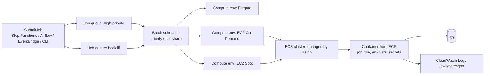

# 12 — AWS Batch and Containerized Data Jobs

> Related: [07 Lambda](07-aws-lambda-and-event-driven-processing.md) · [11 Orchestration](11-aws-step-functions-and-orchestration.md) · [04 Glue vs. EMR vs. Batch vs. Lambda](04-aws-glue.md) · [28 Lab 10](28-hands-on-labs.md)

---

## 1. Architecture



| Component | Description |
|---|---|
| **Job definition** | Container image, vCPU/memory (or GPU), command, job role, execution role, env vars, secrets, retry strategy, timeout, platform (EC2/Fargate), mount points, log config. Versioned (revisions). |
| **Job queue** | Priority; maps to up to **3 compute environments** in order (verified 2026-10-10); scheduling policy (FIFO by default or fair-share). |
| **Compute environment (CE)** | Managed (Batch scales EC2/Fargate) or unmanaged; type EC2, Spot, Fargate, Fargate Spot; min/desired/max vCPUs; instance types; allocation strategy; subnets & security groups. |
| **Job** | Instance of a definition with overrides; states: `SUBMITTED → PENDING → RUNNABLE → STARTING → RUNNING → SUCCEEDED/FAILED`. |
| **Array job** | 2–10,000 child jobs sharing a definition; `AWS_BATCH_JOB_ARRAY_INDEX` env var. |
| **Multi-node parallel (MNP)** | Tightly coupled multi-instance jobs (EC2 only). |
| **Dependencies** | Up to 20 per job (`dependsOn`), `N_TO_N` or `SEQUENTIAL` for arrays. |

Hard quotas (verified, not adjustable): 50 job queues, 50 compute environments, 3 CEs per queue, 20 dependencies per job, 10,000 array size, 24 KiB job definition, 30 KiB SubmitJob payload, 50 SubmitJob TPS per account, 1,000,000 jobs in SUBMITTED.

---

## 2. EC2 vs. Fargate compute in AWS Batch

| Dimension | EC2 (On-Demand / Spot) | Fargate (/ Fargate Spot) |
|---|---|---|
| Startup | Instance launch if scaling from zero (minutes); fast if warm (min vCPUs > 0) | Task provisioning typically under a minute–few minutes; no instance management |
| Resource ceiling | Any instance type (large memory, many vCPUs, local NVMe) | Up to 16 vCPU / 120 GB memory per task; ephemeral storage up to 200 GiB (verify current) |
| GPUs | Yes | No |
| Multi-node parallel | Yes | No |
| Custom AMI / daemons | Yes (launch templates) | No |
| Bin packing | Multiple jobs per instance | One job per task |
| Cost | Cheapest at high utilization; Spot up to large discounts | Per vCPU/GB-second; no idle instance waste; Fargate Spot discounts |
| Ops | AMIs, instance selection, ECS agent | Minimal |
| Best for | Heavy/long jobs, GPU, very large memory, high-volume throughput | Spiky, small/medium jobs; teams avoiding infra; strict isolation per job |

**Selection rule:** Fargate for jobs ≤ 16 vCPU/120 GB without GPUs where simplicity matters; EC2 (with Spot for interruptible work) for large, GPU, high-throughput, or cost-sensitive steady workloads.

**Operational consequences:** EC2 CEs require subnet IP planning, instance type diversity for Spot, and understanding scaling lag; Fargate jobs need awsvpc networking (one ENI per job → subnet IPs) and image pulls each time (image size matters).

**Limitations:** Fargate lacks GPUs/MNP/privileged containers; EC2 has scaling latency from zero.

---

## 3. Job lifecycle internals and the RUNNABLE trap

- `RUNNABLE` = job is ready but **no capacity** has been placed. Common causes:
  - CE `maxvCpus` reached or CE disabled/INVALID.
  - Job requests more vCPU/memory than any allowed instance type provides (e.g., 64 GB memory requested with only `m5.large` allowed — note usable memory on an instance is less than nominal).
  - Subnet IP exhaustion, no route to ECR/S3 (private subnet without NAT/endpoints) → instances can't register/pull.
  - Spot capacity unavailable for allowed types.
  - Service-linked role / instance role (`ecsInstanceRole`) issues.
  - EC2 vCPU quota (`Running On-Demand Standard instances`) reached.

**Interview trap:** "Jobs stuck in RUNNABLE" is rarely a Batch bug — it's capacity, sizing, or networking.

---

## 4. Container images and ECR

- Build lean images (multi-stage builds, slim base, pinned dependencies). Large images slow Fargate starts.
- Push to **ECR** with image scanning (basic/enhanced via Inspector) `[Additional cost]` for enhanced; immutable tags; lifecycle policies to expire old images.
- Private subnets need **ECR API + ECR DKR interface endpoints + S3 gateway endpoint** (image layers stored in S3) or NAT `[VPC/networking required]`.
- Pin images by digest in job definitions for reproducibility.

```dockerfile
# Example: Python data job image (illustrative)
FROM public.ecr.aws/docker/library/python:3.12-slim AS base
ENV PYTHONDONTWRITEBYTECODE=1 PYTHONUNBUFFERED=1
WORKDIR /app
COPY requirements.txt .
RUN pip install --no-cache-dir -r requirements.txt
COPY src/ ./src/
USER 1000
ENTRYPOINT ["python", "-m", "src.job"]
```

---

## 5. Job definitions: resources, env vars, secrets, retries

```json
{
  "jobDefinitionName": "orders-enrichment",
  "type": "container",
  "platformCapabilities": ["FARGATE"],
  "containerProperties": {
    "image": "<account-id>.dkr.ecr.<region>.amazonaws.com/orders-enrichment@sha256:<digest>",
    "command": ["--run-date", "Ref::run_date", "--input", "Ref::input_prefix"],
    "jobRoleArn": "arn:aws:iam::<account-id>:role/orders-enrichment-job",
    "executionRoleArn": "arn:aws:iam::<account-id>:role/batch-ecs-execution",
    "resourceRequirements": [{"type": "VCPU", "value": "4"}, {"type": "MEMORY", "value": "16384"}],
    "environment": [{"name": "LOG_LEVEL", "value": "INFO"}],
    "secrets": [{"name": "PARTNER_API_TOKEN", "valueFrom": "arn:aws:secretsmanager:<region>:<account-id>:secret:<name>"}],
    "networkConfiguration": {"assignPublicIp": "DISABLED"},
    "fargatePlatformConfiguration": {"platformVersion": "LATEST"},
    "ephemeralStorage": {"sizeInGiB": 100},
    "logConfiguration": {"logDriver": "awslogs", "options": {"awslogs-group": "/aws/batch/orders-enrichment"}}
  },
  "parameters": {"run_date": "1970-01-01", "input_prefix": "s3://<bucket>/landing/"},
  "retryStrategy": {
    "attempts": 3,
    "evaluateOnExit": [
      {"onStatusReason": "Host EC2*", "action": "RETRY"},
      {"onReason": "CannotPullContainerError*", "action": "RETRY"},
      {"onExitCode": "2", "action": "EXIT"},
      {"onReason": "*", "action": "RETRY"}
    ]
  },
  "timeout": {"attemptDurationSeconds": 7200},
  "propagateTags": true,
  "tags": {"cost-center": "data-platform", "pipeline": "orders"}
}
```

| Element | Notes |
|---|---|
| `jobRoleArn` | Permissions **your code** uses (S3, DynamoDB) |
| `executionRoleArn` | Permissions **ECS agent** uses (pull ECR image, write logs, fetch secrets) — required for Fargate |
| `secrets` | Injected from Secrets Manager / SSM Parameter Store at start; the execution role needs `secretsmanager:GetSecretValue` (+ `kms:Decrypt`) |
| `retryStrategy.attempts` | 1–10; `evaluateOnExit` rules matched in order (up to 5) |
| `timeout.attemptDurationSeconds` | Minimum 60 s; job terminated after timeout (per attempt) |
| `Ref::param` | Parameter substitution in `command` |

**Interview trap:** Putting secrets in `environment` (plain text, visible in describe-job-definitions and CloudTrail) instead of `secrets`.

**Interview trap:** Retrying a non-idempotent job (e.g., appends to a table) on Spot interruption duplicates data. Design the job to write deterministic outputs (overwrite by run key) or check a completion marker first.

---

## 6. Running Python / PySpark workloads in containers

| Workload | Approach in Batch |
|---|---|
| pandas/Polars/DuckDB single-node (≤ ~100 GB working set) | Ideal: one container per partition/day; array jobs for parallelism |
| PySpark local mode | `SparkSession.builder.master("local[*]")` inside one large container — fine for medium data; no cluster overhead; use EC2 CE for big memory |
| Distributed Spark | Prefer EMR Serverless/Glue; MNP Spark on Batch is possible but complex |
| Binary tools (ffmpeg, GDAL, genomics) | Strong fit |
| GPU ML inference over files | EC2 GPU CE |

Array job pattern — process 1,000 files in parallel:

```python
# Runs in: AWS Batch container (Requires AWS). Each child picks its shard by index.
import os, boto3

index = int(os.environ.get("AWS_BATCH_JOB_ARRAY_INDEX", "0"))
manifest_bucket, manifest_key = os.environ["MANIFEST_BUCKET"], os.environ["MANIFEST_KEY"]
s3 = boto3.client("s3")
keys = s3.get_object(Bucket=manifest_bucket, Key=manifest_key)["Body"].read().decode().splitlines()
my_key = keys[index]
# process my_key deterministically; write output to s3://.../out/<basename>.parquet (overwrite-safe)
```

Write the manifest first (fixed ordering) so indices are stable across retries.

---

## 7. Logging and monitoring

- `awslogs` driver to CloudWatch Logs (default group `/aws/batch/job`); set retention.
- Job state change events to **EventBridge** (`Batch Job State Change`) → alert on `FAILED`.
- Metrics: queue depth by state (via `ListJobs` or Batch CloudWatch metrics/Container Insights), CE desired vs. running vCPUs, Spot interruptions.
- `statusReason` and container `reason`/`exitCode` in `DescribeJobs` are the first debugging signals (`OutOfMemoryError: Container killed due to memory usage`, `CannotPullContainerError`, `Host EC2 (instance i-...) terminated` for Spot).

---

## 8. Scheduling: priority and fair-share

- Multiple queues with priorities share CEs (higher priority queue gets capacity first).
- **Fair-share scheduling policies**: share identifiers with weights, compute reservation to keep capacity for inactive shares — prevent backfills from starving production.

**Interview trap: Backfills can compete with production jobs for compute and storage resources.** Use a separate low-priority queue (or separate CE with a vCPU cap) for backfills, plus fair-share.

---

## 9. Cost

- Spot for interruptible jobs with checkpoints/idempotency; diversify instance types; `SPOT_PRICE_CAPACITY_OPTIMIZED` allocation.
- `minvCpus = 0` to scale to zero (accept cold start); a small warm floor for latency-sensitive queues.
- Graviton instances (arm64 images) for price-performance where libraries support it.
- Right-size requests: over-requesting memory wastes bin-packing capacity.

---

## 10. Interview questions and model answers

**Q1. When choose Batch over Glue for a nightly transform?**
When logic isn't Spark (pandas/DuckDB/binary tools), data per unit fits one node, you need custom images/GPUs, or you want Spot economics for embarrassingly parallel work (array jobs).

**Q2. 500 jobs stuck in RUNNABLE for an hour. Diagnose.**
Check CE status (VALID/ENABLED), `maxvCpus`, desired vCPUs; job resource requests vs. instance types (memory headroom); EC2 vCPU quotas; subnet free IPs; Spot capacity; instance registration (ECS agent logs, route to ECS/ECR endpoints). Fix sizing or networking, add instance types.

**Q3. How do you pass secrets securely?**
`secrets` in the job definition referencing Secrets Manager/SSM; execution role with scoped `GetSecretValue`; KMS decrypt; never env vars in plain text or baked into images.

**Q4. Design retries for a job that's sometimes killed by Spot and sometimes fails due to bad input.**
`evaluateOnExit`: RETRY on `Host EC2*` status reason; EXIT on application exit code signaling bad data; attempts 3; job writes deterministic outputs.

**Q5. Fargate job fails with `CannotPullContainerError` in a private subnet.**
No route to ECR: add ECR API, ECR DKR interface endpoints and S3 gateway endpoint (or NAT); check execution role permissions for ECR.

---

## 11. Self-check

1. **Q:** Max compute environments per job queue? **A:** 3.
2. **Q:** Difference between job role and execution role? **A:** Job role = app permissions; execution role = ECS agent permissions (pull image, logs, secrets).
3. **Q:** What env var identifies an array child's index? **A:** `AWS_BATCH_JOB_ARRAY_INDEX`.
4. **Q:** Fargate supports GPUs? **A:** No.
5. **Q:** Most common meaning of RUNNABLE for a long time? **A:** No capacity can be placed (limits, sizing, networking, Spot availability).
6. **Q:** How to keep backfills from starving production? **A:** Separate lower-priority queue/CE caps and fair-share scheduling.
