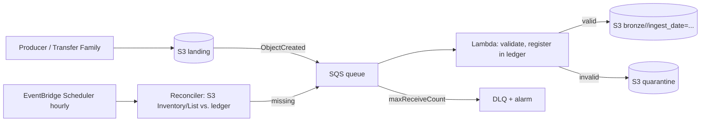

# 13 — Data Ingestion Patterns

> Related: [09 DMS](09-aws-dms-and-database-ingestion.md) · [08 Streaming](08-amazon-kinesis-and-streaming.md) · [03 S3 events](03-amazon-s3.md) · [14 Transformations](14-data-transformation-and-processing.md) · [20 Data Quality](20-data-quality-and-reliability.md)

---

## 1. Pattern catalog

| Pattern | Trigger | Typical AWS implementation | Key risk |
|---|---|---|---|
| Full refresh (snapshot) | Schedule | Glue JDBC / DMS full load / `UNLOAD` from source | Cost grows with table size; source load |
| Incremental (watermark) | Schedule | Glue/EMR JDBC with control table | Late commits; no deletes |
| CDC (log-based) | Continuous | DMS, Debezium on MSK Connect | Ordering, deletes, schema drift, slot/log retention |
| Event-driven file ingestion | S3 object created | S3 → SQS/EventBridge → Lambda/Step Functions/Glue | Duplicate/missing events, small files |
| Streaming | Continuous | KDS/MSK → Firehose/Flink/Spark | Duplicates, late events, hot keys |
| API ingestion | Schedule/webhook | Lambda/Batch/Glue Python shell; AppFlow for SaaS `[Optional integration]` | Rate limits, pagination, partial failures |
| Partner file drop (SFTP) | Arrival | AWS Transfer Family → S3 | Malformed files, re-sent files |
| Bulk migration | One-time | DataSync, Snowball, S3 Batch Operations, DMS | Validation, cutover |

---

## 2. Full refresh vs. incremental processing

| Dimension | Full refresh | Incremental |
|---|---|---|
| Correctness | Simple — target equals source snapshot; deletes handled automatically | Requires correct change detection, dedupe, delete handling |
| Cost | O(table size) every run | O(changes) |
| Source impact | High | Low |
| Recovery | Rerun | Replay from watermark/Bronze |
| Late data | Naturally included | Needs lookback windows |
| Schema change | Rebuild picks it up | Must evolve target |
| Best for | Small dims (< ~10M rows), sources without change tracking, periodic reconciliation | Large facts, high-frequency loads |

**Selection rule:** Incremental for anything large or frequent; **schedule a periodic full reconciliation** (weekly/monthly) even for incremental pipelines to catch drift.

**Limitations:** Full refresh windows get longer as data grows; incremental depends on source discipline (`updated_at` maintained by every writer).

---

## 3. Watermark-based incremental ingestion

Control table (DynamoDB or an Iceberg/RDS table):

| pipeline | source_table | watermark_col | last_watermark | last_run_id | status | updated_at |
|---|---|---|---|---|---|---|
| orders_ingest | sales.orders | updated_at | 2026-10-10T01:00:00Z | r-2026101001 | SUCCEEDED | ... |

Algorithm:

```text
1. wm_old = read watermark (status must be SUCCEEDED)
2. wm_new = SELECT MAX(updated_at) FROM source  (or now() - safety_lag)   -- capture upper bound FIRST
3. extract rows WHERE updated_at > (wm_old - lookback) AND updated_at <= wm_new
4. write to Bronze under batch_id (deterministic prefix); overwrite if exists
5. merge into Silver with dedupe by (pk, updated_at)
6. only after successful merge: update watermark = wm_new (conditional update on last_run_id)
```

Why capture the upper bound first: rows committed during extraction with `updated_at` > wm_new will be picked up next time instead of being skipped. Why `safety_lag`: transactions in flight may commit later with earlier timestamps.

**Interview trap:** Updating the watermark before the downstream write commits → data loss on failure. Updating it after → possible reprocessing, which is fine **if writes are idempotent**.

---

## 4. CDC ingestion (summary)

Required handling (see [09](09-aws-dms-and-database-ingestion.md), [14](14-data-transformation-and-processing.md)):

1. **Ordering**: per key by commit sequence (LSN/SCN/commit ts + sequence).
2. **Duplicates**: replays after restarts → dedupe by (pk, sequence).
3. **Deletes**: hard deletes as tombstones (`Op = D`) → delete in Silver or mark `is_deleted`.
4. **Updates**: full row images (configure `binlog_row_image=FULL`, `REPLICA IDENTITY FULL` in PostgreSQL if needed for before-images).
5. **Schema changes**: new columns appear mid-stream → schema evolution in Silver.
6. **Transactions across tables**: consumers may see table A's change before table B's → reconcile in Gold or use transaction metadata.
7. **Initial snapshot consistency**: full load + CDC overlap.

---

## 5. Event-driven file ingestion



Design points:
- **Completion signals**: producers write `_SUCCESS` or a manifest last; process the batch only when the manifest arrives (avoid processing partial multi-file deliveries).
- **Ledger** (DynamoDB): `file_key`, `etag`, `size`, `status`, `batch_id` — enables idempotency and reconciliation.
- **Re-sent files** with the same name: compare ETag/checksum; treat as replacement or duplicate per contract.
- **Zip files**: Lambda `/tmp` limits; use Batch for large archives.

---

## 6. API ingestion

Concerns: authentication (OAuth tokens in Secrets Manager), **pagination** (cursor vs. offset — offset pagination misses/duplicates rows when data changes during paging), **rate limits** (429 + `Retry-After`), partial failures, incremental windows (`updated_since`), schema drift in JSON, large responses.

```python
# Runs in: local Python / Lambda / Batch. Runnable locally against any cursor-paginated API (uses only stdlib).
import json, time, random, urllib.request, urllib.error
from typing import Iterator

def fetch_pages(base_url: str, token: str, since: str, max_retries: int = 5) -> Iterator[dict]:
    cursor = None
    while True:
        url = f"{base_url}?updated_since={since}&limit=500" + (f"&cursor={cursor}" if cursor else "")
        req = urllib.request.Request(url, headers={"Authorization": f"Bearer {token}"})
        for attempt in range(max_retries):
            try:
                with urllib.request.urlopen(req, timeout=30) as resp:
                    page = json.load(resp)
                break
            except urllib.error.HTTPError as e:
                if e.code in (429, 500, 502, 503, 504) and attempt < max_retries - 1:
                    retry_after = e.headers.get("Retry-After")
                    delay = float(retry_after) if retry_after else min(2 ** attempt, 30) * random.uniform(0.5, 1.5)
                    time.sleep(delay)
                    continue
                raise
        yield page
        cursor = page.get("next_cursor")
        if not cursor:
            return
```

Write each page (or batch of pages) to Bronze as a separate object with a deterministic name (`run_id/page-0001.json`) so retries overwrite rather than duplicate.

---

## 7. Schema inference and evolution

| Approach | Where | Risk |
|---|---|---|
| Inference at read (Spark `inferSchema`, crawlers) | Bronze exploration | Type flips between runs; full scan cost for inference |
| Explicit schemas in code | Silver/Gold | Requires change management |
| Schema registry (Glue Schema Registry) | Streaming | Compatibility enforcement at producer |
| Table format evolution (Iceberg `ALTER TABLE ADD COLUMN`) | Silver/Gold | Need rules for type widening only |

Evolution rules (best practice):
- **Additive nullable columns**: allowed (backward compatible).
- **Type widening** (int → bigint, float → double, decimal precision increase): allowed in Iceberg with constraints.
- **Renames/drops/type narrowing**: breaking → version bump, dual publish.
- Spark Parquet: `mergeSchema` option reads files with differing schemas (cost: footer reads).

**Interview trap:** CSV/JSON schema inference in production. Explicitly define schemas for Silver reads; use `PERMISSIVE` with `columnNameOfCorruptRecord` (or `badRecordsPath` on some platforms) to capture bad rows.

---

## 8. Late-arriving data

| Situation | Strategy |
|---|---|
| Events arrive hours late (mobile offline) | Partition by **event date**, process with lookback window (reprocess last N days' partitions), or Iceberg MERGE |
| Facts arrive before dimensions | Insert placeholder ("inferred member") dimension rows; update when dimension arrives |
| Dimensions change after facts | SCD2 with effective dates; join on event time |
| Streaming windows | Watermarks with allowed lateness; side outputs for too-late events; batch correction |

Track lateness: `ingest_ts - event_ts` distribution per source; drives lookback window sizing.

---

## 9. Backfills

| Concern | Practice |
|---|---|
| Idempotency | Same logic as daily runs, parameterized by date range; overwrites partitions |
| Isolation | Separate compute (queue/workgroup/cluster), lower priority |
| Throughput | Bounded concurrency (source DB capacity, DPU quota) |
| Ordering | For SCD2/cumulative metrics, run sequentially by date or recompute history in one pass |
| Validation | Compare row counts/aggregates vs. source per day |
| Communication | Notify consumers; freeze dependent dashboards or label "restating" |
| Cost | Estimate before start (scan GB × days) |

**Interview trap: Backfills can compete with production jobs for compute and storage resources** — and can also re-trigger downstream event-driven pipelines (thousands of S3 events). Disable or route backfill outputs to avoid unintended triggers.

---

## 10. Deduplication

| Level | Technique |
|---|---|
| Exact duplicates | `dropDuplicates()` on all columns / hash |
| Key-based (latest wins) | `ROW_NUMBER() OVER (PARTITION BY pk ORDER BY updated_at DESC, seq DESC) = 1` |
| Streaming | `dropDuplicatesWithinWatermark` (Spark 3.5+) or `dropDuplicates` with watermark |
| Cross-batch | MERGE into target keyed by pk (target is the dedupe state) |
| File-level | Ledger keyed by ETag/checksum |

Choose deterministic tie-breakers; `updated_at` ties are common (second-level precision).

---

## 11. Idempotent ingestion — checklist

1. Deterministic run identity (logical date, batch id).
2. Deterministic output location per run (overwrite on retry).
3. Atomic publish (manifest/success marker, catalog swap, Iceberg commit).
4. Dedupe at Silver by business key + version.
5. Watermark advanced only after commit.
6. Ledger of processed inputs.
7. Reconciliation job independent of the pipeline.

---

## 12. Batch vs. CDC vs. streaming

See full table in [09 §9](09-aws-dms-and-database-ingestion.md). Shortcut: **latency requirement + delete requirement + source access** determine the choice.

---

## 13. Interview questions and model answers

**Q1. A partner re-sends yesterday's 20 files with corrections. Your pipeline appends. What breaks and how do you fix it?**
Duplicates in Bronze/Silver. Fix: treat file delivery as a versioned batch (manifest with batch id); Silver rebuild for that business date = overwrite partition from latest batch; ledger records batch supersession.

**Q2. Design ingestion from a REST API with 10,000 requests/day limit and 5 M records.**
Incremental `updated_since` windows; maximize page size; persist cursor checkpoints so a failed run resumes; quota-aware scheduler; write pages to Bronze; nightly full sync only if API supports bulk export.

**Q3. How do you choose a lookback window?**
Measure lateness distribution (p99.9 of commit delay or event lateness); window = that plus margin; dedupe makes overlap harmless; cost of reprocessing overlap is the trade-off.

**Q4. Why might `MAX(updated_at)` from the extracted batch be a bad watermark?**
If extraction was filtered, empty, or the source clock skews; also rows with equal timestamps beyond the batch boundary. Prefer upper bound captured at extraction start with a safety lag.

**Q5. What's the minimal metadata to add at Bronze?**
`_ingest_ts`, `_source_system`, `_source_object` (file/key/offset), `_batch_id`, `_schema_version`, and for CDC `_op` and `_commit_seq`.

---

## 14. Self-check

1. **Q:** When should the watermark be updated? **A:** After the downstream write commits successfully.
2. **Q:** Why prefer cursor over offset pagination? **A:** Offsets shift as data changes during paging, causing duplicates/misses.
3. **Q:** How to avoid processing partial multi-file deliveries? **A:** Wait for a manifest/success marker written last.
4. **Q:** What's an inferred dimension member? **A:** A placeholder dimension row created when a fact references an unseen key, updated when the real record arrives.
5. **Q:** Why run a periodic full reconciliation in incremental pipelines? **A:** To detect drift from missed changes, deletes, or bugs.
6. **Q:** Backfill side effect on event-driven pipelines? **A:** Writes can generate S3 events that trigger downstream jobs unexpectedly.
