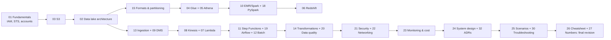

# AWS Data Engineering Interview Preparation Pack

A senior-level preparation pack and engineering reference for **Data Engineer, Senior Data Engineer, Cloud Data Engineer, and AWS Data Platform Engineer** interviews at product companies, FAANG-scale organizations, consulting firms, and enterprises.

> **Verification date: 2026-10-10.**
> AWS changes quotas, defaults, regional availability, feature names, and pricing frequently. Values that were re-checked against official AWS documentation on the verification date are marked as verified in [`27-numbers-limits-and-defaults.md`](27-numbers-limits-and-defaults.md). Everything else is written from official documentation as understood at authoring time and **must be rechecked against current official documentation before you rely on it in production or quote it as fact in an interview.** When in doubt, say in the interview: "the documented default was X when I last checked; I would confirm in Service Quotas."

---

## 1. Who this pack is for

Assumed background (about 6 years of data engineering):

- Python, SQL, PySpark/Apache Spark, Apache Airflow, Snowflake, and core ETL concepts are already familiar.
- The pack therefore skips "what is a DataFrame" and focuses on **internals, failure modes, trade-offs, debugging, cost, and architecture**.

What interviewers at senior level are testing:

| Signal | What it looks like in an answer |
|---|---|
| Depth | You explain *what happens internally* (e.g., Spark stage boundaries, Kinesis shard hashing, S3 request partitioning). |
| Judgement | You say *when not to use* a service and why. |
| Operability | You talk about retries, idempotency, backfills, alerting, runbooks. |
| Cost awareness | You can estimate the bill and name the dominant cost driver. |
| Security | You separate IAM, resource policies, KMS, Lake Formation, and network paths. |
| Communication | You structure answers: requirements → estimates → design → trade-offs → failure modes. |

---

## 2. File index

### Core architecture and AWS services

| # | File | Focus |
|---|---|---|
| 01 | [AWS Fundamentals](01-aws-fundamentals.md) | Regions/AZs, shared responsibility, IAM, STS, Organizations, cross-account |
| 02 | [Data Lake Architecture](02-data-lake-architecture.md) | Medallion layers, lakehouse, table formats, multi-account reference architectures |
| 03 | [Amazon S3](03-amazon-s3.md) | Storage classes, consistency, performance, events, encryption, cost |
| 04 | [AWS Glue](04-aws-glue.md) | Data Catalog, crawlers, ETL jobs, bookmarks, DynamicFrames, Data Quality |
| 05 | [Amazon Athena](05-amazon-athena.md) | Trino-based serverless SQL, partition projection, CTAS, cost control |
| 06 | [Amazon Redshift](06-amazon-redshift.md) | RA3/Serverless, distribution/sort keys, WLM, COPY/UNLOAD, tuning |
| 07 | [Lambda & Event-Driven Processing](07-aws-lambda-and-event-driven-processing.md) | Execution model, event sources, retries, idempotency, limits |
| 08 | [Kinesis & Streaming](08-amazon-kinesis-and-streaming.md) | KDS, Data Firehose, MSK comparison, ordering, delivery semantics |
| 09 | [DMS & Database Ingestion](09-aws-dms-and-database-ingestion.md) | Full load + CDC, LOBs, JDBC extraction, incremental patterns |
| 10 | [EMR & Apache Spark](10-amazon-emr-and-apache-spark.md) | EMR deployment models, Spark internals, sizing, AQE, debugging |
| 11 | [Step Functions & Orchestration](11-aws-step-functions-and-orchestration.md) | Step Functions, Glue Workflows, Scheduler, MWAA trade-offs |
| 12 | [AWS Batch & Containers](12-aws-batch-and-containerized-data-jobs.md) | Job queues, compute environments, EC2 vs. Fargate, containers |

### Data engineering foundations and implementation

| # | File | Focus |
|---|---|---|
| 13 | [Data Ingestion Patterns](13-data-ingestion-patterns.md) | Batch, incremental, CDC, API, files, schema evolution, backfills |
| 14 | [Transformation & Processing](14-data-transformation-and-processing.md) | ETL vs. ELT, medallion processing, CDC apply, SCD1/SCD2 |
| 15 | [File Formats & Partitioning](15-file-formats-and-partitioning.md) | Parquet/ORC/Avro/JSON/CSV, compression, small files, pruning |
| 16 | [Python for DE Interviews](16-python-for-data-engineering-interviews.md) | Generators, concurrency, testing, coding exercises |
| 17 | [SQL for DE Interviews](17-sql-for-data-engineering-interviews.md) | Windows, gaps and islands, sessionization, SCD2, optimization |
| 18 | [PySpark Interview Prep](18-pyspark-interview-preparation.md) | Plans, joins, skew, partitions, memory, exercises |
| 19 | [Apache Airflow & MWAA](19-apache-airflow-and-mwaa.md) | Scheduling semantics, TaskFlow, mapping, MWAA architecture |
| 20 | [Data Quality & Reliability](20-data-quality-and-reliability.md) | Validation, reconciliation, SLOs, incident response |

### Advanced architecture and senior-level preparation

| # | File | Focus |
|---|---|---|
| 21 | [Security & Governance](21-aws-security-and-governance.md) | IAM, KMS, Secrets Manager, Lake Formation, CloudTrail |
| 22 | [Networking & Connectivity](22-networking-and-connectivity.md) | VPC, endpoints, NAT, DNS, hybrid connectivity, diagnosis |
| 23 | [Monitoring & Cost Optimization](23-monitoring-and-cost-optimization.md) | CloudWatch, Spark UI, cost drivers, tagging, budgets |
| 24 | [System Design](24-data-engineering-system-design.md) | 13-step framework, 12 detailed designs with Mermaid diagrams |
| 25 | [Scenario-Based Questions](25-scenario-based-interview-questions.md) | 100+ scenarios with full structured answers |
| 26 | [Interview Cheatsheet](26-aws-interview-cheatsheet.md) | Decision trees, comparison tables, talking points |
| 27 | [Numbers, Limits & Defaults](27-numbers-limits-and-defaults.md) | Quotas and defaults with links and verification dates |
| 28 | [Hands-On Labs](28-hands-on-labs.md) | 12 labs with cost labels and cleanup |
| 29 | [Interview Study Plan](29-interview-study-plan.md) | 8-week and 12-week tracks, readiness checklist |
| 30 | [Troubleshooting Playbook](30-troubleshooting-playbook.md) | Error → root cause → diagnosis → fix → prevention |
| 31 | [Python/SQL/PySpark Cookbook](31-python-sql-pyspark-cookbook.md) | Runnable examples with prerequisites and cleanup |
| 32 | [Architecture Decision Records](32-architecture-decision-records.md) | 12 ADRs with rejected options and reversal conditions |

---

## 3. Learning roadmap

## 4. Interview domains and weightings (typical senior DE loop)

| Domain | Typical rounds | Primary chapters |
|---|---|---|
| SQL coding | 1 round (45–60 min) | 17, 31 |
| Python coding | 1 round | 16, 31 |
| Spark / big data | 1 round or embedded | 10, 18, 15 |
| AWS service depth | Embedded in design + "deep dive on your project" | 03–12 |
| Data system design | 1–2 rounds | 24, 02, 32 |
| Production troubleshooting / ops | Embedded | 30, 20, 23 |
| Security & governance | Embedded (heavier at enterprises/consulting) | 21, 22 |
| Behavioral / leadership | 1 round | 29 (story bank section) |

## 5. Skill matrix (self-assess 1–4)

| Skill | 1 – Aware | 2 – Working | 3 – Senior | 4 – Expert / Staff |
|---|---|---|---|---|
| S3 | Knows buckets/keys | Lifecycle, encryption | Request-rate partitioning, event semantics, cost modeling | Designs multi-account lake with access points, replication, governance |
| Glue | Ran a crawler | Writes jobs, bookmarks | Tunes workers, diagnoses OOM/skew, avoids crawler pitfalls | Metadata-driven framework, Lake Formation integration |
| Athena | Runs queries | CTAS, partitions | Partition projection, cost controls, Iceberg | Engine-level reasoning, workload isolation |
| Redshift | Runs queries | COPY/UNLOAD | Dist/sort design, WLM, plan reading | Multi-cluster data sharing, workload architecture |
| Spark | Writes DataFrames | Reads Spark UI | Skew, AQE, memory model, sizing | Predicts plan & cost before running |
| Streaming | Knows Kinesis exists | Builds consumer | Ordering, retries, checkpoints, resharding | Exactly-once end-to-end designs |
| CDC | Knows the term | Runs DMS | Handles deletes, ordering, schema drift | Designs replay/backfill with SCD2 |
| Orchestration | Writes a DAG | Retries, sensors | Idempotent DAG design, backfill strategy | Platform-wide orchestration standards |
| Security | Knows IAM | Writes policies | Cross-account, KMS, Lake Formation | Org-level guardrails (SCP/RCP), data perimeters |
| System design | Lists services | Draws pipeline | Quantifies, discusses trade-offs | Drives ambiguous requirements to a costed design |

Target for a senior role: **3 in every row, 4 in two or three rows** that match your experience.

## 6. Prerequisites

- An AWS account you control (personal sandbox, not production). Enable **AWS Budgets** alerts before running labs (see [28](28-hands-on-labs.md)).
- AWS CLI v2 configured using IAM Identity Center (SSO) or a named profile. **Never** hardcode access keys.
- Python 3.10+ with `boto3`, `pyspark`, `pytest`.
- Java 17 (for local PySpark 3.5+/4.x).
- Optional: Docker (Batch/container labs), a local Airflow (e.g., `pip install apache-airflow` with constraints file) for DAG parsing tests.

## 7. Recommended study sequence

1. **Week-level plan**: pick Track A (8 weeks) or Track B (12 weeks) in [29](29-interview-study-plan.md).
2. **Each chapter**: read → do the self-check at the end without looking → run the related lab/cookbook recipe → answer 5 scenario questions from [25](25-scenario-based-interview-questions.md).
3. **Every weekend**: one timed system design from [24](24-data-engineering-system-design.md) + one ADR rewrite from [32](32-architecture-decision-records.md).
4. **Final 7 days**: [26](26-aws-interview-cheatsheet.md), [27](27-numbers-limits-and-defaults.md), [30](30-troubleshooting-playbook.md).

## 8. Conventions used in this pack

### Prerequisite tags

AWS does not have one universal "edition" model. Each feature is tagged with its real prerequisites:

| Tag | Meaning |
|---|---|
| `[IAM permission required]` | The caller needs specific IAM actions (and possibly resource policy grants). |
| `[VPC/networking required]` | Requires VPC configuration (subnets, security groups, endpoints, NAT, routes). |
| `[Lake Formation required]` | Requires Lake Formation permissions/registration to be configured. |
| `[KMS configuration required]` | Requires KMS key and key policy/grants. |
| `[Cloud-specific]` | AWS-proprietary behavior; not portable. |
| `[Region-dependent]` | Not available, or different limits, in some Regions. |
| `[Additional cost]` | Charged beyond the base service usage. |
| `[Quota-dependent]` | Governed by an adjustable Service Quotas value. |
| `[Optional integration]` | Off by default; you opt in. |
| `[Legacy/deprecated]` | Still encountered in interviews/older estates; avoid for new builds. |

### Callouts

- **Interview trap** — a commonly misunderstood concept.
- **Official behavior** — what AWS documents.
- **Best practice** — engineering recommendation (not AWS-enforced).
- **Senior talking point** — a framing that distinguishes a senior answer.

### Code labels

Every code block in chapters 16–19 and 31 states **Runs in:** (local Python, notebook, Glue job, EMR, Athena, Redshift, Airflow, AWS CLI) and whether it is **Runnable** or **Pseudocode**. Examples requiring live AWS resources are explicitly marked **Requires AWS**.

---

## 9. Glossary of core AWS data engineering terms

| Term | Meaning |
|---|---|
| **Account** | Isolation boundary for resources, billing, and IAM. The root of multi-account design. |
| **ACID table format** | Apache Iceberg, Apache Hudi, Delta Lake: add transactions, snapshots, and row-level updates on top of files in S3. |
| **AQE** | Spark Adaptive Query Execution: re-optimizes plans at runtime using shuffle statistics (coalescing partitions, switching join strategies, splitting skewed partitions). |
| **AZ (Availability Zone)** | One or more discrete data centers in a Region with independent power/networking. |
| **Bookmark (Glue)** | Glue-managed state that records which input was processed by a job to enable incremental runs. |
| **Bronze/Silver/Gold** | Medallion layers: raw as-landed, cleansed/conformed, business-ready aggregates. |
| **CDC** | Change Data Capture: capturing inserts/updates/deletes from a source database's log. |
| **CTAS** | `CREATE TABLE AS SELECT`: creates a new table from a query result (Athena, Redshift). |
| **Data Catalog (Glue)** | Hive-metastore-compatible metadata store for databases, tables, partitions, schemas. |
| **Data contract** | Versioned agreement on schema, semantics, SLAs, and quality between producer and consumer. |
| **DLQ** | Dead-letter queue: destination for messages that repeatedly fail processing. |
| **DPU** | Glue Data Processing Unit: 4 vCPU and 16 GB memory. Billing unit for Glue. |
| **Distribution style** | Redshift strategy (`AUTO`, `EVEN`, `KEY`, `ALL`) for placing rows on slices. |
| **DynamicFrame** | Glue abstraction over Spark that tolerates inconsistent schemas via choice types. |
| **EFO** | Kinesis Enhanced Fan-Out: dedicated 2 MB/s per-shard read pipe per registered consumer. |
| **Envelope encryption** | Encrypting data with a data key, and encrypting that data key with a KMS key. |
| **Idempotency** | Re-running an operation produces the same end state (no duplicates). |
| **Lakehouse** | Lake storage (S3 + open formats) with warehouse semantics (ACID tables, governance, SQL). |
| **Lake Formation** | Fine-grained (database/table/column/row/cell) permissions layered on the Glue Data Catalog. |
| **LF-Tags** | Lake Formation tag-based access control attributes. |
| **Managed storage (RMS)** | Redshift Managed Storage used by RA3 and Serverless, backed by S3 with local SSD caching. |
| **MWAA** | Amazon Managed Workflows for Apache Airflow. |
| **Partition (Hive-style)** | Directory-like key segment `col=value/` used for pruning. |
| **Partition key (Kinesis)** | String hashed (MD5) to choose the shard; determines ordering scope. |
| **Partition projection** | Athena feature that computes partitions from table properties instead of querying the catalog. |
| **Prefix (S3)** | Leading part of an object key; S3 scales request rates per partitioned prefix. |
| **RPU** | Redshift Processing Unit for Redshift Serverless (16 GB memory per RPU). |
| **SCD Type 1/2** | Slowly Changing Dimension: overwrite (1) vs. keep history with validity ranges (2). |
| **SCP / RCP** | Organizations Service Control Policy (caps principals) / Resource Control Policy (caps resources). |
| **Shard** | Kinesis Data Streams capacity unit (provisioned: 1 MB/s or 1,000 records/s write; 2 MB/s read). |
| **Shuffle** | Spark redistribution of data across partitions for wide operations; disk + network heavy. |
| **Slice** | Redshift unit of parallelism within a compute node. |
| **Sort key** | Redshift column ordering that enables zone-map block skipping. |
| **STS** | Security Token Service: issues temporary credentials (`AssumeRole`). |
| **Watermark** | Persisted high-water mark (timestamp/ID/LSN) marking how far incremental processing has progressed; in streaming, also a lateness threshold. |
| **WLM** | Redshift Workload Management: queues, concurrency, memory allocation, query priorities. |
| **Zone map** | Redshift per-block min/max metadata used to skip blocks. |

---

## 10. How to use this pack in an interview

- Lead with **requirements and numbers** before services.
- Name **one primary design and one alternative**, with the condition that would make you switch.
- Always cover: **idempotency, retries, late data, backfill, schema evolution, security, monitoring, cost**.
- When you are not sure of an exact AWS limit, say so and describe how you'd verify it (Service Quotas console, `aws service-quotas list-service-quotas`). Interviewers reward calibrated honesty more than recited numbers.

## 11. Source policy

Primary sources, in priority order:

1. AWS service documentation — <https://docs.aws.amazon.com/>
2. AWS Well-Architected Framework, including the Data Analytics Lens — <https://docs.aws.amazon.com/wellarchitected/latest/analytics-lens/analytics-lens.html>
3. AWS Architecture Center — <https://aws.amazon.com/architecture/>
4. Apache Spark documentation — <https://spark.apache.org/docs/latest/>
5. Apache Airflow documentation — <https://airflow.apache.org/docs/>
6. Python documentation — <https://docs.python.org/3/>
7. Apache Iceberg — <https://iceberg.apache.org/docs/latest/>

Distinction used throughout: **Official behavior** (documented by the vendor) vs. **Best practice** (engineering judgement, including from AWS prescriptive guidance, but not enforced).

## 12. Status of this pack

- All 33 files contain complete content.
- Python code in chapters 16 and 31 was syntax-checked; local-only examples (no AWS calls) were executed where noted. AWS-dependent examples were **not executed** and are labeled **Requires AWS**.
- Remaining verification items are listed at the end of [27](27-numbers-limits-and-defaults.md).
